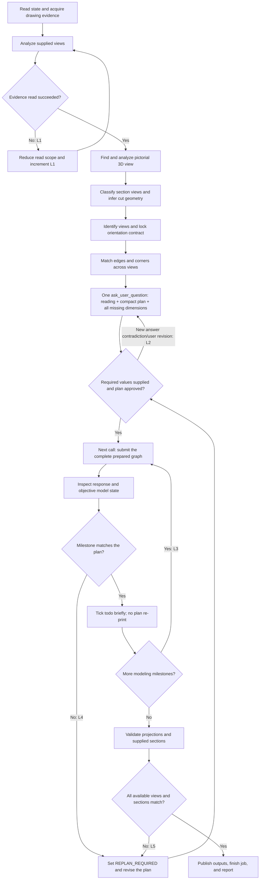

# SolidWorks CAD
Operate SolidWorks only through these twelve high-level `mcp__solidworks__` tools.
Approved support tools for workflow assistance: `ask_user_question`, `todo_write`,
`skill`, `modlens_read_image` (local image file paths only; URL forms such as
`http://` are rejected) and `read_mcp_resource` — the only way to open a
skill reference, since this preset has no file tool.
The runtime tool schemas and returned payloads are the authoritative contract.
Parse each tool's JSON string before acting on its envelope status. Every tool
result is compact single-line JSON. `start_job` returns `job_id` and
`job_token` first; bulky readiness and state detail is read with
`inspect_state(scope="state")`.
## Tool Boundary

| Tool | Use |
| --- | --- |
| `start_job` | Connect to SolidWorks, optionally open a target document, and return `job_id` plus private `job_token`. |
| `inspect_state` | Read readiness, locked document state, constrained CAD analysis, or approved recipe/schema content; references return one page at a time (`reference_offset`/`reference_limit`). |
| `submit_feature_graph` | Build a new part or assembly from one complete Feature Graph. |
| `apply_document_edits` | Apply allowlisted parametric edits to the locked active document. |
| `drawing_workflow` | Create a production drawing and requested views, annotations, tables, or checks. |
| `save_or_export` | Save, export, batch export, or close through the safety policy. |
| `request_confirmation` | Refresh one-time confirmation data for a pending high-risk action. |
| `confirm_action` | Execute exactly one action after fresh, explicit user approval. |
| `cancel_action` | Cancel a queued confirmation action without executing it; use this to release a pending Feature Graph. |
| `finish_job` | Run final objective verification and close the authenticated job. |
| `read_drawing_text` | Optional OCR candidate table with positions; directly view the original drawing first. |
| `read_drawing_region` | Zoom part of a drawing image (grid cell or pixel box) so small dimensions can be read; read-only, needs no job and touches no CAD. |

There is no model-visible low-level fallback. Do not use SolidWorks COM, Shell,
macros, scripts, REST endpoints, desktop automation, or legacy low-level CAD MCP
tools. Report `CAPABILITY_GAP` when these twelve tools cannot express or inspect the
requested operation. If the tool surface is unavailable, report `MCP_UNAVAILABLE`
and make no CAD call.

Two job-scoped write rules:
- **Pending Feature Graph** — once `submit_feature_graph` returns
  `pending_confirmation`, every document write is refused with
  `GRAPH_PENDING_CONFIRMATION` until that action is confirmed or cancelled.
  Confirm it with `confirm_action`, or release the guard with
  `cancel_action`.
- **Targetless job on a pre-existing document** — a job begun without
  `target_document` binds read-only to whatever document was active, and
  refuses `save_or_export`, `apply_document_edits` and
  `submit_feature_graph(fresh_document=false)` with
  `JOB_DOCUMENT_READ_ONLY`. Start a new job with `target_document` to edit
  that document, or build a fresh document with a confirmed
  `fresh_document` Feature Graph.

## Core Workflow

1. Call `inspect_state(scope="state")` to check readiness and current document.
2. Read only the references needed for the task with
   `inspect_state(scope="reference", reference_topic=...)`; a large reference
   arrives one page at a time, so pass `reference_offset`/`reference_limit`
   instead of repeating an identical call.
3. For image or drawing reconstruction, complete the bounded workflow below,
   present the plan inline in your reply, and obtain approval before mutation.
4. Call `start_job` before any deep document inspection or mutation. Supply
   `target_document` for an existing file and leave it empty for a fresh model.
   An empty `target_document` with no active document starts an unbound job.
5. Keep `job_id` and `job_token` private. Pass both to every later job-scoped
   call. Never place `job_token` in plans, logs, summaries, or user-visible text.
6. Use the smallest matching high-level mutation tool.
7. Inspect every response before continuing. A successful transport call is not
   proof that the CAD result is correct.
8. Use requested paths; otherwise save a new file in the working directory, never overwrite; then call `finish_job`.

`start_job` locks the expected active-document identity. Every later job-scoped
call verifies that identity. If the user switches documents, stop and begin a new
job for the newly intended target.

An unbound job — started with no active document — has no identity to lock, so
every document-bound call is refused with `JOB_DOCUMENT_UNBOUND` before any CAD
call: `apply_document_edits`, `submit_feature_graph` with
`fresh_document=false`, `drawing_workflow`, save/export/batch/close, and
`confirm_action` of a pending action that does not create its own document. The
job binds only through its own document-creating call,
`submit_feature_graph` with `fresh_document=true`; `save_or_export` `close` with
`close_all=true` runs but never binds. Otherwise start a new job with
`target_document`, or open the document first and start a new job.

## Reading a Skill Reference

A `solidworks://skill/references/<file>.md` link is a read-only MCP resource, never a file path:
this preset ships no file tool, so a path cannot be opened. Read it with `read_mcp_resource`,
server `solidworks`, that exact URI as this skill links it. A URI carrying a path or a `..`
segment is refused with `SKILL_RESOURCE_TRAVERSAL_REFUSED`, an unknown name with
`SKILL_RESOURCE_NOT_FOUND`; use only the URIs linked here instead of guessing a file name.

## Drawing Reconstruction Flow

This flow applies only when geometry is inferred from drawings or images.
At node A, start a job only when deep inspection of an active CAD document is
needed; this is not modeling, and node F reuses that job. Attached images can be
analyzed before any job exists.

Node A directly views the original drawing first. OCR and crops are OPTIONAL aids.
Crop WHOLE VIEWS as source-pixel boxes at zoom 2 in one batch (front, top/side, sections,
lettered views, notes); never grid cells or zoom 3-4 fragments, which cut a dimension off
its dimension line and feature. Classify dimensions as EXPLICIT / DERIVED / USER / UNKNOWN.
DERIVED includes its formula and evidence; an absent numeric label is not necessarily
an absent constraint. Never infer dimensions from pixel proportions, even with approval.
Use mm unless the drawing states another unit; omit unspecified material; save a new
file in the working directory without overwriting existing files. Infer projection from
drawing evidence; ask only if unresolved projection would produce different parts.
Present the reading conclusion, compact plan and ALL genuinely missing dimensions in
ONE ask_user_question call, with plan approval included; no three-question cap.
After the answer, build directly. Ask again only if that answer introduces a new
contradiction. “接受/继续” approves the plan but supplies no missing numeric value.
Read [drawing intake](solidworks://skill/references/drawing-intake.md) for the evidence contract.



The graph has `N=19`, `E=23`, one component, independent loop rank
`E-N+1=5`, and McCabe path complexity `E-N+2=6`. Retry-control locations must
equal the loop rank: exactly these five rows.

| ID | Controlled back edge | Maximum traversal count |
| --- | --- | --- |
| L1 | reduced evidence read -> view analysis | 1 |
| L2 | plan not ready/approved -> PLAN revision | Only a user-requested revision or a new contradiction in the answer; no repeated same-matter approval |
| L3 | more milestones -> next milestone | `max(N-1,0)` for `N` modeling todos in the approved plan |
| L4 | milestone mismatch -> replan | 2 per stable modeling todo |
| L5 | directional/sectional mismatch -> replan | 3 per target |

Before a back edge: stop if its count is at maximum; otherwise increment, persist,
then traverse. Counts survive tool changes, hypotheses, and plan versions; reset
only for a changed target or explicit user reset. Keep `L3` by approved
`PLAN_VERSION`, `L4` by todo ID, and copy pre-PLAN `L1` into PLAN.

`L2` never splits missing dimensions and plan approval into separate questions.
Batch all genuine UNKNOWNs with the compact plan; an answer permits building.
Waiting for input does not increment it; user-requested revisions do. Do not add another automatic retry path. Confirmation pauses are not retries.
If a flow edit adds or removes a back edge, recompute the graph and table.

Every unresolved modeling constraint is UNKNOWN after checking explicit dimensions,
geometry, symmetry, concentricity, tangency, equalities and dimension chains. A unique
DERIVED result needs no user confirmation. Never estimate a dimension from pixels.

At exhaustion, stop mutation:

```text
STATUS: RETRY_EXHAUSTED
LOOP_ID: <L1-L5>
ATTEMPTS: <count/max>
LAST_CAUSE: <failure or mismatch>
ACTION: Stop mutation and request decisive user input.
```

## Inspection

Use `inspect_state` with no credentials only for `state` or `reference`.
Document analysis requires the active job credentials.

| Document | Supported scopes |
| --- | --- |
| Part | `features`, `geometry`, `mass_properties`, `bodies`, `faces`, `edges`, `selection` |
| Assembly | `components`, `components_flat`, `mates`, `faces`, `edges`, `selection` |
| Drawing | `drawing`, `selection` |

Assembly `faces` and `edges` also require `component`. Use identifiers returned
by current inspection data. Reinspect after structural edits because prior
face/edge indexes may no longer identify the same geometry.

Reference topics are `contract`, `canonicalization`, `forward`, `mapping`,
`mapping_part`, `mapping_sheet_metal`, `mapping_assembly`, `verification`,
`reverse`, `coverage`, `feature_graph_part_card`, `feature_graph_quickref`, `feature_graph_schema`, and
`feature_graph_changelog`. A reference comes back one page at a time inside
`verification` as `topic`, `content`, and `page` (`offset`, `limit`,
`returned_lines`, `total_lines`, `total_chars`, `has_more`, `next_offset`,
`line_truncated`; `0` means the defaults, a smaller `reference_limit` may be
requested, larger is clamped; each page is at most 120 lines and about 6000
characters, and every serialized page stays under 7000 characters). Follow
`page.next_offset` while `page.has_more` is true, or jump with
`reference_offset` to `page.index.sections[].line`. For `feature_graph_schema`,
`page.index` also has `sections` (`section`, `line`, `entries`) and
`feature_types`.

If an evidence read is too broad, never repeat it unchanged. Traverse `L1` once
using a smaller image/PDF region or a narrower supported `inspect_state` scope;
do not invent unsupported flags. On another failure emit `RETRY_EXHAUSTED`.

## Feature Graph

For a new part or assembly:

See the [common part card](solidworks://skill/references/feature-graph-part-card.md).

1. BEFORE the one question, in ONE parallel step: `start_job`, feature_graph_part_card
   (common part grammar + complete example), the matching mapping_part,
   mapping_sheet_metal or mapping_assembly, and the drawing reads. Read
   feature_graph_quickref or indexed schema sections only for constructs the card
   cannot settle, also before the question; never walk full schema pages. Grade the
   drawing simple or complex (the user's 简单图/复杂图 wins); simple reads nothing extra.
2. After approval the NEXT call is `submit_feature_graph(..., fresh_document=true)`
   with ONE complete graph in feature-tree dependency order, fillets and chamfers
   included. Between approval and submission: no reference reads, no plan or todo
   rewrite, no second confirmation, no turn end. A fresh-document graph needs no
   batch confirmation. Meters for distances, radians for angles.
3. Verify from the submit result first, then ONE parallel step of compact geometry,
   bodies and features reads (edges/faces only to locate a problem). Save a new file, then
   finish_job; act on its PLANNED_FEATURES_MISSING and CREATED_DOCUMENT_UNSAVED warnings.

A graph-level `material` that the library positively does not contain is reported in
`warnings` as `MATERIAL_NOT_FOUND` while the status stays `completed`: the geometry is kept, and
the warning names the material actually on the part afterwards (`material_on_part`, which may be
one it already had). `MATERIAL_NOT_APPLIED` — present in the library but not applied, or a library
that could not be read — is a real failure and rolls the graph back. Never substitute a
similar-looking material to silence a warning: apply the exact library name, or add the specified
material to the library, with `apply_document_edits`.

Spell a material name exactly as the **loaded** library holds it, which on a localised install is
the localised spelling (this install is Chinese: `1060 合金`, not `1060 Alloy`); the same material
under its English spelling is positively absent from the loaded database and warns.

Do not split a complete graph into low-level modeling calls. Do not invent graph
fields, feature types, selectors, units, or references absent from the schema.
The [capability map](solidworks://skill/references/feature-graph-capability-map.md) summarizes
expressible constructs; record inexpressible ones as `CAPABILITY_GAP`.

For a part whose complete graph would be oversized (asymmetric cast parts,
crossed-bore housings), submit ordered milestones as SEQUENTIAL graphs against
the SAME locked document: the first with `fresh_document=true`, later ones with
`fresh_document=false` into the active document after inspecting the live
geometry and anchoring to it (see the milestone strategy in
[reconstruction-reasoning.md](solidworks://skill/references/reconstruction-reasoning.md)). Never
shrink a graph by dropping evidenced features — report the split in the plan
instead.

## Cosmetic Threads
Threads are COSMETIC only: an annotation the drawing reads, with zero geometry
change (no faces or edges added). Author `hole.thread` (designation, optional
`class`, and `depth` — required for a blind hole) or a standalone
`cosmetic_thread` node whose `ref` names the bore mouth by `edge_anchor`
(`near` = the mouth circle's CENTRE, plus `radius`) or by `bore_face`.
The pilot is a tapped hole's `diameter`, never the tap drill: the drill comes
from the table (M5 4.2, M6 5.0, M8x1.25 6.8, M12x1.75 10.2, M40x2 38,
M42x2 40 mm), and a `diameter` that disagrees with it is rejected as
`PILOT_MISMATCH`. The diameter handed to SolidWorks is the NOMINAL MAJOR
diameter in meters. Put the class-qualified spec in the callout/note (e.g.
`M5-8H`): SolidWorks 2025 does not resolve `Size`, so the note carries it.
Write the class in UPPERCASE (6H): lowercase (6g, 6h) means an EXTERNAL
thread class, which v1 does not support and rejects.
A counterbore is cut BEFORE the pilot. `add_cosmetic_thread` is additive per
edge — never retry it. Inch and real (cut) threads are out of scope.

## Existing Document Edits

`apply_document_edits` accepts only an array of `{tool, params}` objects using
this allowlist: `modify_dimension`, `edit_feature`, `set_part_material`,
`add_edge_feature`, `create_pattern`, `add_reference_geometry`,
`add_sketch_constraint`, `insert_toolbox_component`, and
`create_exploded_view`. Use current feature names and inspected geometry
references; reinspect after topology changes. Read the relevant reference before
unfamiliar parameters. Deletion and large batches on existing documents enter confirmation.

## Drawing Workflow

Use `drawing_workflow` for production drawings: model/display views, flat
patterns, section/detail views, model annotations, dimensions, center marks,
BOM/balloons, hole tables, and standards checks. Save the source model first when
views need a stable path. Verify the drawing identity, view count, references,
dimensions, scale, tables, and standards findings returned by the tool.

## Confirmation

For `status="pending_confirmation"`, stop mutation and call
`request_confirmation` with the same job and action IDs. Show its exact
`action_summary`; wait for a new message explicitly approving it; then call
`confirm_action` with the returned action ID/token, exact `confirmation_text` as
`user_confirmation`, and exact summary.

The FIRST save of the part this job created (proved by its stable document_id) to a path
that does not exist runs at once. Any other save naming a path (another untitled document,
a saved document to a new path) is a Save As that renames the open document: expect
`risk="save_as"` naming document and target. Overwrites confirm. On pending_confirmation call
request_confirmation then confirm_action at once (DSH asks the user); never end the turn.

Do not infer approval from the original request. Do not reuse an old or consumed
confirmation token. If risk or summary changes, present the new summary and wait
for another explicit user message. Never automatically re-enter confirmation.

## Transactions And Failures

Feature Graph execution, document edits, and drawing workflows run inside the
SolidWorks undo transaction layer. Existing files also receive a first-write
backup when possible.

Handle response status as follows:

| Status | Action |
| --- | --- |
| `completed` | Continue only after checking `verification`, `partial_state`, and `completed_steps`. |
| `pending_confirmation` | Enter the confirmation workflow and pause. |
| `failed` | Stop; inspect `error` and `recovery_status`. |
| `partial` | Stop; some state may remain. Report `completed_steps`, `partial_state`, backup, and recovery result. |
| `verification_failed` | Stop; execution occurred but objective verification did not pass. |

Only `discarded` permits automatic rebuilding. Existing-document Undo is unverified.
`rollback_failed` or `recovery_unverified` requires user confirmation before continuing.
A backup is evidence, not proof of restored geometry. Confirmation never closes residual docs.

## Verification And Trust

Before completion, verify every applicable exposed item: document identity/type,
rebuild and feature order, topology, dimensions, directions, bounding box,
body/component/mate counts, relevant mass properties, drawing content/standards,
and nonempty requested outputs.

Use the returned trust level accurately:

- `verified`: objective final verification passed.
- `drawing_consistent`: drawing-direction evidence agrees without a reference
  solid comparison.
- `built_unverified`: construction succeeded but required objective evidence was
  unavailable.
- `unverified`: do not claim completion as verified.

`finish_job` is mandatory for a completed write workflow.

## Drawing Reconstruction

For a model reconstructed from images, PDF pages, orthographic views, or sections:

Default pre-read: `feature_graph_part_card` plus the corresponding `mapping_part`,
`mapping_sheet_metal` or `mapping_assembly`. For a specific reasoning, annotation,
standard-feature or assembly question, read only the relevant section of
[reconstruction reasoning](solidworks://skill/references/reconstruction-reasoning.md),
[part drawing evidence](solidworks://skill/references/part-drawing-evidence.md) or
[assembly reconstruction](solidworks://skill/references/assembly-reconstruction.md).
No full-reference prerequisite and no reading-count gate.

Before PLAN, identify the projection convention; scan for a pictorial view;
classify every orthographic, section, detail, and auxiliary view; and lock the
canonical frame `+X=right`, `+Y=up`, `+Z=front`. The bottom of Top is model front
and the left of Left is model rear. Record a signed `CAD_AXIS_MAP` for an existing
model.

Use explicit dimensions and annotations for values and standard feature meaning.
Use a pictorial view first for topology, handedness, and spatial placement; use a
section first for material/void evidence on its cut plane. Cross-check ordinary
views by visible outline, hidden line, then centerline. Pixel measurement is only
topological evidence, NEVER a source of modeled dimensions. Log conflicts and UNKNOWNs.

Resolve the envelope, normal surfaces, internal features, inclined/oblique
surfaces, then curved/cylindrical features. Assign `F##` faces, `E##` edges,
`V##` vertices, and `S##` section details. Locate every critical face, edge, and
vertex from at least two independent projections; use the third to confirm or
explain hiding, coincidence, tangency, or point projection. Auxiliary views
control true shape/size of inclined faces. Generate a missing view only by
projecting resolved 3D topology. If topology remains nonunique after all supplied
evidence, set `RECONSTRUCTION_STATUS: BLOCKED` rather than guessing.

### PLAN.md

Before the first mutation, present one plan inline: the reply is the plan of record (no
file tool here; write PLAN.md only if one exists). Simple drawing: about 10 lines of key
fields. Complex drawing: the template below, under 70 lines and 4 KB.

```markdown
# CAD Reconstruction Plan
PLAN_VERSION: 1
PLAN_STATUS: DRAFT
LOOP_COUNTS: L1=0; L2=0; L3={}; L4={}; L5=0
TARGET: <source and requested output>
MODE: <exact|schematic>
DRAWING_META: <title/no/rev; units/scale; projection; part/assembly; standard/unique>
PROJECTION: <first-angle|third-angle>
NORMALIZATION: <dimensions or schematic scale>
MODEL_FRAME: +X=right; +Y=up; +Z=front
CAD_AXIS_MAP: <canonical -> document signed axes>
SIDE_VIEW: <left|right>
VIEW_DATUMS: <shared X/Y/Z datums>
PICTORIAL: <status; source; findings; conflicts>
SECTIONS: <not_present or IDs; type; parent; sightline; plane/offsets; confidence>
DETAIL_COVERAGE: <detected/resolved/explained/unresolved>
SURFACE_COVERAGE: <F## resolved/explained/unresolved across views>
DIMENSION_BASIS: <explicit/baseline/chain/derived/schematic; datums; conflicts>
FEATURE_ANNOTATIONS: <holes/threads/nuts/fasteners/depth/count/pattern/radii/chamfers or none>
MATERIAL_FINISH_TOLERANCE: <material/finish/roughness/tolerance/GD&T/notes/unresolved>
RECONSTRUCTION_STATUS: <DRAFT|READY|BLOCKED|COMPLETE>
MANUFACTURING_STATUS: <COMPLETE|INCOMPLETE|UNRESOLVED>
## View Ledger
| View | Envelope | F/E/V/S evidence | Hidden/depth evidence |
| --- | --- | --- | --- |
| Front | ... | ... | ... |
| Top | ... | ... | ... |
| Side | ... | ... | ... |
| Section/Aux | ... | ... | material/void or true-shape evidence |
## Detail Correspondence
| ID | Front | Top | Side/Section/Aux | 3D inference/status |
| --- | --- | --- | --- | --- |
| F01/E01/V01/S01 | ... | ... | ... | resolved/explained/unresolved |
## Feature Sequence And Todo
- [x] Analyze pictorial, orthographic, sectional, auxiliary, and part evidence
- [x] Lock projection, axes, surfaces, details, missing views, and statuses
- [ ] Approve this PLAN_VERSION
- [ ] M1 <F/E/V/S IDs; sketch plane; signed direction; end condition; dimension source>
- [ ] M2 <same fields>
- [ ] Validate Front
- [ ] Validate Top
- [ ] Validate Side
- [ ] Validate supplied Sections/Auxiliary views
- [ ] Save/export requested outputs
## Validation Matrix
| View | Planned checks | Result |
| --- | --- | --- |
| Front | ... | pending |
| Top | ... | pending |
| Side | ... | pending |
| Section/Aux | cut material/void; transitions; depth; true shape | pending or N/A |
LAST_CHECKPOINT: none
REPLAN_LOG: none
```

Use `exact` mode for dimensioned work; never offer a schematic alternative for a
dimensioned drawing, and check every whole view showing a feature before marking it UNKNOWN.
A schematic exercise (only when the user asks) needs USER normalization; never
turn pixel proportions into graph coordinates. Unresolved values remain UNKNOWN.

Set `PLAN_STATUS: READY` only when view roles, axis signs, topology, handedness,
missing views, section/auxiliary conventions, dimensions or normalization,
`F##/E##/V##/S##`, feature order, signed directions, end conditions, dimension
sources, standard-part identity, thread semantics, and measurable checks are
coherent. Every nonconstruction detail must be `resolved`, `explained`, or
explicitly `unresolved`. Keep reconstruction and manufacturing completeness as
separate statuses. Consult the
[capability map](solidworks://skill/references/feature-graph-capability-map.md) only when a feature's
expressibility is unclear; record inexpressible features as `CAPABILITY_GAP`.

If any required constraint remains UNKNOWN, collect it with ALL other missing
constraints and the compact plan in ONE ask_user_question, including approval.
Waiting does not consume L2. The source/default/one-round rules here govern any
older reference prose; do not split the same matter into another approval round.
Only then set `APPROVED` and check its approval todo. Any changed topology,
orientation, dimension, direction, or feature order creates a new version.

### Execute, Checkpoint, And Validate

The approved plan is already in context: do not reread or re-present it. The job
and references were prepared before the question, so submit at once: one complete
`submit_feature_graph(..., fresh_document=true)` for a new model. Do not split a
complete graph merely to create checkpoints.

Encode design intent: anchor the first datum/sketch to the origin when reasonable;
establish geometric relations, then location dimensions, then shape dimensions;
keep sketches simple and preferably fully constrained; use mirror or pattern when
the evidence establishes symmetry or repetition.

For every thread, nut, bolt, screw, or stud todo, record the axis, internal or
external role, cosmetic/symbolic or physical representation, designation source,
thread extent, and mating evidence. Prefer an approved standard/toolbox component
for a fully designated standard fastener. Model a physical helix only when the
request requires it and the runtime schema supports it.

One successful complete graph is one MCP milestone and may check every modeling
todo it covers after objective readback. For genuinely staged edits or drawing
operations, each high-level MCP call is one milestone and `L3` controls
continuation. Before each payload, resolve sketch plane and every extrusion, cut,
hole, mirror, pattern, and offset direction through the Orientation Contract and
`CAD_AXIS_MAP`.

After each milestone, use `inspect_state` with the smallest relevant scopes.
Compare feature results, bounds, topology, dimensions, directions, and evidence
IDs with the plan. On match, tick covered todos with short status lines; do not
re-present the plan. On mismatch, stop mutation,
use `L4`, set `REPLAN_REQUIRED`, log the smallest mismatch and root cause, revise
the plan/version and report the repair under the approved scope.
After `discarded`, L4 permits at most 2 complete repair executions, persisted across jobs.
See feature_graph_part_card recovery/L4: lock all dimensions/end types, ordered feature
sequence, materials and intrinsic sketch shape; placement/reversed/frame may change.
No identical replay, reset, renumbering or splitting; supply specific new repair evidence.
If inadmissible, uncertain, context-changed or exhausted, request user confirmation;
archive the old chain as user_override and restart at 0 only after approval. Merge batch approval.
Check every `direction_flipped` feature in readback AND three views. Fix VALIDATION_FAILED at once.
Do not repeat plan approval unless the user answer introduced a new contradiction.

Validate independently:

- Front looking `-Z`: width, height, silhouette, levels, openings, and centers.
- Top looking `-Y`: drawing bottom is `+Z` front; check footprint, depth, offsets,
  openings, and front/rear placement.
- Left looking `+X`: drawing left is `-Z` rear; check transitions, thicknesses,
  cuts/holes, and front/rear placement.
- Right looking `-X`: drawing right is `-Z` rear; use this instead for a Right view.
- Each supplied section: recreate its cut plane and sightline; check cut contours,
  material/void regions, centers, transitions, connectivity, and through/blind
  depths. Missing hidden lines alone are neither PASS nor FAIL.
- Each auxiliary view: check the true shape/size and the parent-view projection;
  omitted hidden lines in a partial auxiliary view do not prove feature absence.
- Each threaded interface: check coaxiality, designation, pitch, hand, fit when
  stated, engagement length, through/blind extent, and nut open/closed topology.

Write `PASS`, `FAIL`, or `UNAVAILABLE` with evidence in each Validation Matrix
row. When useful and planned, make a working save and use `drawing_workflow` to
create Front/Top/Side validation views. View creation alone is not a PASS; the
returned evidence must support comparison.

On any directional or sectional `FAIL`, stop final save/export, traverse `L5`,
reinspect the pictorial view first when one was found, update PLAN before repair,
and repair within the approved scope. If a direction or section is `UNAVAILABLE`, do not loop
or invent a pass; finish only if MCP final verification can complete, then report
`built_unverified` and name the gap.

Without a reference solid, use `drawing_consistent` only when Front, Top, and Side
and every supplied section all pass. Mark PLAN `COMPLETE` only after required
outputs and `finish_job` succeed.

## Final Report

Report:

- document and requested outputs
- operations actually completed
- objective verification performed
- final `status`, `verification_status`, `recovery_status`, and `trust_level`
- assumptions, unavailable checks, or capability gaps

Never claim success from appearance or a tool return code alone. Keep this main
skill at or below 550 lines; disclose detail through the linked reference files.
