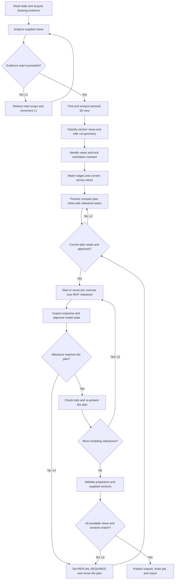

# SolidWorks CAD

Operate SolidWorks only through these nine high-level `mcp__solidworks__` tools.
Approved support tools for workflow assistance: `ask_user_question`, `todo_write`,
`skill`, and `modlens_read_image` (local image file paths only; URL forms such as
`http://` are rejected).
The runtime tool schemas and returned payloads are the authoritative contract.
Parse each tool's JSON string before acting on its envelope status. Every tool
result is compact single-line JSON. `start_job` returns `job_id` and
`job_token` first; bulky readiness and state detail is read with
`inspect_state(scope="state")`.

## Tool Boundary

| Tool | Use |
| --- | --- |
| `start_job` | Connect to SolidWorks, optionally open a target document, and return `job_id` plus private `job_token`. |
| `inspect_state` | Read readiness, locked document state, constrained CAD analysis, or approved recipe/schema content; references return one page at a time (`reference_offset`/`reference_limit`). |
| `submit_feature_graph` | Build a new part or assembly from one complete Feature Graph. |
| `apply_document_edits` | Apply allowlisted parametric edits to the locked active document. |
| `drawing_workflow` | Create a production drawing and requested views, annotations, tables, or checks. |
| `save_or_export` | Save, export, batch export, or close through the safety policy. |
| `request_confirmation` | Refresh one-time confirmation data for a pending high-risk action. |
| `confirm_action` | Execute exactly one action after fresh, explicit user approval. |
| `finish_job` | Run final objective verification and close the authenticated job. |

There is no model-visible low-level fallback. Do not use SolidWorks COM, Shell,
macros, scripts, REST endpoints, desktop automation, or legacy low-level CAD MCP
tools. Report `CAPABILITY_GAP` when the nine tools cannot express or inspect the
requested operation. If the nine-tool surface is unavailable, report
`MCP_UNAVAILABLE` and make no CAD call.

## Core Workflow

1. Call `inspect_state(scope="state")` to check readiness and current document.
2. Read only the references needed for the task with
   `inspect_state(scope="reference", reference_topic=...)`; a large reference
   arrives one page at a time, so pass `reference_offset`/`reference_limit`
   instead of repeating an identical call.
3. For image or drawing reconstruction, complete the bounded workflow below,
   present the plan inline in your reply, and obtain approval before mutation.
4. Call `start_job` before any deep document inspection or mutation. Supply
   `target_document` for an existing file and leave it empty for a fresh model.
   An empty `target_document` with no active document starts an unbound job.
5. Keep `job_id` and `job_token` private. Pass both to every later job-scoped
   call. Never place `job_token` in plans, logs, summaries, or user-visible text.
6. Use the smallest matching high-level mutation tool.
7. Inspect every response before continuing. A successful transport call is not
   proof that the CAD result is correct.
8. Save or export only to the requested paths, then call `finish_job`.

`start_job` locks the expected active-document identity. Every later job-scoped
call verifies that identity. If the user switches documents, stop and begin a new
job for the newly intended target.

An unbound job — started with no active document — has no identity to lock, so
every document-bound call is refused with `JOB_DOCUMENT_UNBOUND` before any CAD
call: `apply_document_edits`, `submit_feature_graph` with
`fresh_document=false`, `drawing_workflow`, save/export/batch/close, and
`confirm_action` of a pending action that does not create its own document. The
job binds only through its own document-creating call,
`submit_feature_graph` with `fresh_document=true`; `save_or_export` `close` with
`close_all=true` runs but never binds. Otherwise start a new job with
`target_document`, or open the document first and start a new job.

## Drawing Reconstruction Flow

This flow applies only when geometry is inferred from drawings or images.
At node A, start a job only when deep inspection of an active CAD document is
needed; this is not modeling, and node F reuses that job. Attached images can be
analyzed before any job exists.



The graph has `N=19`, `E=23`, one component, independent loop rank
`E-N+1=5`, and McCabe path complexity `E-N+2=6`. Retry-control locations must
equal the loop rank: exactly these five rows.

| ID | Controlled back edge | Maximum traversal count |
| --- | --- | --- |
| L1 | reduced evidence read -> view analysis | 1 |
| L2 | plan not ready/approved -> PLAN revision | 3 |
| L3 | more milestones -> next milestone | `max(N-1,0)` for `N` modeling todos in the approved plan |
| L4 | milestone mismatch -> replan | 2 per stable modeling todo |
| L5 | directional/sectional mismatch -> replan | 3 per target |

Before a back edge: stop if its count is at maximum; otherwise increment, persist,
then traverse. Counts survive tool changes, hypotheses, and plan versions; reset
only for a changed target or explicit user reset. Keep `L3` by approved
`PLAN_VERSION`, `L4` by todo ID, and copy pre-PLAN `L1` into PLAN.

`L2` includes `BLOCKED` resolution, incomplete plans, user-requested revision, and
withheld approval. Waiting for input does not increment it; a new PLAN revision
does. Do not add another automatic retry path. Confirmation pauses are not retries.
If a flow edit adds or removes a back edge, recompute the graph and table.

Every dimension the drawing evidence cannot read stays `unresolved` in the plan.
Never fill placement or size coordinates from pixel proportions without explicit
user approval in the plan (the Missing Dimension Gate in
[reconstruction-reasoning.md](references/reconstruction-reasoning.md)).

At exhaustion, stop mutation:

```text
STATUS: RETRY_EXHAUSTED
LOOP_ID: <L1-L5>
ATTEMPTS: <count/max>
LAST_CAUSE: <failure or mismatch>
ACTION: Stop mutation and request decisive user input.
```

## Inspection

Use `inspect_state` with no credentials only for `state` or `reference`.
Document analysis requires the active job credentials.

| Document | Supported scopes |
| --- | --- |
| Part | `features`, `geometry`, `mass_properties`, `bodies`, `faces`, `edges`, `selection` |
| Assembly | `components`, `components_flat`, `mates`, `faces`, `edges`, `selection` |
| Drawing | `drawing`, `selection` |

Assembly `faces` and `edges` also require `component`. Use identifiers returned
by current inspection data. Reinspect after structural edits because prior
face/edge indexes may no longer identify the same geometry.

Reference topics are `contract`, `canonicalization`, `forward`, `mapping`,
`mapping_part`, `mapping_sheet_metal`, `mapping_assembly`, `verification`,
`reverse`, `coverage`, and `feature_graph_schema`. A reference comes back one
page at a time inside `verification` as `topic`, `content`, and `page` (`offset`,
`limit`, `returned_lines`, `total_lines`, `total_chars`, `has_more`,
`next_offset`, `line_truncated`; `0` means the defaults, a smaller
`reference_limit` may be requested, larger is clamped; each page is at most 40
lines and about 4000 characters). Follow `page.next_offset` while
`page.has_more` is true, or jump with `reference_offset` to
`page.index.sections[].line`. For `feature_graph_schema`, `page.index` also has
`sections` (`section`, `line`, `entries`) and `feature_types`.

If an evidence read is too broad, never repeat it unchanged. Traverse `L1` once
using a smaller image/PDF region or a narrower supported `inspect_state` scope;
do not invent unsupported flags. On another failure emit `RETRY_EXHAUSTED`.

## Feature Graph

For a new part or assembly:

1. Read `forward`, the relevant mapping topic, `verification`, and
   `feature_graph_schema`; `feature_graph_schema` is read by paging (about 15
   pages at the default limit), and `page.index.feature_types` lists the
   available node kinds.
2. Build one complete graph in feature-tree dependency order.
3. Use meters for all Feature Graph distances and radians for all Feature Graph
   angles.
4. Call `submit_feature_graph(..., fresh_document=true)`.
5. Check compiler node results, rebuilt CAD state, topology, dimensions, bounds,
   and physical properties available in `partial_state` and `verification`.

Do not split a complete graph into low-level modeling calls. Do not invent graph
fields, feature types, selectors, units, or references absent from the schema.
The [capability map](references/feature-graph-capability-map.md) summarizes
expressible constructs; record inexpressible ones as `CAPABILITY_GAP`.

For a part whose complete graph would be oversized (asymmetric cast parts,
crossed-bore housings), submit ordered milestones as SEQUENTIAL graphs against
the SAME locked document: the first with `fresh_document=true`, later ones with
`fresh_document=false` into the active document after inspecting the live
geometry and anchoring to it (see the milestone strategy in
[reconstruction-reasoning.md](references/reconstruction-reasoning.md)). Never
shrink a graph by dropping evidenced features — report the split in the plan
instead.

## Existing Document Edits

`apply_document_edits` accepts only an array of `{tool, params}` objects using
this allowlist: `modify_dimension`, `edit_feature`, `set_part_material`,
`add_edge_feature`, `create_pattern`, `add_reference_geometry`,
`add_sketch_constraint`, `insert_toolbox_component`, and
`create_exploded_view`. Use current feature names and inspected geometry
references; reinspect after topology changes. Read the relevant reference before
unfamiliar parameters. Deletion and large batches enter confirmation.

## Drawing Workflow

Use `drawing_workflow` for production drawings: model/display views, flat
patterns, section/detail views, model annotations, dimensions, center marks,
BOM/balloons, hole tables, and standards checks. Save the source model first when
views need a stable path. Verify the drawing identity, view count, references,
dimensions, scale, tables, and standards findings returned by the tool.

## Confirmation

For `status="pending_confirmation"`, stop mutation and call
`request_confirmation` with the same job and action IDs. Show its exact
`action_summary`; wait for a new message explicitly approving it; then call
`confirm_action` with the returned action ID/token, exact `confirmation_text` as
`user_confirmation`, and exact summary.

Do not infer approval from the original request. Do not reuse an old or consumed
confirmation token. If risk or summary changes, present the new summary and wait
for another explicit user message. Never automatically re-enter confirmation.

## Transactions And Failures

Feature Graph execution, document edits, and drawing workflows run inside the
SolidWorks undo transaction layer. Existing files also receive a first-write
backup when possible.

Handle response status as follows:

| Status | Action |
| --- | --- |
| `completed` | Continue only after checking `verification`, `partial_state`, and `completed_steps`. |
| `pending_confirmation` | Enter the confirmation workflow and pause. |
| `failed` | Stop; inspect `error` and `recovery_status`. |
| `partial` | Stop; some state may remain. Report `completed_steps`, `partial_state`, backup, and recovery result. |
| `verification_failed` | Stop; execution occurred but objective verification did not pass. |

Treat `recovery_status="rolled_back"` as a failed operation restored by undo.
Treat `rollback_failed` as a potentially modified document requiring immediate
human review. A backup is recovery evidence, not proof that the active document
was restored.

## Verification And Trust

Before completion, verify every applicable exposed item: document identity/type,
rebuild and feature order, topology, dimensions, directions, bounding box,
body/component/mate counts, relevant mass properties, drawing content/standards,
and nonempty requested outputs.

Use the returned trust level accurately:

- `verified`: objective final verification passed.
- `drawing_consistent`: drawing-direction evidence agrees without a reference
  solid comparison.
- `built_unverified`: construction succeeded but required objective evidence was
  unavailable.
- `unverified`: do not claim completion as verified.

`finish_job` is mandatory for a completed write workflow.

## Drawing Reconstruction

For a model reconstructed from images, PDF pages, orthographic views, or sections:

Read [reconstruction reasoning](references/reconstruction-reasoning.md) in full
before analysis. Also read [part drawing evidence](references/part-drawing-evidence.md)
when any dimension, title block, hole/thread callout, bolt, screw, stud, nut,
washer, fastener, BOM, tolerance, datum, roughness, material, finish, revision,
or technical note appears, and [assembly reconstruction](references/assembly-reconstruction.md)
when the evidence describes a multi-part assembly. These local references add
reasoning rules; they do not replace runtime MCP schema/reference topics.

Before PLAN, identify the projection convention; scan for a pictorial view;
classify every orthographic, section, detail, and auxiliary view; and lock the
canonical frame `+X=right`, `+Y=up`, `+Z=front`. The bottom of Top is model front
and the left of Left is model rear. Record a signed `CAD_AXIS_MAP` for an existing
model.

Use explicit dimensions and annotations for values and standard feature meaning.
Use a pictorial view first for topology, handedness, and spatial placement; use a
section first for material/void evidence on its cut plane. Cross-check ordinary
views by visible outline, hidden line, then centerline. Pixel measurement is only
schematic evidence. Log every conflict and unresolved item.

Resolve the envelope, normal surfaces, internal features, inclined/oblique
surfaces, then curved/cylindrical features. Assign `F##` faces, `E##` edges,
`V##` vertices, and `S##` section details. Locate every critical face, edge, and
vertex from at least two independent projections; use the third to confirm or
explain hiding, coincidence, tangency, or point projection. Auxiliary views
control true shape/size of inclined faces. Generate a missing view only by
projecting resolved 3D topology. If topology remains nonunique after all supplied
evidence, set `RECONSTRUCTION_STATUS: BLOCKED` rather than guessing.

### PLAN.md

Before the first mutation, present one complete plan inline in your reply and
reuse it as this task's long-term memory. The reply is the plan of record: this
profile has no file-writing tool, so never block on creating a file. Keep the
plan under 70 lines and 4 KB, track its progress with `todo_write`, and write
the same content to a workspace `PLAN.md` file only when a file-writing tool is
actually available.

```markdown
# CAD Reconstruction Plan
PLAN_VERSION: 1
PLAN_STATUS: DRAFT
LOOP_COUNTS: L1=0; L2=0; L3={}; L4={}; L5=0
TARGET: <source and requested output>
MODE: <exact|schematic>
DRAWING_META: <title/no/rev; units/scale; projection; part/assembly; standard/unique>
PROJECTION: <first-angle|third-angle>
NORMALIZATION: <dimensions or schematic scale>
MODEL_FRAME: +X=right; +Y=up; +Z=front
CAD_AXIS_MAP: <canonical -> document signed axes>
SIDE_VIEW: <left|right>
VIEW_DATUMS: <shared X/Y/Z datums>
PICTORIAL: <status; source; findings; conflicts>
SECTIONS: <not_present or IDs; type; parent; sightline; plane/offsets; confidence>
DETAIL_COVERAGE: <detected/resolved/explained/unresolved>
SURFACE_COVERAGE: <F## resolved/explained/unresolved across views>
DIMENSION_BASIS: <explicit/baseline/chain/derived/schematic; datums; conflicts>
FEATURE_ANNOTATIONS: <holes/threads/nuts/fasteners/depth/count/pattern/radii/chamfers or none>
MATERIAL_FINISH_TOLERANCE: <material/finish/roughness/tolerance/GD&T/notes/unresolved>
RECONSTRUCTION_STATUS: <DRAFT|READY|BLOCKED|COMPLETE>
MANUFACTURING_STATUS: <COMPLETE|INCOMPLETE|UNRESOLVED>
## View Ledger
| View | Envelope | F/E/V/S evidence | Hidden/depth evidence |
| --- | --- | --- | --- |
| Front | ... | ... | ... |
| Top | ... | ... | ... |
| Side | ... | ... | ... |
| Section/Aux | ... | ... | material/void or true-shape evidence |
## Detail Correspondence
| ID | Front | Top | Side/Section/Aux | 3D inference/status |
| --- | --- | --- | --- | --- |
| F01/E01/V01/S01 | ... | ... | ... | resolved/explained/unresolved |
## Feature Sequence And Todo
- [x] Analyze pictorial, orthographic, sectional, auxiliary, and part evidence
- [x] Lock projection, axes, surfaces, details, missing views, and statuses
- [ ] Approve this PLAN_VERSION
- [ ] M1 <F/E/V/S IDs; sketch plane; signed direction; end condition; dimension source>
- [ ] M2 <same fields>
- [ ] Validate Front
- [ ] Validate Top
- [ ] Validate Side
- [ ] Validate supplied Sections/Auxiliary views
- [ ] Save/export requested outputs
## Validation Matrix
| View | Planned checks | Result |
| --- | --- | --- |
| Front | ... | pending |
| Top | ... | pending |
| Side | ... | pending |
| Section/Aux | cut material/void; transitions; depth; true shape | pending or N/A |
LAST_CHECKPOINT: none
REPLAN_LOG: none
```

Use `exact` mode for dimensioned/fabrication work. Use `schematic` for
dimensionless projection exercises; preserve available proportions or record one
normalization, and state depth/handedness assumptions.

Set `PLAN_STATUS: READY` only when view roles, axis signs, topology, handedness,
missing views, section/auxiliary conventions, dimensions or normalization,
`F##/E##/V##/S##`, feature order, signed directions, end conditions, dimension
sources, standard-part identity, thread semantics, and measurable checks are
coherent. Every nonconstruction detail must be `resolved`, `explained`, or
explicitly `unresolved`. Keep reconstruction and manufacturing completeness as
separate statuses. While writing modeling todos, check the
[capability map](references/feature-graph-capability-map.md); plan only features
the vocabulary can express and record the rest as `CAPABILITY_GAP`.

If one decision can change topology or handedness, set `BLOCKED` and ask one
focused question. Waiting does not consume `L2`; revising the plan after new
input does. Present the compact plan inline and obtain explicit approval of its
current version.
Only then set `APPROVED` and check its approval todo. Any changed topology,
orientation, dimension, direction, or feature order creates a new version.

### Execute, Checkpoint, And Validate

Reread the approved plan in full immediately before mutation. Start or reuse the job,
read only the required Feature Graph references, then prefer one complete
`submit_feature_graph(..., fresh_document=true)` for a new model. Do not split a
complete graph merely to create checkpoints.

Encode design intent: anchor the first datum/sketch to the origin when reasonable;
establish geometric relations, then location dimensions, then shape dimensions;
keep sketches simple and preferably fully constrained; use mirror or pattern when
the evidence establishes symmetry or repetition.

For every thread, nut, bolt, screw, or stud todo, record the axis, internal or
external role, cosmetic/symbolic or physical representation, designation source,
thread extent, and mating evidence. Prefer an approved standard/toolbox component
for a fully designated standard fastener. Model a physical helix only when the
request requires it and the runtime schema supports it.

One successful complete graph is one MCP milestone and may check every modeling
todo it covers after objective readback. For genuinely staged edits or drawing
operations, each high-level MCP call is one milestone and `L3` controls
continuation. Before each payload, resolve sketch plane and every extrusion, cut,
hole, mirror, pattern, and offset direction through the Orientation Contract and
`CAD_AXIS_MAP`.

After each milestone, use `inspect_state` with the smallest relevant scopes.
Compare feature results, bounds, topology, dimensions, directions, and evidence
IDs with the plan. On match, check only covered todos, update `LAST_CHECKPOINT`
and loop counts, then re-present the updated plan. On mismatch, stop mutation,
use `L4`, set `REPLAN_REQUIRED`, log the smallest mismatch and root cause, revise
the plan/version, re-present it, and obtain approval before repair.

Validate independently:

- Front looking `-Z`: width, height, silhouette, levels, openings, and centers.
- Top looking `-Y`: drawing bottom is `+Z` front; check footprint, depth, offsets,
  openings, and front/rear placement.
- Left looking `+X`: drawing left is `-Z` rear; check transitions, thicknesses,
  cuts/holes, and front/rear placement.
- Right looking `-X`: drawing right is `-Z` rear; use this instead for a Right view.
- Each supplied section: recreate its cut plane and sightline; check cut contours,
  material/void regions, centers, transitions, connectivity, and through/blind
  depths. Missing hidden lines alone are neither PASS nor FAIL.
- Each auxiliary view: check the true shape/size and the parent-view projection;
  omitted hidden lines in a partial auxiliary view do not prove feature absence.
- Each threaded interface: check coaxiality, designation, pitch, hand, fit when
  stated, engagement length, through/blind extent, and nut open/closed topology.

Write `PASS`, `FAIL`, or `UNAVAILABLE` with evidence in each Validation Matrix
row. When useful and planned, make a working save and use `drawing_workflow` to
create Front/Top/Side validation views. View creation alone is not a PASS; the
returned evidence must support comparison.

On any directional or sectional `FAIL`, stop final save/export, traverse `L5`,
reinspect the pictorial view first when one was found, update PLAN before repair,
and obtain approval again. If a direction or section is `UNAVAILABLE`, do not loop
or invent a pass; finish only if MCP final verification can complete, then report
`built_unverified` and name the gap.

Without a reference solid, use `drawing_consistent` only when Front, Top, and Side
and every supplied section all pass. Mark PLAN `COMPLETE` only after required
outputs and `finish_job` succeed.

## Final Report

Report:

- document and requested outputs
- operations actually completed
- objective verification performed
- final `status`, `verification_status`, `recovery_status`, and `trust_level`
- assumptions, unavailable checks, or capability gaps

Never claim success from appearance or a tool return code alone.

Keep this main skill at or below 550 lines; disclose detailed domain rules through
the directly linked reference files.
