<div align="center">

<a href="#实测成果陈列馆">
  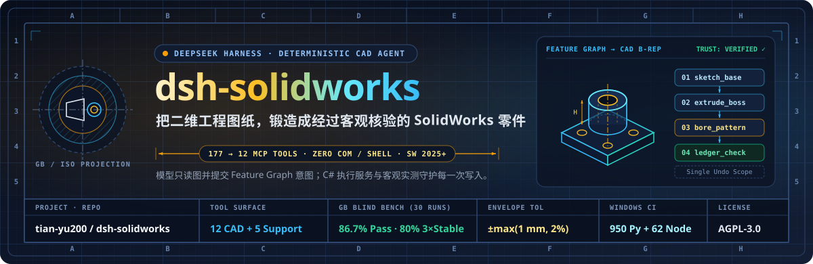
</a>

<br />

[](https://github.com/tian-yu200/dsh-solidworks/actions/workflows/ci.yml)
[](https://github.com/tian-yu200/dsh-solidworks/releases/latest)
[](https://github.com/tian-yu200/dsh-solidworks)
[](LICENSE)

<p>
  <strong>把工程图纸（三视图、零件图的图片或 PDF）锻造成经过客观核验的 SolidWorks 零件。</strong>
</p>

<blockquote>
  <em>「大模型不该在 COM 接口与 VBA 宏里盲目试错；它只需读懂图纸、提交意图，<br />
  把几何交给确定性编译器，把真伪交给卡尺、极值点与质量属性。」</em>
</blockquote>

<p>
  <a href="#工坊三幕剧场">工坊序章</a> ·
  <a href="#实机动态演示">实机演示</a> ·
  <a href="#实测成果陈列馆">成果陈列馆</a> ·
  <a href="#实测战绩与精度演进">实测战绩</a> ·
  <a href="#五步确定性闭环工作流">工作流</a> ·
  <a href="#六层安全隔离与工具边界">架构与工具</a> ·
  <a href="#安装与启动">快速部署</a> ·
  <a href="#数据边界与已知限制">边界与限制</a>
</p>

</div>

---

本项目基于 **DeepSeek Harness（DSH）**，目前为 **Windows-only public alpha**。模型读图后只就真正缺失的尺寸提一轮问题；你批准方案后，系统一次性提交结构化 `Feature Graph`，由不含 LLM 的确定性编译器与 C# 执行服务驱动本机 SolidWorks 完成建模，再通过客观实测对照核验交付。整个过程中，模型接触不到 COM、Shell、宏或脚本，只能调用白名单内的 **12 个任务级工具**与 **5 个支撑工具**。

项目基于并修改了上游 [SolidPilot](https://github.com/eyfel/mcp-server-solidworks)，保留原作者版权并整体按 **AGPL-3.0** 发布，详见 [NOTICE.md](NOTICE.md) 和 [LICENSE](LICENSE)。

---

## 工坊三幕剧场

<div align="center">
<table>
  <tr>
    <td align="center" width="33.3%">
      <br />
      <b>01 · 蓝图启程</b><br />
      <sub>发送三视图或 PDF，锁定文档身份与坐标网格，启动受控任务</sub>
    </td>
    <td align="center" width="33.3%">
      <br />
      <b>02 · 编译成体</b><br />
      <sub>提交 CAD 中立特征图，确定性编译器逐特征构建原生 B-Rep 实体</sub>
    </td>
    <td align="center" width="33.3%">
      <br />
      <b>03 · 实测交付</b><br />
      <sub>精确量包络、体积与圆柱面，四视图同屏核验通过方得 verified</sub>
    </td>
  </tr>
</table>
</div>

<details>
<summary>查看工坊吉祥物设定彩蛋：三视图视角下的工程师小鸡（正视 · 轴测 · 侧视）</summary>
<p align="center">
  
</p>
</details>

---

## 实机动态演示

<p align="center">
  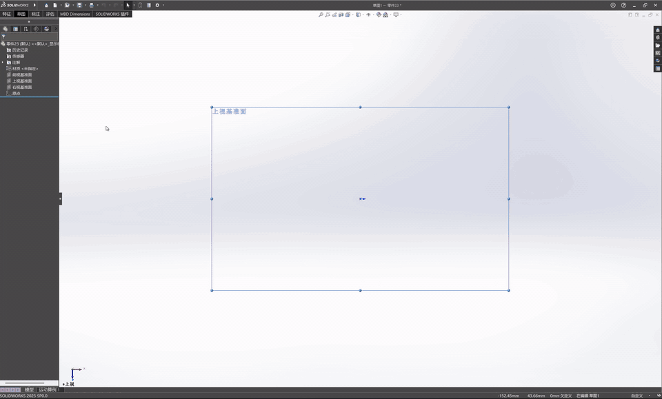
</p>

> **说明**：上图是阀体零件的**慢放重放**，并非实时录屏——使用 [`batch_build.py`](dsh-integration/scripts/batch_build.py) `--pace` 把一份已构建成功的 `Feature Graph` 重新构建一遍，每完成一个特征节点停顿片刻方便观察特征树生长，最后加速约 9 倍制成动图（关于 `valve_body_v4/v5` 的耗时样本边界见 [阀体管线记录](docs/valve-pipeline-runlog.md)）。

**完整无剪辑实机录屏**：
- **脚踏座：从发图纸到出零件的一次完整运行**（2026-11-01 录制，时长 16 分钟，使用 `v2.0.0` 之后开发版 + `gpt-6.1-sol high`）。该次运行中，读图到提问约 11.5 分钟，方案批准后约 2 分钟零件出现在 SolidWorks 中。
  下载：[footpedal-full-run-2026-11-01.mp4](https://github.com/tian-yu200/dsh-solidworks/releases/download/v2.1.0/footpedal-full-run-2026-11-01.mp4)（Release 附件，SHA-256 见 `v2.1.0` 发布说明）。

---

## 实测成果陈列馆

> 以下展板全部截取自本机 SolidWorks 2025 的真实运行输出（`artifacts/views/` 与系统自带四视图对比渲染）：左侧为输入工程图，右侧为系统自动生成的 **正视 / 左视 / 俯视 / 轴测** 实体投影对比。点击任意展板可查看 `1568×980` 原图细节。

### 精选代表作 · 跨工艺几何类型展示

<table>
  <tr>
    <td align="center" width="50%">
      <a href="docs/media/showcase/1_1_1_impeller_housing.png">
        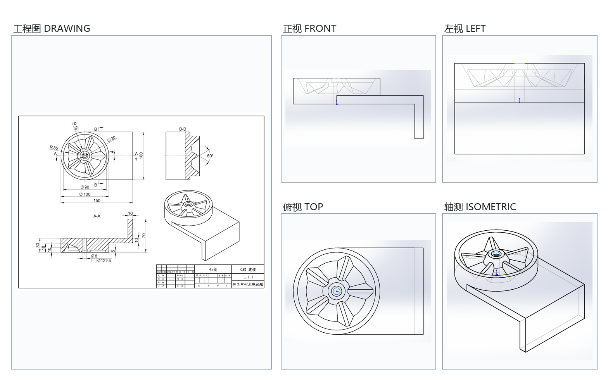
      </a><br />
      <b>1.1.1 叶轮座（45钢）</b><br />
      <sub>5 副锥形辐射叶轮筋 + 环形壳体 + L 形法兰支座<br />
      <b>3/3 轮稳定通过</b> · 实测体积 <code>276.64 cm³</code>（金标准 <code>276.64 cm³</code>，<b>0.00% 误差</b>）</sub>
    </td>
    <td align="center" width="50%">
      <a href="docs/media/showcase/1_1_5_impeller_flange.png">
        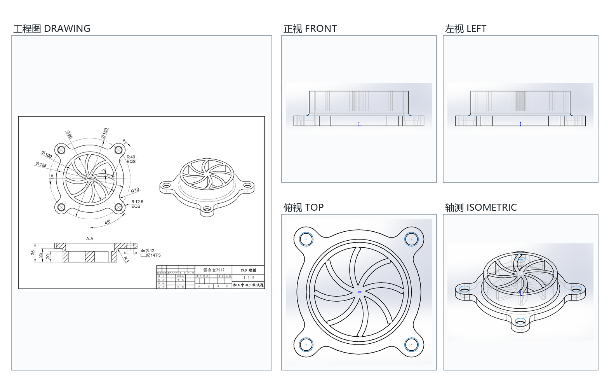
      </a><br />
      <b>1.1.5 叶片法兰（铝合金2017）</b><br />
      <sub>7 片 <code>R40 EQS</code> 旋涡弧形叶片 + 四耳沉孔法兰（<code>4×Ø12 / Ø14↓5</code>）+ <code>R10/R3</code> 圆角<br />
      实测体积 <code>150.42 cm³</code>（参考 <code>151.07 cm³</code>，<b>-0.43% 误差</b>）</sub>
    </td>
  </tr>
  <tr>
    <td align="center" width="50%">
      <a href="docs/media/showcase/1_1_4_trapezoidal_shaft.png">
        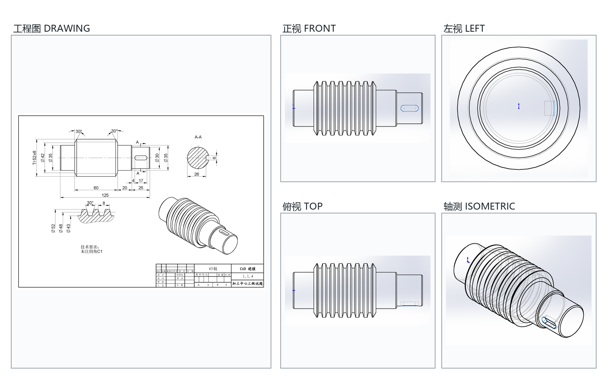
      </a><br />
      <b>1.1.4 梯形螺纹轴 Tr52×8（45钢）</b><br />
      <sub>真实螺旋梯形螺纹轮廓（<code>Ø52 / Ø48 / Ø43</code>）+ 轴端键槽 + 退刀槽<br />
      实测体积 <code>162.44 cm³</code>（参考 <code>161.07 cm³</code>，<b>+0.85% 误差</b>）</sub>
    </td>
    <td align="center" width="50%">
      <a href="docs/media/showcase/1_1_10_abs_shell.png">
        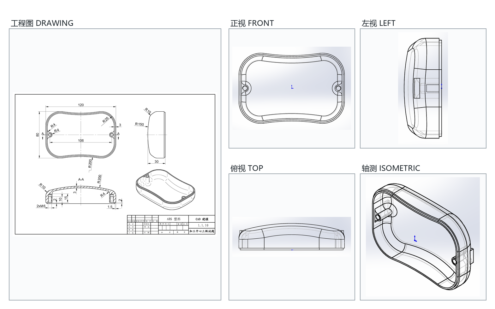
      </a><br />
      <b>1.1.10 ABS 弧顶薄壳（ABS 塑料）</b><br />
      <sub><code>R200 / R150</code> 双曲面顶盖 + <code>3 mm</code> 等壁厚抽壳 + <code>2×M6</code> 攻丝底孔凸台<br />
      H25 等高顶面消歧修复后，包络 <code>30×80×120 mm</code> 与双底孔一次打穿</sub>
    </td>
  </tr>
  <tr>
    <td align="center" width="50%">
      <a href="docs/media/showcase/1_1_7_curved_bracket.png">
        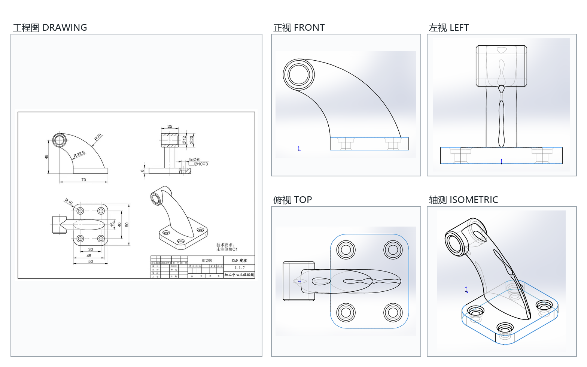
      </a><br />
      <b>1.1.7 弯臂支座（HT200）</b><br />
      <sub><code>45×15</code> 椭圆截面沿 <code>R70 / R32.5</code> 圆弧放样臂 + <code>Ø20/Ø12</code> 轴套 + 4 沉头孔<br />
      实测包络 <code>58.0×60.0×80.0 mm</code> 精确命中（体积 <code>48.16 cm³</code> vs <code>47.5 cm³</code>；底板 C1 未生成）</sub>
    </td>
    <td align="center" width="50%">
      <a href="docs/media/showcase/1_1_6_bent_wrench.png">
        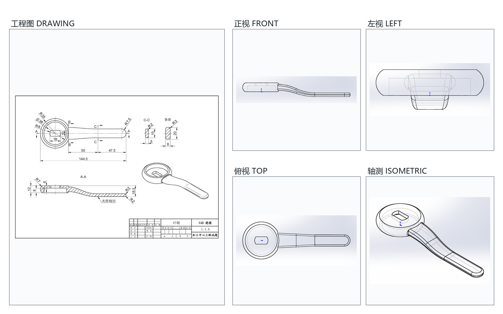
      </a><br />
      <b>1.1.6 异形下弯扳手（45钢）</b><br />
      <sub>鼓形圆头（<code>R7</code>）+ <code>Ø38</code> 沉腔 + <code>18×10</code> 腰孔 + 下弯渐缩手柄 + 语义特征命名<br />
      实测包络 <code>18.5×50.0×144.5 mm</code> 精确命中（<code>20.56 cm³</code>；根部 <code>R3</code> 按 <code>R2</code> 近似）</sub>
    </td>
  </tr>
</table>

<details>
<summary>展开更多实测展品：2026-11-18 国标盲测三连稳健件 &amp; 复杂斜臂支架（4 件）</summary>
<br />
<table>
  <tr>
    <td align="center" width="50%">
      <a href="docs/media/showcase/t409_piston.png">
        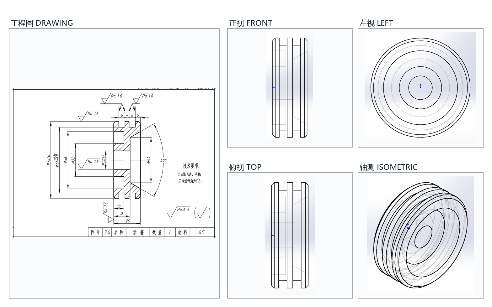
      </a><br />
      <b>t409 活塞（45钢）</b><br />
      <sub><b>3/3 轮零误差</b> · 三次均精确产出 <code>59.32 cm³</code>（标准 <code>59.32 cm³</code>，0.00% 离散）</sub>
    </td>
    <td align="center" width="50%">
      <a href="docs/media/showcase/t408_packing_gland.png">
        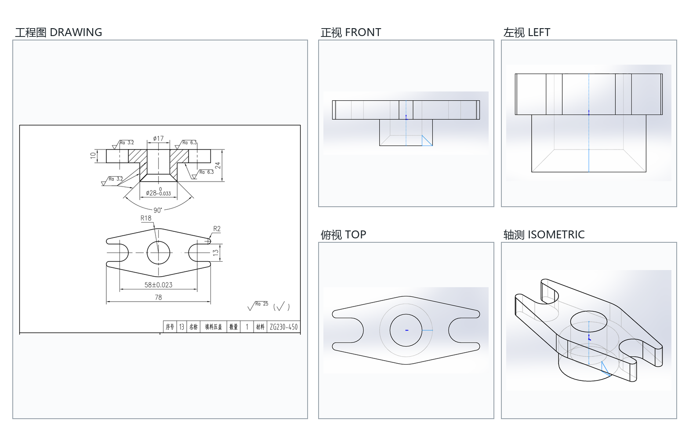
      </a><br />
      <b>t408 填料压盖（ZG230-450）</b><br />
      <sub><b>3/3 轮零误差</b> · 三次均精确产出 <code>20.44 cm³</code>（标准 <code>20.44 cm³</code>，0.00% 离散）</sub>
    </td>
  </tr>
  <tr>
    <td align="center" width="50%">
      <a href="docs/media/showcase/t407_nozzle_fitting.png">
        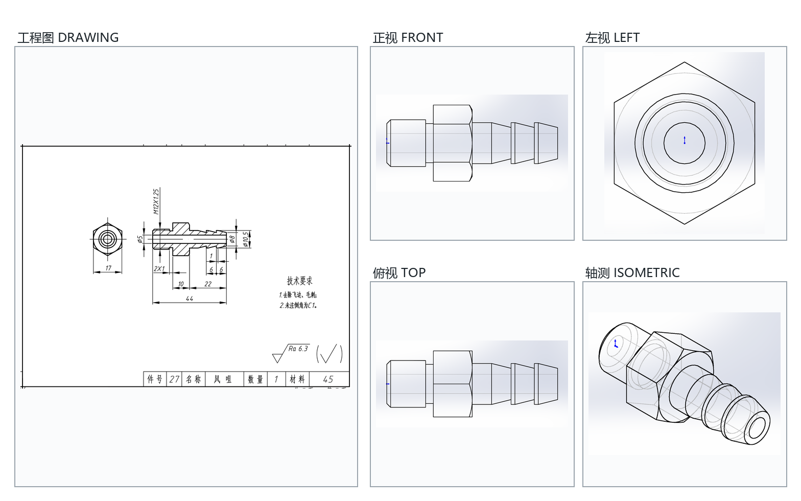
      </a><br />
      <b>t407 风咀接头（45钢）</b><br />
      <sub><b>3/3 轮通过</b> · 宝塔倒刺 + 六角法兰，三次均为 <code>4.52 cm³</code>（标准 <code>4.53 cm³</code>，0.00% 离散）</sub>
    </td>
    <td align="center" width="50%">
      <a href="docs/media/showcase/t025_ribbed_bracket.png">
        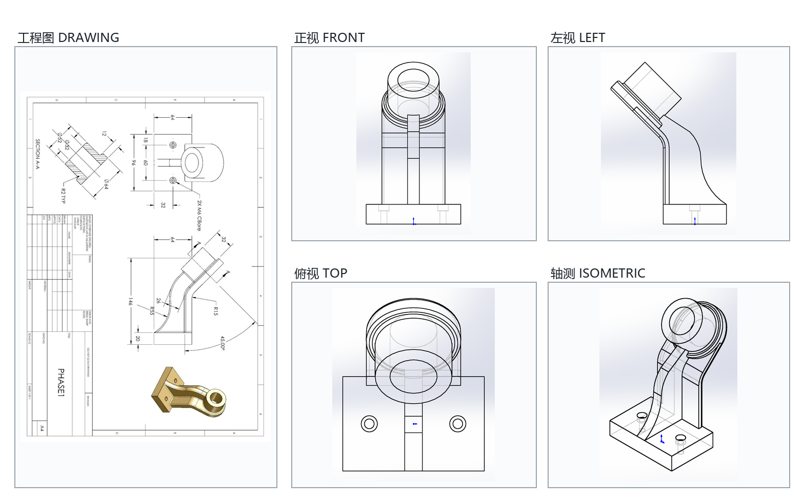
      </a><br />
      <b>t025 英文弯臂支架（结构展示）</b><br />
      <sub><code>45°</code> 倾斜弯臂 + 加强筋 + 沉孔底座 + 轴套（实测体积 <code>259.17 cm³</code>，暂无金标准件）</sub>
    </td>
  </tr>
</table>
</details>

---

## 实测战绩与精度演进

<p align="center">
  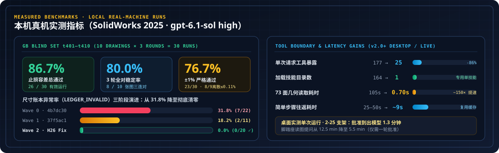
</p>

### 1. 桌面单次交互实测（摘自 [v2.0.0 发布说明](https://github.com/tian-yu200/dsh-solidworks/releases/tag/v2.0.0)）

以下数据来自作者本机使用 `gpt-6.1-sol high` 与 DSH 桌面端的实测对比：

| 零件 / 优化项目 | 实测结果 |
| --- | --- |
| **2-25 支架** | 读图到提问用时 `5.8 分钟`；**从批准方案到出模型 `1.3 分钟`** |
| **脚踏座** | 读图到提问耗时从 `12.5 分钟` 降至 `5.5 分钟`，全程只需一次批准 |
| **每次请求的负担** | 携带工具从 `177` 个降至 `25` 个，技能目录从 `164` 个降至 `1` 个；简单步骤从 `25–50 秒` 降至约 `9 秒` |
| **COM 跨进程几何读取** | 启用 `CommandInProgress` 后，读取 73 个面的耗时从 `105 秒` 降至 **`0.70 秒`**（约 `150×` 提速） |

### 2. 中文国标盲测集 3 轮复现结果（2026-11-18 · 本地未公开测试集 `t401–t410`）

10 张中小型机械加工件国标图纸，在相同代码与 `gpt-6.1-sol high` 配置下各独立连续运行 3 轮（共 30 次有效运行；完整评测图纸集、金标准参考模型与评测脚本保留在本地 `state/benchmark/`，不随公开仓库分发）：

- **止损口径总通过率**：**`26 / 30`（`86.7%`）**；**“同一张图 3 轮全对”稳定率**：**`8 / 10`（`80.0%`）**。
- **`±1%` 严格口径通过率**：**`23 / 30`（`76.7%`）**；9 张成功建出的图纸中有 8 张的三次重复体积离散 **`≤ 0.11%`**（其中 7 张实现 **`0.00%`** 零离散）。
- **尺寸账本异常率归零**：补齐 `dimension_ledger` 速查契约与 H26 同轴圆柱 `surface_point` 物理消歧后，`LEDGER_INVALID` 从早先 `31.8%`（`7/22`）→ 第 1 波 `18.2%`（`2/11`）→ 第 2 波彻底降至 **`0.0%`（`0/20`）**。
- **诚实边界说明**：该轮中系统给出 `verified` 共 8 次，其中 7 次真通过（`87.5%`），仍有 1 次误放（`t410` 底盖叉座第 3 轮把下部斜削平法兰误读为完整圆盘，因模型读图与自身计划同源一致而放行）；另外 `t406` 第 3 轮因草图拉伸连续失败未建出零件。

<details>
<summary>展开查看 t401–t410 逐题 3 轮实测明细表（30 次运行全记录）</summary>
<br />

| 编号 | 零件名称 | 止损容差 | 止损通过 | ±1% 严格 | 标准体积 (cm³) | 实测体积范围 (cm³) | 3 次体积离散 | 首模中位 (min) |
| --- | --- | --- | :---: | :---: | :---: | :---: | :---: | :---: |
| `t401` | 隔架 45 钢 | `±1%` | `3/3` | `3/3` | `28.07` | `28.07–28.07` | `0.00%` | `1.5` |
| `t402` | 销轴 45 钢 | `±4%` | `3/3` | `0/3` *(注)* | `0.64` | `0.65–0.65` | `0.00%` | `2.4` |
| `t403` | 端盖 45 钢 | `±1%` | `3/3` | `3/3` | `10.31` | `10.31–10.31` | `0.00%` | `4.4` |
| `t404` | 底盖 HT200 | `±1%` | `3/3` | `3/3` | `46.25` | `46.20–46.25` | `0.11%` | `2.3` |
| `t405` | 指示器连接板 45 钢 | `±1.5%` | `3/3` | `3/3` | `2.44` | `2.45–2.45` | `0.00%` | `4.5` |
| `t406` | 环头螺钉 Q235A | `±2%` | `2/3` | `2/3` | `6.58` | `6.59–6.59` | `0.00%` | `4.3` |
| `t407` | 风咀接头 45 钢 | `±2%` | `3/3` | `3/3` | `4.53` | `4.52–4.52` | `0.00%` | `3.7` |
| `t408` | 填料压盖 ZG230-450 | `±1%` | `3/3` | `3/3` | `20.44` | `20.44–20.44` | `0.00%` | `2.5` |
| `t409` | 活塞 45 钢 | `±2%` | `3/3` | `3/3` | `59.32` | `59.32–59.32` | `0.00%` | `2.4` |
| `t410` | 底盖叉座 HT200 | `±2%` | `0/3` | `0/3` | `53.60` | `39.90–52.65` | `23.79%` | `3.5` |

> 注：`t402` 微型销轴总体积仅 `0.64 cm³`，三次均稳定建出 `0.65 cm³`（绝对差 `0.01 cm³`），仅因图面未标数值的端部示意小倒角导致比例略超 `±1%`。

</details>

---

## 五步确定性闭环工作流

<p align="center">
  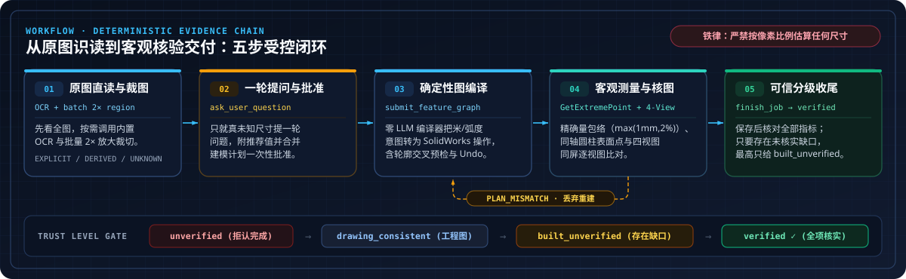
</p>

1. **发图**：在 DSH 中发送一张工程图纸图片或 PDF，说明“建模”。
2. **读图**：模型先直接看原图。小字看不清时，用 `read_drawing_text`（Windows 内置 OCR 整图扫描一次）与 `read_drawing_region`（一次调用批量裁切、放大多个视图）辅助。尺寸严格分成四类：**图上明示（EXPLICIT）**、**可唯一推导（DERIVED）**、**用户给值（USER）**、**真正未知（UNKNOWN）**。
3. **一轮提问与批准**：读图结论与建模计划写在消息正文里；模型只就真正未知的尺寸提问，每个问题附带推荐解读，并与计划批准合并成**一轮**。
4. **确定性编译建模**：批准后一次提交完整的 `Feature Graph`（CAD 中立的特征意图，单位固定为米和弧度）。不含 LLM 的确定性编译器在提交阶段即拦截闭合轮廓重叠/交叉/转台跨轴，并在一个 SolidWorks Undo 作用域内逐节点构建——整次构建合成一条撤销记录，失败时单步撤销。
5. **精确自查与四视图比对**：新零件必须携带批准方案的包络尺寸（`expect`），体积和特征数可选。建完后通过精确极值点（`IBody2.GetExtremePoint`，而非粗略包围盒）逐轴核对，容差为 `max(1 mm, 2%)`；不符时立即报 `PLAN_MISMATCH` 并丢弃废件。同时导出工程图与正/左/俯/轴测四视图同屏对照图供逐视图检查。
6. **可信分级收尾**：`finish_job` 做最终客观验证。`verification_failed`、`partial`、`rollback_failed` 都不算成功交付；只要存在未核实的项（体积不符、包络未读到、计划特征缺失、新零件未保存、尺寸账本 `dimension_ledger` 不符或测不到），结果最高仅给 `built_unverified`，并将原因完整列在 `verification_gaps` 里。

交互式图解版工作流文档见 [`docs/workflow.html`](docs/workflow.html)（下载后用浏览器打开）。

<details>
<summary>工具调用顺序参考（面向开发者与 Prompt 审计）</summary>

1. 用 `inspect_state(scope="state")` 检查 SolidWorks 就绪状态与活动文档。
2. 在提问之前，用一步并行调用完成三件事：
   - `start_job` 获取 `job_id` 与私密 `job_token`；
   - `inspect_state(scope="reference")` 读取本任务需要的 recipe 或 `feature_graph_quickref` / schema；
   - 图纸任务：直接看原图，按需调用 `read_drawing_text` 与 `read_drawing_region`。
   - 参考文档分页返回：每页内容约 `6820` 字符，连同封套不超过 `7000` 字符、最多 `150` 行；用 `reference_offset` / `reference_limit` 按 `page.has_more` 续读，`feature_graph_schema` 可用 `page.index.sections[].line` 跳读。
3. 一轮提问：正文给出读图结论与计划，`ask_user_question` 只放缺失尺寸与批准选项。
4. 按任务调用 `submit_feature_graph`、`apply_document_edits` 或 `drawing_workflow`（新建零件必带 `expect`）。
5. 收到 `pending_confirmation` 时，调用 `request_confirmation` 展示精确 `action_summary`，等用户在新消息中明确批准后再调用 `confirm_action`。
6. 用 `inspect_state` 检查实测结果，按需调用 `save_or_export`。
7. 最后必须调用 `finish_job` 结束任务。

</details>

---

## 六层安全隔离与工具边界

<p align="center">
  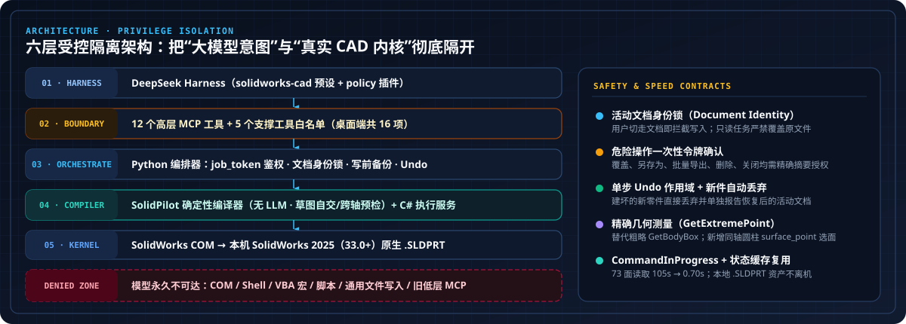
</p>

专用会话只能看到以下 **12 个 `mcp__solidworks__*` 高层工具**，由策略插件在预设层强制隔离：

| 工具 | 用途 |
| --- | --- |
| `start_job` | 启动任务、连接 SolidWorks、锁定目标文档身份并返回任务凭据 |
| `inspect_state` | 读取状态、文档分析结果和受控的 recipe / schema / 四视图对比 |
| `read_drawing_text` | 用 Windows 内置 OCR 一次性读出整张图纸上的文字（可选辅助） |
| `read_drawing_region` | 批量裁切、放大图纸区域（支持网格与像素框），看清小尺寸（可选辅助） |
| `submit_feature_graph` | 一次提交完整的 Feature Graph，创建零件或装配体 |
| `apply_document_edits` | 对当前锁定目标执行严格白名单内的参数化编辑 |
| `drawing_workflow` | 创建工程图、视图、标注、BOM、气泡、孔表，并做标准检查 |
| `save_or_export` | 保存、导出（STEP / IGES / STL / PDF / DWG / DXF）、批量导出或关闭 |
| `request_confirmation` | 为待确认的高风险动作刷新一次性确认数据与精确摘要 |
| `confirm_action` | 用户在新消息中明确批准后，执行对应的那一项待确认动作 |
| `cancel_action` | 取消待确认动作，不执行 |
| `finish_job` | 完成最终客观验证，输出分级可信结论并结束任务 |

除这 12 个 CAD 工具外，策略插件仅放行 **5 个支撑工具**：

- `ask_user_question`：向用户发起选择题式单轮提问；
- `todo_write`：维护任务待办清单；
- `skill`：仅允许加载 `solidworks-cad` 这一个技能；
- `modlens_read_image`：读取本地图片证据（`http://`、`https://`、`ftp://`、`file://` 等 URL 一律拒绝）；
- `read_mcp_resource`：按 `solidworks://skill/references/<file>.md` 读取技能参考文档（本预设没有本地文件工具，这是读取参考文档的唯一入口）。

其余所有全局工具（Shell、通用文件写入、网络抓取、旧低层 MCP）一律拒绝。注册事实源：[`mcp-server-solidworks-main/adapters/dsh/server.py`](mcp-server-solidworks-main/adapters/dsh/server.py)；白名单：[`dsh-integration/plugins/solidworks-policy/index.js`](dsh-integration/plugins/solidworks-policy/index.js)。

### 关键工程能力细节

- **丰富且预检的 Feature Graph 节点（单位：米 / 弧度）**：
  - 基础与成形：`box`、`sketch`（矩形、圆、线、弧、椭圆、样条、键槽、圆角矩形等图元）、`extrude`、`revolve`（`boss` / `cut`，旋转轴精确取草图中心线 2D 端点）、`sweep`、`rib`、`loft`、`hole`（盲孔或 `through_all`）、`linear_pattern`、`circular_pattern`、`fillet`、`chamfer`、`shell`（面锚点与壁厚体积差校验）、钣金与镜像等。
  - 计划期前置防呆：草图闭合轮廓自交/重走/重叠、旋转截面跨轴、扫掠路径与截面不交，都会在计划阶段直接返回 `VALIDATION_FAILED`，不必等到 SolidWorks 报错 `EXTRUSION_FAILED`。
- **精细化几何测量与选面消歧**：
  - 精确包络量测（`IBody2.GetExtremePoint`）、同轴多直径圆柱物理表面点选面（`surface_point`）、等高顶面坐标消歧（`resolve_top_face`），以及按真实特征树语义自动命名。
- **严谨的风控与恢复机制**：
  - 独立 `solidworks` profile、任务级私密 `job_token`、活动文档身份锁、首次修改前自动备份；覆盖/另存为（`save_as`）/批量导出/删除/全部关闭均强制精确摘要确认；未知传输超时报告“结果未知，先读状态再重试”。

---

## 安装与启动

**运行要求**：Windows 64 位系统；SolidWorks 2025（已在 `33.0` 上实测）或更高版本；.NET Framework 4.8 与 MSBuild；Python 3.12（与 CI 相同）；DeepSeek Harness。

### 方式一：中文一键环境部署向导（推荐）

仓库内置了面向 Windows 用户的中文引导部署脚本 [`Setup-SolidWorksEasy.ps1`](dsh-integration/scripts/Setup-SolidWorksEasy.ps1)，自动完成 64 位与 .NET 4.8 检查、C# 执行服务校验/编译、非系统盘工作目录设置、DSH 安全配置同步以及多模态视觉模型识图能力守卫：

```powershell
& .\dsh-integration\scripts\Setup-SolidWorksEasy.ps1 -DshRoot C:\path\to\deepseek-harness
```

### 方式二：分步手动安装与启停

1. **创建 Python 虚拟环境**：

   ```powershell
   py -3.12 -m venv .\mcp-server-solidworks-main\adapters\claude\.venv
   & .\mcp-server-solidworks-main\adapters\claude\.venv\Scripts\python.exe -m pip install -r .\mcp-server-solidworks-main\adapters\claude\requirements.txt
   ```

2. **使用 MSBuild 编译 C# 执行服务**（若 SolidWorks 未装在默认路径，请指定 `SolidWorksInstallDir`）：

   ```powershell
   msbuild .\mcp-server-solidworks-main\execution\solidworks\SolidworksExecution\SolidworksExecution.csproj /p:Configuration=Debug /p:SolidWorksInstallDir="C:\Program Files\SOLIDWORKS Corp\SOLIDWORKS"
   ```

3. **安装配置、启动与自检**：

   ```powershell
   # 安装 preset、profile 与策略插件（修改前自动备份到 config-backups\）
   & .\dsh-integration\scripts\Install-SolidWorksDsh.ps1 -DshRoot C:\path\to\deepseek-harness

   # 启动专用 SolidWorks 会话
   & .\dsh-integration\scripts\Start-SolidWorksDsh.ps1 -DshRoot C:\path\to\deepseek-harness

   # 诊断检查（含模型图片输入能力校验）
   & .\dsh-integration\scripts\Doctor-SolidWorksDsh.ps1 -DshRoot C:\path\to\deepseek-harness
   ```

4. **恢复安装前的 DSH 配置**：

   ```powershell
   & .\dsh-integration\scripts\Restore-SolidWorksDsh.ps1 `
     -BackupRoot .\config-backups\<timestamp>
   ```

> **关于多模态看图模型**：官方纯文本模型不接收图纸图片输入；配置与换模型规范详见 [`docs/DSH模型图片输入配置.md`](docs/DSH模型图片输入配置.md)，也可用 `node .\dsh-integration\scripts\Check-ModelImageCapability.mjs` 离线自检。

---

## 测试与仓库结构

### 自动化回归测试

每次推送至 `main` 后，GitHub Actions 均会在 Windows Runner 上运行全部无需 SolidWorks 授权的回归测试（最近一次实测：**Python `950 passed, 1 skipped` + Node `62 passed`，合计 `1,012` 项通过**）。

```powershell
# 1. Python 编排器 / 编译器 / 一致性全量测试（-e 相对路径需在 adapters\claude 目录下安装）
Set-Location .\mcp-server-solidworks-main\adapters\claude
.\.venv\Scripts\python.exe -m pip install -r requirements-dev.txt
Set-Location ..\..
.\adapters\claude\.venv\Scripts\python.exe -m pytest -q

# 2. 回到仓库根目录运行 Node 策略插件与安装脚本测试
Set-Location ..
node --test "dsh-integration/plugins/solidworks-policy/test/*.test.mjs" "dsh-integration/scripts/test/*.test.mjs"
```

真实的 SolidWorks 建模不在云端 CI 中运行（无 SolidWorks 授权）。在本机已启动 SolidWorks 后，可使用 [`batch_build.py`](dsh-integration/scripts/batch_build.py) 直接重放 Feature Graph 做端到端真机回归。

### 目录概览

```text
dsh-solidworks
├─ .github\workflows\          Windows CI 回归流水线
├─ dsh-integration\
│  ├─ profiles\solidworks\     独立 solidworks profile（默认 workspace-write）
│  ├─ presets\solidworks-cad\  专用预设与技能事实源
│  ├─ plugins\solidworks-policy\  12+5 工具白名单与识图防呆插件
│  └─ scripts\                 一键中文向导、安装、诊断、模型能力守卫、batch_build.py
├─ .dsh\skills\solidworks-cad\ 工作区同步镜像（与 dsh-integration 下事实源保持逐字节一致）
├─ docs\                       工作流图解、工具清单、视觉配置、踩坑记录、media 展品
├─ mcp-server-solidworks-main\
│  ├─ adapters\dsh\            高层编排器、读图与 OCR、四视图对照、尺寸账本
│  ├─ cad-planner\             Feature Graph JSON Schema 与契约
│  ├─ compiler\solidworks\     确定性编译器与几何预检
│  └─ execution\solidworks\    C# 执行服务（唯一接触 SolidWorks COM 的层）
└─ SolidWorksAiAssistant用户对话工作流.md
```

---

## 数据边界与已知限制

### 数据处理边界

- **本地生成与留存**：Feature Graph 的确定性编译、COM 驱动、`.SLDPRT` / `.STEP` 三维文件与特征树均在你的本机生成并保存，不上传三维模型资产。
- **云端视觉识图说明**：当你使用云端多模态模型识读图纸时，当次选中的二维图纸图片及局部放大裁切图会发送至你自行配置的大模型 API 服务商（遵循该服务商隐私条款；**仓库未包含且未承诺零数据留存协议，涉密图纸请勿使用公有云模型**）。

### 已知限制

- **输入格式**：支持位图（PNG、JPG 等）与 PDF；PDF 按页渲染为位图再读，不把矢量线条或文本层当作直接尺寸来源；暂不支持直接解析 DXF / DWG。
- **同源读错盲区**：逐个关键尺寸的核对依赖模型在特征图里自填的 `dimension_ledger`；未填写时最高只给 `built_unverified`。由于账本与特征图出自同一模型，读图阶段看错的数字它无法自行揪出，仍需工程图与四视图对照及人工终审。
- **撤销边界**：失败回滚依赖 SolidWorks 的单步 Undo 作用域，而非数据库级原子事务；中途若有自带撤销栈的操作导致一步撤不干净，将报告 `rollback_failed` 或 `recovery_unverified`。新建零件失败时直接关闭丢弃，不依赖撤销；修改已有零件失败时同样报告 `recovery_unverified` 而不自动盲目重试。
- **评测覆盖范围**：`t401–t410` 等基准来自作者本机运行统计，原始图纸与参考模型仅留在本地，尚未构建全公开标准化基准库；目前仅在 SolidWorks 2025（`33.0`）上完整实测。

### 维护边界

- 高层工具注册事实源：[`mcp-server-solidworks-main/adapters/dsh/server.py`](mcp-server-solidworks-main/adapters/dsh/server.py)
- 低层 SolidPilot 工具仅供 Python 编排器内部调用，严禁直接暴露给模型。
- C# 执行服务是唯一访问 SolidWorks COM 的一层；Feature Graph 能力以 `cad-planner/contracts/feature-graph.schema.json` 为准，低层 wire 协议以 `execution/solidworks/contracts` 为准。
- 工具、schema 或策略变更后，需同步更新 Skill、工具清单、插件白名单并跑通仓库一致性测试（`test_repo_consistency.py`）。

---

## License

本仓库是 [SolidPilot](https://github.com/eyfel/mcp-server-solidworks) 的衍生发行版，整体按 [GNU Affero General Public License v3.0](LICENSE) 发布。上游版权、修改说明、Cosmetic Thread 参考致谢和商标声明见 [NOTICE.md](NOTICE.md)。
