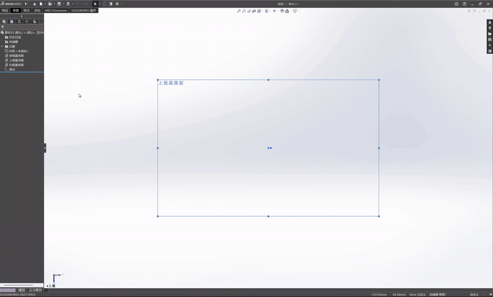

# dsh-solidworks

[](https://github.com/tian-yu200/dsh-solidworks/actions/workflows/ci.yml)
[](https://github.com/tian-yu200/dsh-solidworks/releases/latest)

**把工程图纸（三视图、零件图的图片）变成经过核验的 SolidWorks 零件。**

本项目基于 DeepSeek Harness（DSH）：模型读图后，只就真正缺失的尺寸提一轮问题；你批准方案后，它一次性完成建模，建完再用客观测量对照方案自查。整个过程中模型接触不到 COM、Shell、宏或脚本，只能调用 12 个任务级工具。

项目目前是 Windows-only public alpha。它基于并修改了上游 [SolidPilot](https://github.com/eyfel/mcp-server-solidworks)，保留原作者版权并使用 AGPL-3.0，详见 [NOTICE.md](NOTICE.md) 和 [LICENSE](LICENSE)。

## 演示



上图是阀体零件的**慢放回放**，不是实时录屏：用 `batch_build.py --pace` 把一份已经建成功的 Feature Graph 重新构建一遍，每建完一个特征停顿一下方便观看，最后再加速约 9 倍做成动图。

完整录屏（未剪辑）：

- **脚踏座：从发图纸到出零件的一次完整运行**。2026-11-01 录制，时长 16 分钟，使用 v2.0.0 之后的开发版本，模型为 gpt-6.1-sol high。这次运行中，读图到提问约 11.5 分钟，批准后约 2 分钟零件出现在 SolidWorks 中。下载：[footpedal-full-run-2026-11-01.mp4](https://github.com/tian-yu200/dsh-solidworks/releases/download/v2.1.0/footpedal-full-run-2026-11-01.mp4)（Release 附件，SHA-256 见 v2.1.0 发布说明）

## 它怎么工作

1. **发图**：在 DSH 里发一张图纸图片，说"建模"。
2. **读图**：模型先直接看原图。小字看不清时，用 `read_drawing_text`（Windows 内置 OCR，整张图扫描一次）和 `read_drawing_region`（一次调用批量裁切、放大多个视图）辅助。尺寸分四类：图上明示、可唯一推导、用户给值、真正未知。
3. **一轮提问与批准**：读图结论和建模计划写在消息正文里。模型只就真正未知的值提问，每个问题附一个推荐值，并和计划批准合并成一轮。
4. **建模**：批准后提交一张完整的 Feature Graph，也就是 CAD 中立的特征意图。确定性编译器（不含 LLM）把它转换成 SolidWorks 操作，在一个 Undo 作用域内逐个节点构建：整次构建合成一条撤销记录，失败时单步撤销。
5. **自查**：新零件必须带上批准方案中的包络尺寸，体积和特征数可选。建完后按实测结果比对，每个轴的容差为 max(1 mm, 2%)。不符时报 `PLAN_MISMATCH`，零件被丢弃，这次失败计入修复预算。
6. **收尾**：`finish_job` 做最终的客观验证。`verification_failed`、`partial`、`rollback_failed` 都不算成功交付。只要还有没核实的项（体积不符、包络没读到、计划特征没建全、新零件没保存、尺寸表不符或测不到），或者特征图没带可测的尺寸表（`dimension_ledger`），结果最高只给 `built_unverified`，原因列在 `verification_gaps` 里。

图解版工作流见 [`docs/workflow.html`](docs/workflow.html)，下载后用浏览器打开。

## 实测数据

以下数据来自作者本机，使用 gpt-6.1-sol high 和 DSH 桌面版，摘自 [v2.0.0 发布说明](https://github.com/tian-yu200/dsh-solidworks/releases/tag/v2.0.0)：

| 零件 / 项目 | 结果 |
| --- | --- |
| 2-25 支架 | 读图到提问用时 5.8 分钟；**从批准到出模型 1.3 分钟** |
| 脚踏座 | 读图到提问的用时从 12.5 分钟降到 5.5 分钟，只需一次批准 |
| 每次请求的负担 | 携带的工具从 177 个降到 25 个，技能目录从 164 个降到 1 个；简单步骤从 25–50 秒降到约 9 秒 |

这些是单次运行的结果，还没有整理成可复跑的基准集（见"已知限制"）。

## 分层架构

```text
DeepSeek Harness（solidworks-cad 预设 + policy 插件）
  -> 12 个高层 MCP 工具
  -> Python 编排器：任务凭据、权限、确认、事务、验证
  -> SolidPilot 确定性编译器 + C# 执行服务
  -> SolidWorks COM
  -> SolidWorks
```

这种结构保留真实的 SolidWorks 后端，同时把模型限制在任务级工具上，避免它直接拼接 COM、Shell、宏或低层 CAD 调用。C# 执行服务是唯一接触 SolidWorks COM 的一层。

## 模型可见工具

专用会话只能看到以下 12 个 `mcp__solidworks__*` 工具：

| 工具 | 用途 |
| --- | --- |
| `start_job` | 启动任务、连接 SolidWorks、锁定目标文档并返回任务凭据 |
| `inspect_state` | 读取状态、文档分析结果和受控的 recipe/schema |
| `read_drawing_text` | 用 Windows 内置 OCR 一次性读出整张图纸上的文字（可选辅助） |
| `read_drawing_region` | 批量裁切、放大图纸区域，看清小尺寸（可选辅助） |
| `submit_feature_graph` | 一次提交完整的 Feature Graph，创建零件或装配体 |
| `apply_document_edits` | 对当前目标执行严格白名单内的编辑 |
| `drawing_workflow` | 创建工程图、视图、标注、BOM、气泡、孔表，并做标准检查 |
| `save_or_export` | 保存、导出、批量导出或关闭 |
| `request_confirmation` | 为待确认的危险动作刷新一次性确认数据 |
| `confirm_action` | 用户明确批准后，执行对应的那一项待确认动作 |
| `cancel_action` | 取消待确认动作，不执行 |
| `finish_job` | 完成最终客观验证并结束任务 |

除这 12 个工具外，策略插件还放行 5 个支撑工具：

- `ask_user_question`：向用户提问；
- `todo_write`：维护待办清单；
- `skill`：只能加载 `solidworks-cad` 这一个技能；
- `modlens_read_image`：读取图片证据，只接受本地图片文件路径，`http://`、`https://`、`ftp://`、`file://` 等 URL 一律拒绝；
- `read_mcp_resource`：按 `solidworks://skill/references/<file>.md` 读取技能参考文档。本预设没有本地文件工具，这是读取参考文档的唯一入口。

其他工具一律拒绝。

注册事实源：`mcp-server-solidworks-main/adapters/dsh/server.py`；白名单：`dsh-integration/plugins/solidworks-policy/index.js`。

## 关键能力

- 读图：OCR 与批量裁切放大配合使用，一次调用可以同时裁切多个区域。
- 独立的 `solidworks` profile，不污染通用的 `web` profile。
- 任务级 `job_id` 与私密 `job_token`。
- 活动文档身份锁：用户切换文档后，阻止继续写入。
- 现有文件在首次写入前备份。
- SolidWorks Undo 作用域：一次构建合成一条撤销记录，失败时单步撤销，撤销后重建验证。撤销范围按文档身份跟踪，所属文档关闭后自动释放。
- 调用超时后报告"结果未知，先读状态再重试"，不会盲目重做。
- Feature Graph 复用现有的确定性编译器，长度单位为米，角度单位为弧度。节点类型：
  - `box`、`sketch`（矩形、圆、线、弧、椭圆、样条、键槽、圆角矩形等轮廓）、`extrude`；
  - `revolve`（`boss`/`cut`，旋转轴取草图中心线的精确 2D 端点）、`sweep`、`rib`、`loft`；
  - `hole`（`depth` 可以是以米为单位的盲孔深度，也可以是 `through_all`）；
  - `linear_pattern`、`circular_pattern`、`fillet`、`chamfer`；
  - `shell`（`body`、`thickness`、`faces_to_remove` 面锚点、`outward`）；
  - 钣金、镜像等。

  草图中的闭合轮廓如果互相重叠，会在计划阶段就被拒绝（`VALIDATION_FAILED`），不必等到构建时才报 `EXTRUSION_FAILED`。
- 编辑现有文档受严格白名单约束。
- 工程图支持标准视图、展开图、剖视图、局部视图、模型标注、自动尺寸、中心标记、BOM、气泡、孔表和标准检查。
- 覆盖、批量、删除、全部关闭、丢弃未保存修改等风险动作都需要精确确认。以下保存同样需要确认（`risk = save_as`）：为未命名文档指定路径，或把已保存的文档存到不同路径。新建文档构建失败并被丢弃时，结果会标注 `created_document_discarded`，并单独报告恢复后的活动文档。
- 每次写入后检查文档身份、重建状态，以及适用的几何或工程图结果。
- 输出包含 `execution_status`、`verification_status`、`recovery_status` 和 `trust_level`。
- 速度：
  - SolidWorks COM 附加和 HTTP 连接会复用；
  - 同一个 `state_version` 下的分析读取有缓存；
  - 身份类检查走快速的 `GET /api/tool/identity`；
  - 状态未变时，`finish_job` 复用上一次的写后验证。

## 工作流（工具调用顺序）

1. 用 `inspect_state(scope="state")` 检查 SolidWorks 和活动文档。
2. 在提问之前，用一个并行步骤完成以下几件事：
   - 用 `start_job` 获取 `job_id` 和私密的 `job_token`；
   - 用 `inspect_state(scope="reference")` 读取本任务需要的 recipe 或 Feature Graph schema；
   - 图纸任务：直接看原图，需要时调用 `read_drawing_text` 和 `read_drawing_region`。

   参考文档的读取规则：
   - 大的参考文档分页返回：每页内容约 6820 字符，连同封套不超过 7000 字符，最多 150 行。`reference_limit` 传更小的值有效，更大的值会被截到上限，传 `0` 表示默认。
   - 用 `reference_offset`/`reference_limit` 翻页，按 `page.has_more`/`page.next_offset` 往下读。
   - `feature_graph_schema` 的 `page.index.feature_types` 列出节点类型，`page.index.sections[].line` 可直接跳到某一节。
   - 构建前先读自动生成的 `feature_graph_quickref`（覆盖每种节点的必填/可选字段和单位，1–2 页）。
3. 一轮提问：读图结论和计划写在消息正文里，`ask_user_question` 只放缺失的值和批准，然后等用户批准。
4. 按任务调用 `submit_feature_graph`、`apply_document_edits` 或 `drawing_workflow`。新零件的图必须带上 `expect`，即批准方案中的包络尺寸。
5. 收到 `pending_confirmation` 时，调用 `request_confirmation`，向用户展示精确的 `action_summary`（其中会点名目标文档的路径或标题）。等用户在新消息里明确批准后，再调用 `confirm_action`。
6. 用 `inspect_state` 检查结果，按需调用 `save_or_export`。
7. 最后调用 `finish_job`。

完整的代理规则：
[`dsh-integration/presets/solidworks-cad/skills/solidworks-cad/SKILL.md`](dsh-integration/presets/solidworks-cad/skills/solidworks-cad/SKILL.md)

工具边界说明：
[`docs/SolidWorks-MCP工具清单.md`](docs/SolidWorks-MCP工具清单.md)

模型图片输入配置（换模型时保持看图能力）：
[`docs/DSH模型图片输入配置.md`](docs/DSH模型图片输入配置.md)

## 目录

```text
dsh-solidworks
├─ .github\workflows\          CI（Windows）
├─ dsh-integration\
│  ├─ profiles\solidworks\
│  ├─ presets\solidworks-cad\
│  ├─ plugins\solidworks-policy\
│  └─ scripts\                 安装、诊断、batch_build.py
├─ .dsh\skills\solidworks-cad\
├─ docs\                       工作流总览、工具清单、演示动图
├─ mcp-server-solidworks-main\
│  ├─ adapters\dsh\            编排器、读图、OCR
│  ├─ cad-planner\
│  ├─ compiler\solidworks\
│  └─ execution\solidworks\
└─ SolidWorksAiAssistant用户对话工作流.md
```

`dsh-integration` 下的 Skill 是安装事实源，`.dsh` 下的是工作区同步镜像，两份内容必须保持一致。

## 安装与启动

要求：Windows；SolidWorks 2025（已在 33.0 上实测）或更高版本；.NET Framework 4.8 和 MSBuild；Python 3.12（与 CI 相同）；DeepSeek Harness。

1. 创建 Python 环境。安装脚本会使用这个 venv：

   ```powershell
   py -3.12 -m venv .\mcp-server-solidworks-main\adapters\claude\.venv
   & .\mcp-server-solidworks-main\adapters\claude\.venv\Scripts\python.exe -m pip install -r .\mcp-server-solidworks-main\adapters\claude\requirements.txt
   ```

2. 用 MSBuild 编译 C# 执行服务。SolidWorks 没有装在默认路径时，设置 `SolidWorksInstallDir`：

   ```powershell
   msbuild .\mcp-server-solidworks-main\execution\solidworks\SolidworksExecution\SolidworksExecution.csproj /p:Configuration=Debug /p:SolidWorksInstallDir="C:\Program Files\SOLIDWORKS Corp\SOLIDWORKS"
   ```

3. 安装到 DSH 并启动：

   ```powershell
   & .\dsh-integration\scripts\Install-SolidWorksDsh.ps1 -DshRoot C:\path\to\deepseek-harness
   & .\dsh-integration\scripts\Start-SolidWorksDsh.ps1 -DshRoot C:\path\to\deepseek-harness
   ```

诊断：

```powershell
& .\dsh-integration\scripts\Doctor-SolidWorksDsh.ps1 -DshRoot C:\path\to\deepseek-harness
```

恢复安装前的配置：

```powershell
& .\dsh-integration\scripts\Restore-SolidWorksDsh.ps1 `
  -BackupRoot .\config-backups\<timestamp>
```

## 测试

每次推送后，GitHub Actions 都会在 Windows 机器上运行所有不需要 SolidWorks 的测试（Python 与 Node 共 800 余项），结果见上方 CI 徽章。

在本地运行：

```powershell
# 测试依赖：pytest、PyYAML 和可编辑安装的编译器（-e 是相对路径，需要在 adapters\claude 目录下执行）
Set-Location .\mcp-server-solidworks-main\adapters\claude
.\.venv\Scripts\python.exe -m pip install -r requirements-dev.txt
Set-Location ..\..
.\adapters\claude\.venv\Scripts\python.exe -m pytest -q

# 回到仓库根目录
Set-Location ..
node --test "dsh-integration/plugins/solidworks-policy/test/*.test.mjs" "dsh-integration/scripts/test/*.test.mjs"
```

真实的 SolidWorks 建模不在 CI 中运行，因为云端机器没有 SolidWorks 授权。在本机可以用 `dsh-integration/scripts/batch_build.py` 直接重放 Feature Graph 做回归测试。

## 已知限制

- 输入是图纸**图片**（PNG、JPG 等位图）或 **PDF**。PDF 按页渲染成图片再读，矢量线条和文字层不当作尺寸来源；还不能直接读取 DXF/DWG。
- 逐个关键尺寸的比对依赖模型在特征图里写的尺寸表（`dimension_ledger`）；没写时只比对包络和体积，结果最高为 `built_unverified`。尺寸表和读图出自同一个模型，读图时读错的尺寸，它查不出来。
- 失败回滚是 SolidWorks 的单步撤销，不是事务。中途若有操作自带撤销记录，一步撤不干净，这时报告 `rollback_failed` 或 `recovery_unverified`。新建的零件失败时直接关闭丢弃，不靠撤销。
- 修改已有零件失败时，SolidWorks 的撤销能否真正恢复原状还没有验证。这种情况会报告为 `recovery_unverified`，不会自动重试。
- 实测数据来自作者本机的单次运行，还没有整理成可复跑的基准集。
- 只在 SolidWorks 2025（33.0）上实测过。

## 维护边界

- 高层工具的注册以 `adapters/dsh/server.py` 为准。
- 低层 SolidPilot 工具只供 Python 编排器调用，不直接暴露给模型。
- C# 执行服务是唯一访问 SolidWorks COM 的一层。
- Feature Graph 的能力以 `cad-planner/contracts/feature-graph.schema.json` 为准。
- 低层 wire 协议以 `execution/solidworks/contracts` 为准。
- 工具、schema 或策略改变后，要同步更新 Skill、工具清单、插件白名单和定向测试。

## License

本仓库是 SolidPilot 的衍生发行版，整体按 [GNU Affero General Public License v3.0](LICENSE) 发布。上游版权、修改说明和商标声明见 [NOTICE.md](NOTICE.md)。
