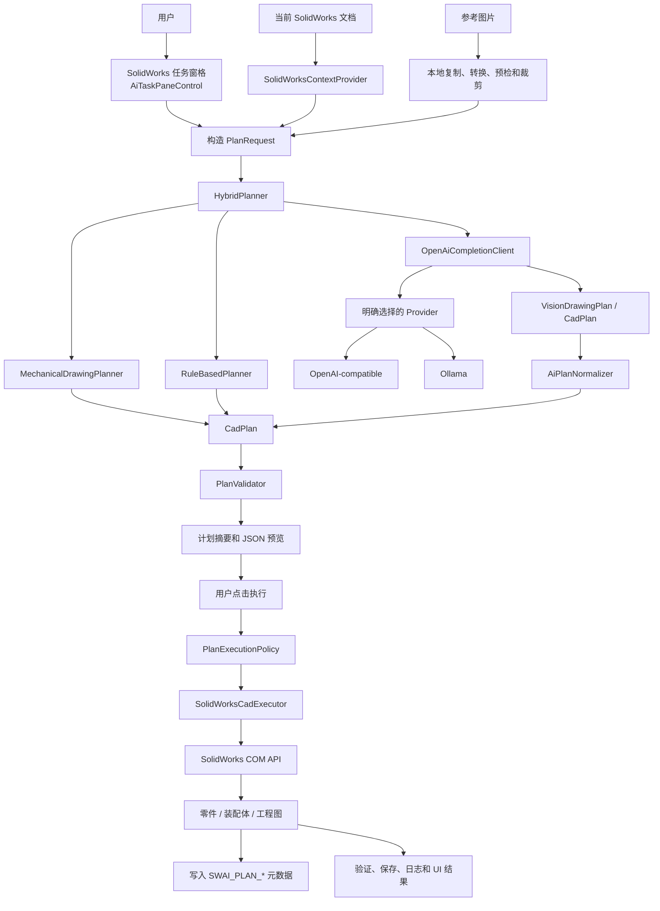
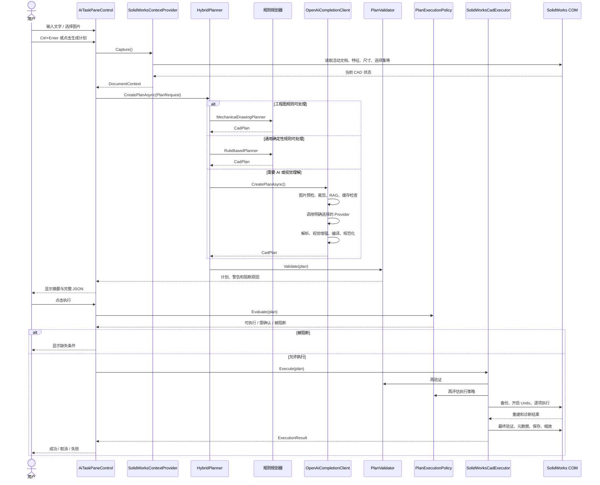
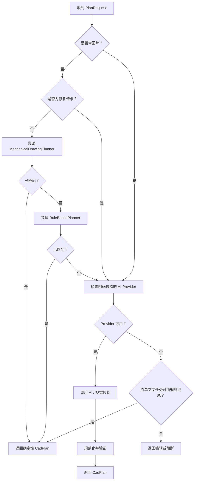
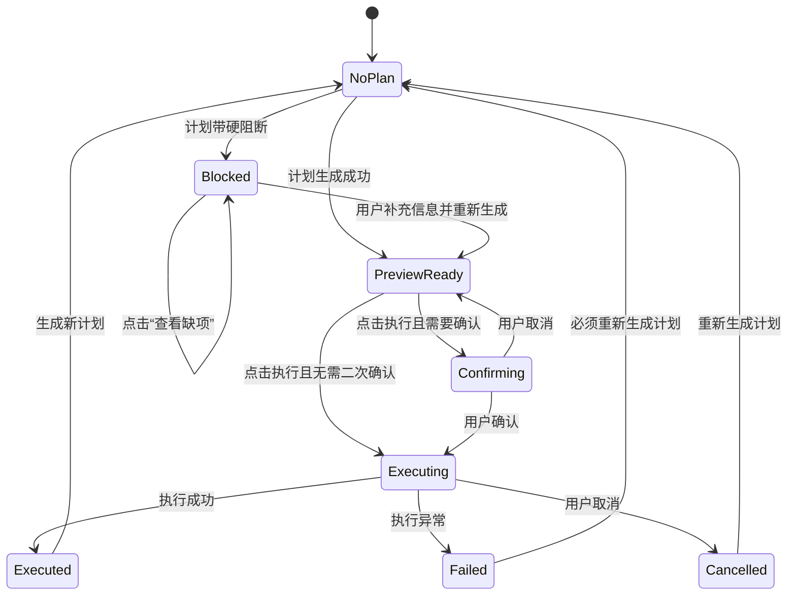

# SolidWorks AI Assistant 用户对话工作流

> 文档对象：`D:\solidworks\SolidWorksAiAssistant`  
> 运行时工作区：`D:\solidworks\AI-Workspace`  
> 整理日期：2026-08-16  
> 文档目的：说明用户在 SolidWorks 任务窗格中输入文字、选择图片、生成计划、确认执行、继续修改时，系统内部真实发生的完整工作流。

---

## 0. 与 dsh-solidwork 的关系

本文描述的 `D:\solidworks\SolidWorksAiAssistant` 是参考实现，不是
`D:\dsh-solidwork` 的直接运行入口。新的 DSH 专用助手复用其结构化规划、安全确认、
Undo、工程图和验证经验，但运行链路改为：

```text
DeepSeek Harness
    -> solidworks-cad preset 与 policy
    -> 9 个高层 mcp__solidworks__ 工具
    -> Python 任务编排、文档身份锁、备份、确认与验证
    -> SolidPilot 编译器和 C# 执行服务
    -> SolidWorks COM
```

DSH 模型只能调用：

`start_job`、`inspect_state`、`submit_feature_graph`、
`apply_document_edits`、`drawing_workflow`、`save_or_export`、
`request_confirmation`、`confirm_action`、`finish_job`。

本文后续的 Taskpane、`CadPlan`、Planner 和 Provider 细节仍用于理解原实现。
它们不应被误写成 DSH 九工具链的实际组件。DSH 的当前事实源是：

- `D:\dsh-solidwork\mcp-server-solidworks-main\adapters\dsh\server.py`
- `D:\dsh-solidwork\mcp-server-solidworks-main\adapters\dsh\orchestrator.py`
- `D:\dsh-solidwork\dsh-integration\presets\solidworks-cad\skills\solidworks-cad\SKILL.md`

---

## 1. 文档范围

本文重点回答以下问题：

1. SolidWorks 插件如何启动并创建 AI 任务窗格。
2. 用户的一次文字或图片指令如何转换为 `PlanRequest`。
3. 系统如何读取当前 SolidWorks 文档，给本次规划提供上下文。
4. 规则规划器、机械工程图规划器和远程/本地 AI Provider 如何分流。
5. 工程图图片如何经过预检、裁剪、视觉理解和计划编译。
6. `CadPlan` 如何描述将要在 SolidWorks 中执行的动作。
7. 计划为什么必须经过多层验证，哪些情况会被阻断。
8. 用户在“确认模式”和“快速模式”下分别会看到什么。
9. SolidWorks COM 执行器如何创建或修改零件、装配体和工程图。
10. 执行失败时如何撤销、恢复原文档并记录诊断信息。
11. 用户继续发出修改指令时，系统如何理解“当前模型”和“上一次计划”。
12. 配置、API Key、图片、计划、备份和日志保存在哪里。

本文所说的“主应用工作流”专指：

```text
SolidWorks 任务窗格
    -> C# 规划层
    -> 计划校验层
    -> SolidWorks COM 执行层
```

`D:\solidworks\mcp` 下的 FurniOx SolidWorks MCP 是一个独立打包程序。当前主插件源码没有把它接入上述对话、规划和执行链，因此本文不会把 MCP 描述成主应用中的必经步骤。

---

## 2. 最重要的结论

### 2.1 这不是把全部聊天记录反复发送给模型的传统多轮聊天

任务窗格会在界面上保存用户消息、系统消息和执行结果，使用户看到一段连续对话；但 `_conversation` 主要负责界面展示。

每次点击“生成计划”时，系统创建的是一份新的 `PlanRequest`。此前所有对话消息不会作为完整消息历史自动拼入下一次模型请求。

后续指令能够理解“把刚才的孔改大”“在当前零件上再加一个槽”，主要依赖：

- 当前活动 SolidWorks 文档的实时状态；
- 当前文档中的特征、尺寸、材料、配置和选择集；
- 上一次成功执行后写入文档的 `SWAI_PLAN_JSON`；
- 对上一次计划生成的精简摘要；
- 用户本次输入的文字和图片。

因此，它更准确地说是：

> 以当前 CAD 文档为事实来源、以计划摘要为增量参考的连续工程操作界面。

而不是：

> 将整个自然语言聊天历史作为模型记忆的开放式聊天机器人。

### 2.2 用户输入不会直接驱动 SolidWorks COM

用户的自然语言首先被转换成结构化 `CadPlan`。只有经过预览、校验和执行策略检查后，白名单中的操作才会被分派到 SolidWorks COM API。

核心安全边界是：

```text
自然语言或图片
    != 直接执行 COM

自然语言或图片
    -> 结构化计划
    -> 白名单校验
    -> 几何预检
    -> 执行策略
    -> 用户确认
    -> COM 执行
```

### 2.3 快速模式仍然会显示计划预览

“快速模式”不是“收到用户消息后立即在 SolidWorks 中自动建模”。当前实现仍然会先生成计划、显示摘要和 JSON，再由用户点击执行。

快速模式主要减少正常执行前的二次确认步骤，不会跳过计划生成、计划预览和安全检查。

### 2.4 图片既可能在本地处理，也可能被发送给明确选择的 AI Provider

图片导入后会先复制到本地 AI 工作区并进行本地预检、缩放和裁剪。

如果最终由 OpenAI-compatible 或 Ollama Provider 完成视觉规划，经过处理的图片会被编码到模型请求中。因此，界面中的“仅本地处理”不能被理解为“图片在任何配置下都不会发送给远程服务”。

是否离开本机取决于当前选择的 Provider 和它实际指向的服务地址。

### 2.5 自动修复代码存在，但当前用户执行主链没有调用

`AiTaskPaneControl` 中实现了 `TryHealPlanAsync()`，并设置了最多两轮修复；但是当前 `ExecuteCurrentPlanCore()` 没有调用它。

所以现行行为是：

- 执行失败后显示失败结果；
- 尝试撤销本轮 CAD 更改；
- 原计划不能直接原样重试；
- 用户需要重新生成计划。

不能把预留的修复方法描述成已经自动参与每次失败恢复。

---

## 3. 项目边界和主要目录

### 3.1 源码目录

主应用位于：

```text
D:\solidworks\SolidWorksAiAssistant
```

主要组成可以概括为：

| 组成 | 责任 |
|---|---|
| Add-in 项目 | 注册并连接 SolidWorks，创建任务窗格，处理 UI 事件，调用规划器和执行器 |
| Core 项目 | 计划模型、规划器接口、规则规划、AI 请求、计划规范化、校验和公共领域逻辑 |
| Smoke Tests | 不启动真实 SolidWorks 的快速测试 |
| Integration Harness | 通过真实 SolidWorks COM 验证计划执行 |
| docs | 领域术语、设计约束和维护说明 |

### 3.2 运行时工作区

默认或当前配置使用：

```text
D:\solidworks\AI-Workspace
```

运行时文件集中在该工作区内，典型目录包括：

| 目录 | 用途 |
|---|---|
| `Plans` | 保存生成并进入执行阶段的计划 JSON |
| `Images` | 保存用户导入的参考图片及转换后的图片 |
| `Backups` | 修改当前文档前创建的备份 |
| `Recovery` | 恢复相关文件 |
| `Diagnostics` | 运行时诊断产物 |
| `IntegrationTests` | 集成测试产物 |
| `Benchmarks` | 性能或样例基准产物 |
| `Training` | 训练或样例数据 |

CAD 文件、工程图文件和导出文件也必须落在被允许的 AI 工作区范围内。

### 3.3 独立 MCP 项目

```text
D:\solidworks\mcp
```

该目录中的 MCP 程序与本文描述的 `SolidWorksAiAssistant` 主插件不是同一条调用链。

除非以后主插件显式增加 MCP 客户端调用，否则应保持以下边界：

```text
主插件：WinForms -> Planner -> Validator -> SolidWorks COM
MCP：独立程序，不是当前主插件对话流程的中间层
```

---

## 4. 技术栈

| 层 | 技术 |
|---|---|
| SolidWorks Add-in | .NET Framework 4.8、x64 |
| 用户界面 | WinForms、SolidWorks Taskpane |
| CAD 集成 | SolidWorks COM Interop |
| Core | .NET Standard 2.0 |
| JSON | Newtonsoft.Json |
| Smoke Tests | .NET 8 |
| Integration Harness | .NET Framework 4.8、真实 SolidWorks COM |
| AI Provider | OpenAI-compatible Chat Completions 或 Ollama Chat |

插件必须运行在与 SolidWorks COM 环境兼容的 Windows、x64 和 .NET Framework 进程中。

---

## 5. 总体架构



架构中的关键思想是：

1. UI 只负责收集用户意图和呈现状态。
2. Planner 只负责形成计划，不直接操作 SolidWorks。
3. Validator 和 Execution Policy 决定计划是否具备执行资格。
4. Executor 只接受结构化、受约束、白名单化的操作。
5. 当前 CAD 文档既是执行对象，也是后续对话的主要上下文。

---

## 6. 一次用户对话的完整生命周期

一次典型指令从开始到结束可拆为以下阶段：

1. 用户在任务窗格输入文字，或选择参考图片。
2. 用户按 `Ctrl+Enter` 或点击“生成计划”。
3. UI 检查输入，清空上一份待执行计划的运行状态。
4. `SolidWorksContextProvider` 捕获当前活动文档。
5. UI 构造新的 `PlanRequest`。
6. `HybridPlanner` 判断应走工程图规则、通用规则还是 AI Provider。
7. 规划器返回 `CadPlan`。
8. `PlanValidator` 检查计划结构和操作参数。
9. UI 显示计划摘要、完整 JSON、假设和阻断原因。
10. 用户检查计划并点击执行。
11. UI 使用计划指纹防止同一计划重复执行。
12. `PlanExecutionPolicy` 再次决定是否允许执行、是否必须确认、是否允许草稿绕过。
13. `SolidWorksCadExecutor` 获取全局执行锁。
14. 执行器再次验证计划并将计划保存到工作区。
15. 执行器创建目标文档，或选择当前活动文档。
16. 如果修改当前文档且启用备份，先保存并备份。
17. 执行器开启 SolidWorks Undo object。
18. 按依赖顺序逐项调用白名单 COM 执行方法。
19. 每一步前后重建并扫描 SolidWorks 错误。
20. 全部操作完成后进行最终重建和模型/工程图验证。
21. 写入 `SWAI_PLAN_*` 自定义属性。
22. 根据配置自动保存，并执行 Zoom to Fit。
23. UI 更新对话区、状态栏和执行按钮状态。
24. 用户的下一条指令再次从一个新的 `PlanRequest` 开始。

---

## 7. 端到端时序图



---

## 8. 插件启动工作流

### 8.1 SolidWorks 加载 Add-in

插件入口是：

```text
SwAiAddin.ConnectToSW()
```

启动阶段负责：

1. 接收 SolidWorks 应用对象和 Add-in Cookie。
2. 初始化日志和配置。
3. 加载用户设置。
4. 确保配置目录、日志目录和 AI 工作区存在。
5. 等待 SolidWorks 主程序完成必要的启动过程。
6. 创建任务窗格。
7. 在任务窗格中嵌入 `AiTaskPaneControl`。
8. 初始化规划器、上下文捕获器和执行器所需依赖。

SolidWorks 启动尚未完全稳定时，插件采用延迟初始化，避免在 COM UI 尚未准备好时过早创建任务窗格。

### 8.2 创建任务窗格

关键方法：

```text
SwAiAddin.InitializeTaskpane()
```

该方法创建 SolidWorks `TaskpaneView`，再将 WinForms `AiTaskPaneControl` 嵌入其中。

任务窗格是用户对话工作流的总入口。自然语言输入、图片导入、计划预览、执行按钮、设置和状态消息都由这个控件承载。

### 8.3 插件卸载

关键方法：

```text
SwAiAddin.DisconnectFromSW()
```

卸载时需要：

- 释放任务窗格控件；
- 释放 SolidWorks COM 对象；
- 解除事件和托管资源；
- 避免 COM 引用残留导致 SolidWorks 退出后仍有后台进程。

---

## 9. 用户界面组成

`AiTaskPaneControl` 主要包含三个页面：

| 页面 | 作用 |
|---|---|
| 对话页 | 输入指令、选择图片、查看消息和生成计划 |
| 执行计划页 | 查看计划摘要、JSON、假设、阻断原因和执行状态 |
| 设置页 | Provider、模型、工作区、确认模式、工程图标准等配置 |

### 9.1 快捷提示

界面提供的典型快捷入口包括：

- 轴；
- 齿轮；
- 机架；
- 尺寸补视图；
- 无尺寸补视图；
- A3 零件图；
- 检查图纸；
- 图片。

快捷提示的本质是帮助用户快速填入受支持的工程意图。它们不会绕过正常的计划生成、验证和执行流程。

### 9.2 计划显示区域

规划完成后，界面显示：

- `Plan.ToSummary()` 生成的可读摘要；
- 完整计划 JSON；
- 计划来源；
- 假设；
- 执行资格；
- 阻断原因；
- 执行按钮及当前状态。

计划预览是人和系统之间的重要边界：用户可以在 SolidWorks 真正发生修改之前，看到系统准备执行什么。

---

## 10. 用户输入入口

### 10.1 文字输入

用户可以：

- 在输入框中输入自然语言；
- 使用快捷提示填入常用请求；
- 按 `Ctrl+Enter`；
- 点击“生成计划”按钮。

核心入口：

```text
AiTaskPaneControl.GeneratePlanAsync()
```

### 10.2 仅图片输入

如果用户没有输入文字，但已经选择图片，系统会补充一个默认意图：

```text
根据参考图片创建可编辑的参数化零件
```

这使纯图片输入仍可以进入规划流程。

默认提示只是意图补全，不代表图片中缺少的制造尺寸可以被系统随意编造。是否可执行仍取决于图片语义、补视图模式和后续验证。

### 10.3 生成新计划前的 UI 清理

每次开始新规划时，UI 会清理上一份待执行计划相关的临时状态，包括：

- 当前计划引用；
- 当前计划的执行指纹；
- 上一次执行结果；
- 执行按钮的成功或失败状态。

这样可以避免将上一份计划的执行状态误用到新计划上。

已经成功写入 SolidWorks 文档的计划元数据不会因此消失，后续上下文仍可从当前文档读取。

---

## 11. 图片导入工作流

核心入口：

```text
AiTaskPaneControl.SelectImage()
```

### 11.1 文件选择和大小限制

用户选择图片后，系统首先检查：

- 文件是否存在；
- 文件大小是否超过 20 MB；
- 文件格式是否可以读取。

超过限制的图片不会进入规划流程。

### 11.2 复制到工作区

图片不会长期依赖原始位置。系统将其复制到：

```text
<AI-Workspace>\Images
```

这样可以：

- 保留本次任务使用的输入；
- 避免原文件移动后计划无法复现；
- 让后续预检、缩放和模型请求使用受控路径；
- 将运行时产物集中在工作区。

### 11.3 格式转换

对于不适合直接进入后续视觉请求的格式：

- BMP 转为 PNG；
- GIF 转为 PNG；
- TIFF 转为 PNG。

其他受支持格式通常保留原格式。

### 11.4 图片预处理

进入 AI 视觉规划前，系统会：

1. 读取图片基本信息。
2. 记录文件名和大小。
3. 计算 SHA256，并在日志中记录哈希前缀。
4. 运行 `EngineeringDrawingPreflight.Analyze`。
5. 生成缩放后的完整页面图。
6. 识别并裁剪主视图区。
7. 裁剪最多三个正投影视图区。
8. 尝试裁剪 BOM 或标题栏区域。
9. 将预检结果、图纸知识和本地 RAG 资料加入模型上下文。

这里的“视图区”是图纸页面中的一个视觉区域；“视图角色”是主视图、俯视图、左视图、右视图、剖视图等语义角色。两者不能混为一谈。

### 11.5 图片隐私边界

本地阶段包括：

- 文件复制；
- 格式转换；
- 哈希计算；
- 工程图预检；
- 页面缩放；
- 视图区裁剪；
- 本地 RAG 检索。

Provider 阶段可能包括：

- 将完整页面或裁剪图编码进 OpenAI-compatible 请求；
- 将图片放入 Ollama Chat 的图像字段；
- 将图片发送到设置中配置的服务地址。

因此，隐私判断应基于 Provider 配置：

| Provider 指向 | 图片流向 |
|---|---|
| 本机 Ollama | 通常只到本机 Ollama 服务 |
| 内网 OpenAI-compatible 服务 | 发送到配置的内网地址 |
| 公网 OpenAI-compatible 服务 | 发送到对应公网服务 |

---

## 12. `PlanRequest` 的构造

每次生成计划时，UI 构造一个新的 `PlanRequest`，核心字段为：

```text
Prompt
ImagePath
DocumentContext
ConfirmationMode
OrthographicCompletionMode
```

概念上可以表示为：

```json
{
  "prompt": "在当前零件的上表面增加两个直径 8 mm 的通孔",
  "image_path": "D:\\solidworks\\AI-Workspace\\Images\\reference.png",
  "document_context": {
    "document_type": "part",
    "document_title": "BasePlate",
    "features": [],
    "dimensions": [],
    "selection": [],
    "previous_ai_plan": {}
  },
  "confirmation_mode": "fast",
  "orthographic_completion_mode": "dimension_constrained"
}
```

以上只是结构示意；实际序列化字段以源码模型为准。

### 12.1 `ConfirmationMode`

确认模式影响计划执行前的交互：

| 模式 | 行为 |
|---|---|
| 确认模式 | 正常计划在用户点击执行后还会出现一次确认 |
| 快速模式 | 仍显示计划预览，但通常省去正常计划的第二次确认 |

任何模式都不会跳过硬阻断、计划验证和执行策略。

### 12.2 `OrthographicCompletionMode`

补视图有两种主要模式：

| 模式 | 标识 | 含义 |
|---|---|---|
| 尺寸约束补全 | `dimension_constrained` | 只有尺寸和视图语义足以唯一重建时，才允许生成可制造的参数化结果 |
| 无尺寸补视图 | `view_only` | 可以按可见比例和拓扑补齐正投影视图，但不得宣称具有制造尺寸 |

关键区别是：

- `dimension_constrained` 追求由工程信息约束的唯一重建；
- `view_only` 追求视觉和投影拓扑的一致，不保证制造尺寸。

---

## 13. 当前 SolidWorks 文档上下文

核心入口：

```text
SolidWorksContextProvider.Capture()
```

规划器不是只看用户的一句话。每次生成计划前，插件会从当前 SolidWorks 会话读取一份快照。

### 13.1 基础文档信息

上下文通常包含：

- 活动文档标题；
- 文档类型；
- 保存路径；
- 单位；
- 当前配置；
- 材料；
- 文档是否已保存。

### 13.2 零件上下文

对零件文档可读取：

- 特征树；
- 最多约 120 个特征；
- 特征名称；
- 特征类型；
- 抑制状态；
- 最多约 160 个显示尺寸；
- 尺寸名称；
- 尺寸当前值；
- 当前配置；
- 材料；
- 外部引用。

数量上限是防止大型模型的上下文无限膨胀，不表示 SolidWorks 文档本身只能有这些对象。

### 13.3 装配体上下文

对装配体可读取：

- 组件；
- 组件名称；
- 组件路径；
- 组件配置；
- 抑制状态；
- 外部引用；
- 当前选择集。

### 13.4 工程图上下文

对工程图可读取：

- 图纸和视图；
- 视图名称；
- 视图引用的模型；
- 视图角色或方向信息；
- 当前选择集；
- 已有工程图结构。

### 13.5 当前选择集

核心逻辑：

```text
SolidWorksContextProvider.AppendSelectionContext()
```

用户在 SolidWorks 图形区或特征树中明确选中的对象会被加入上下文，例如：

- 面；
- 边；
- 顶点；
- 特征；
- 组件；
- 工程图视图；
- 尺寸。

这让“在这个面上打孔”“修改我选中的尺寸”具有更明确的指向。

如果选择集为空，规划器不能假设用户选中了某个对象。

### 13.6 上一次 AI 计划

成功执行后，计划被写入文档自定义属性。下一次捕获上下文时：

```text
SolidWorksContextProvider.AppendAiPlanContext()
```

会读取上一次计划，并通过 `PlanHistorySummarizer` 形成精简摘要。

摘要会限制体积，例如：

- 最多展开约 12 个操作；
- 每个操作最多展开约 14 个输入。

摘要会明确提醒规划器：

> 上一次计划用于理解当前模型和增量修改，不得在当前文档中重复创建已有主体。

这条约束对连续修改非常重要。

---

## 14. “连续对话”的真实语义

### 14.1 UI 消息历史

`_conversation` 保存并显示：

- 用户输入；
- 系统状态；
- 计划生成结果；
- 执行成功消息；
- 取消消息；
- 失败消息。

它给用户提供连续的操作记录和反馈。

### 14.2 规划输入

下一次规划真正依赖的是：

```text
本次 Prompt
+ 本次 ImagePath
+ 本次捕获的 DocumentContext
+ 当前模式设置
```

不是：

```text
从第一条消息开始的完整聊天记录
```

### 14.3 连续修改为什么仍然可行

假设第一次用户输入：

```text
创建一个直径 30 mm、长度 100 mm 的阶梯轴
```

成功执行后：

- SolidWorks 中已经存在实体、特征和尺寸；
- 文档中写有上一次计划；
- 上一次计划摘要会说明已经创建了轴主体；
- 当前文档尺寸可以被再次读取。

第二次用户输入：

```text
把中间轴段直径改成 35 mm
```

新规划器看到的是：

- 当前是一个零件文档；
- 当前特征和尺寸是什么；
- 上一次计划创建过哪些操作；
- 用户本次要求修改尺寸。

因此正确计划应生成 `modify_dimension` 一类增量操作，而不是重新执行 `create_shaft`。

### 14.4 文档状态优先于聊天印象

如果用户在两次 AI 指令之间手动修改了 SolidWorks 模型，下一次捕获到的文档状态会反映该变化。

这意味着当前 CAD 文档是事实来源。上一次计划只是解释模型来源和辅助增量规划的参考，不能覆盖当前实际模型状态。

---

## 15. `HybridPlanner` 路由

核心入口：

```text
HybridPlanner.CreatePlanAsync()
```

路由优先级如下：

1. 无图片、不是修复请求时，先尝试 `MechanicalDrawingPlanner`。
2. 无图片、不是修复请求时，再尝试 `RuleBasedPlanner`。
3. 确定性规划器不能处理时，检查用户明确选择的 AI Provider。
4. Provider 可用时，调用该 Provider。
5. Provider 不可用时，仅简单文字任务可能回退到确定性规则。
6. 图片任务或复杂任务没有可用 Provider 时直接报错。
7. AI 返回计划后运行 `PlanValidator`。
8. AI 参数校验失败时保留计划预览，并把错误加入 `BlockingReasons`。

### 15.1 路由决策图



### 15.2 不自动切换 Provider

系统尊重用户在设置页明确选择的 Provider。

例如：

- 用户选择 OpenAI-compatible，但服务不可用；
- 系统不会静默切到 Ollama；
- 用户选择 Ollama，但模型不存在；
- 系统不会静默把图片发送到公网 Provider。

这种设计避免了不可见的数据流向变化。

---

## 16. `MechanicalDrawingPlanner`

`MechanicalDrawingPlanner` 处理可以由明确规则描述的工程图任务。

典型能力包括：

- 根据当前模型创建工程图；
- 创建标准正投影视图；
- 创建轴测图；
- 创建剖视图；
- 创建局部放大图；
- 插入模型标注；
- 添加中心标记；
- 添加 BOM；
- 检查工程图；
- 导出工程图。

### 16.1 规则规划的价值

对意图明确、输入结构稳定的任务，规则规划具有以下优势：

- 不需要调用 AI Provider；
- 结果可重复；
- 操作和参数更容易审计；
- 不受模型输出格式波动影响；
- 更适合标准化制图流程。

### 16.2 工程信息边界

规则规划器不会凭空编造：

- 公差；
- 表面粗糙度；
- 热处理要求；
- 技术要求；
- 缺失的制造尺寸。

如果用户没有提供这些信息，计划应保留缺项、假设或阻断，而不是填写看似合理的默认工程值。

---

## 17. `RuleBasedPlanner`

`RuleBasedPlanner` 处理一组受支持的参数化建模和修改意图。

典型支持范围：

- 轴；
- 直齿轮；
- 机架；
- 矩形块；
- 圆柱；
- 尺寸修改。

### 17.1 参数提取

规则规划器会从中文自然语言中识别：

- 长度；
- 宽度；
- 高度；
- 直径；
- 半径；
- 模数；
- 齿数；
- 压力角；
- 轴段；
- 尺寸修改目标。

提取后生成白名单操作及其输入。

### 17.2 缺少关键参数

缺少关键工程参数时，规则规划器不会随意补默认值。

例如用户只说：

```text
创建一个齿轮
```

如果模数、齿数或其他必需参数不足，规划器应返回不可执行计划，并在 `BlockingReasons` 中说明缺什么。

### 17.3 斜齿轮限制

当前执行能力对斜齿轮不完整。识别到斜齿轮意图时，应明确阻断，而不是用直齿轮结果冒充斜齿轮。

---

## 18. AI 规划入口

核心方法：

```text
OpenAiCompletionClient.CreatePlanAsync()
```

AI 规划既处理复杂文字任务，也处理参考图片和工程图。

整体步骤为：

1. 构建系统提示。
2. 构建用户上下文。
3. 有图片时执行视觉预处理。
4. 注入工程图知识和本地 RAG。
5. 检查特定几何的本地确定性工厂。
6. 检查计划缓存。
7. 调用明确选择的 Provider。
8. 通过 JSON Schema 约束输出。
9. 对临时网络错误进行有限重试。
10. 对截断或损坏 JSON 请求一次修复。
11. 解析普通 `CadPlan` 或紧凑视觉 IR。
12. 对视觉 IR 进行增强和编译。
13. 在必要时做一次受控视觉复核。
14. 运行 `AiPlanNormalizer`。
15. 缓存可复用计划。

---

## 19. AI 系统提示和用户上下文

系统提示负责告诉模型：

- 只能生成规定 JSON 结构；
- 只允许使用操作白名单；
- 单位使用 mm；
- 不得编造关键制造尺寸；
- 必须表达依赖；
- 必须标记假设和阻断；
- 当前文档修改应采用增量操作；
- 工程图视图必须遵守视图角色、投影法和投影拓扑；
- 无尺寸补视图不能宣称是制造级重建。

用户上下文包含：

- 用户本次文字；
- 当前模式；
- 当前文档快照；
- 选中对象；
- 上一次计划摘要；
- 图片预检信息；
- 图片或裁剪图；
- 本地检索到的工程知识。

系统提示定义“怎样回答”，用户上下文定义“这次要解决什么”。

---

## 20. 工程图视觉预检

`EngineeringDrawingPreflight.Analyze` 在正式模型请求前分析图片。

预检并不直接完成最终建模，而是为视觉模型提供结构化提示和更高质量的局部图像。

### 20.1 预检目标

预检尝试识别：

- 页面边界；
- 主视图区；
- 多个正投影视图区；
- 标题栏；
- BOM；
- 图像宽高和清晰度；
- 可能的工程图布局。

### 20.2 为什么要裁剪

直接把整张高分辨率图纸交给视觉模型，容易出现：

- 小尺寸文字无法识别；
- 视图间关系被忽略；
- 标题栏占用视觉注意力；
- 正投影视图角色混淆；
- token 和延迟增加。

因此请求中既保留缩放后的完整页面，也加入关键区域裁剪，让模型同时获得：

- 全局布局；
- 局部几何；
- 尺寸和注释；
- 视图之间的空间关系。

### 20.3 正投影视图语义

系统需要区分：

- 主视图；
- 俯视图；
- 仰视图；
- 左视图；
- 右视图；
- 后视图；
- 轴测图；
- 剖视图；
- 局部视图。

还需要识别采用的是：

- 第一角投影；
- 第三角投影。

投影法决定各视图在页面上的相对位置。仅凭“左边有一个视图”不能直接断言它就是左视图。

### 20.4 投影拓扑

投影拓扑是不同视图中的边、孔、轮廓和高度变化之间的对应关系。

例如：

- 主视图中的圆孔，在俯视图中可能表现为两条隐藏线；
- 俯视图中的外轮廓台阶，需要和主视图中的高度台阶一致；
- 左右视图中的孔轴方向必须与其他视图一致。

视觉规划不能只复制每个视图的二维线条，还必须形成一个能够同时解释多个视图的三维实体。

---

## 21. 本地 RAG 和特定确定性计划

### 21.1 本地 RAG

系统会把与三视图、工程制图和当前图纸特征相关的本地知识加入模型上下文。

RAG 的作用是补充：

- 视图判断规则；
- 投影关系；
- 常见机械结构；
- 输出计划约束；
- 工程图语义。

RAG 不是 CAD 执行器，也不会绕过计划验证。

### 21.2 `ClevisBracketPlanFactory`

对特定叉架/叉耳支架类图纸，系统可以走本地确定性计划工厂。

该分支用于：

- 识别已知结构；
- 用受控参数形成计划；
- 减少通用视觉模型对复杂叉形轮廓的误解；
- 提高可重复性。

它只是特定结构的优化分支，不代表所有图片都可由本地规则重建。

---

## 22. Provider 调用

支持两类 Provider：

### 22.1 OpenAI-compatible

通过兼容的：

```text
/chat/completions
```

端点发送请求。

服务地址、模型名和 API Key 来自用户配置。

### 22.2 Ollama

通过 Ollama Chat 接口发送：

- 系统提示；
- 用户上下文；
- 必要图片；
- JSON 输出要求。

### 22.3 JSON Schema 约束

模型被要求输出符合计划结构的 JSON。

Schema 约束可以减少：

- 缺字段；
- 字段类型错误；
- 自由文本混入；
- 非白名单操作；
- 参数结构不一致。

Schema 不能替代本地验证。模型返回后仍必须经过 `PlanValidator`、几何预检和执行策略。

---

## 23. AI 请求重试和恢复

### 23.1 临时网络错误

对临时 HTTP 或网络错误，系统只进行一次有限重试。

这样可以处理偶发连接问题，同时避免在 Provider 持续不可用时无限阻塞 UI。

### 23.2 JSON 损坏或截断

如果模型响应看起来是：

- JSON 截断；
- 括号不完整；
- 内容损坏；
- 无法反序列化；

系统会额外请求一次完整 JSON。

这一步是“重新获取合法计划文本”，不等于执行失败后的 CAD 自动修复。

### 23.3 缓存

AI 计划缓存特征：

- 有效期约 10 分钟；
- 最多约 4 项；
- 缓存键由输入和上下文关键部分形成；
- 命中时可以复用相同规划结果。

缓存只减少重复模型请求。计划在执行前仍要经过本地校验和执行策略。

---

## 24. 视觉中间表示 `VisionDrawingPlan`

图片任务不一定直接返回最终 `CadPlan`。系统可以先解析成更紧凑的视觉工程图中间表示：

```text
VisionDrawingPlan
```

这层 IR 用于表达：

- 识别出的视图；
- 各视图角色；
- 投影法；
- 外轮廓；
- 孔、槽、凸台和切除；
- 尺寸或比例推断；
- 视图之间的对应；
- 不确定性；
- 可制造性边界。

### 24.1 视觉增强

```text
VisionDrawingEnhancer.Apply()
```

负责对原始视觉 IR 进行受控补强，例如：

- 规范化视图角色；
- 补充明显的对称关系；
- 整理特征语义；
- 合并重复描述；
- 标记推断来源；
- 为编译阶段准备一致输入。

增强不能凭空发明缺失制造尺寸。

### 24.2 编译为 `CadPlan`

```text
VisionPlanCompiler.Compile()
```

将视觉 IR 转换成可执行计划：

- 选择基础主体操作；
- 生成轮廓、凸台、孔、槽和口袋；
- 建立操作依赖；
- 根据补视图模式决定执行资格；
- 生成 `drawing_analysis`；
- 生成 `drawing_specification`；
- 记录 `inferences`；
- 生成 `view_completion`。

### 24.3 受控视觉复核

如果初次视觉结果缺少关键视图语义，系统最多进行一次受控复核。

复核重点不是让模型完全重写一切，而是补充：

- 哪个视图区是什么视图角色；
- 使用何种投影法；
- 哪些特征在多个视图中对应；
- 哪些尺寸或几何关系仍不确定。

---

## 25. 无尺寸补视图和唯一重建

这是图片工作流中最容易被误解的部分。

### 25.1 尺寸约束模式

`dimension_constrained` 要求输入足以唯一确定三维模型。

“唯一重建”意味着：

- 不是只有一种看起来相似的外形；
- 所有关键长度、宽度、高度、直径和位置可确定；
- 多个正投影视图之间无矛盾；
- 生成的三维实体能解释所有已知视图；
- 结果可以作为制造尺寸模型继续使用。

如果存在多种不同三维实体都能产生相同可见投影，或者关键尺寸缺失，计划必须阻断。

### 25.2 视图补全模式

`view_only` 允许按图片比例和投影关系形成一个可视化三维解释，再由 SolidWorks 投影生成缺失视图。

这类结果必须明确：

- 尺寸来自比例估计或视觉推断；
- 不可用于加工；
- 不能作为制造尺寸依据；
- 主要用途是补齐视图和辅助理解。

### 25.3 正确的补视图方式

系统不是直接在二维图纸上随意画几条线，而是优先：

1. 根据已有视图重建参数化三维实体。
2. 在 SolidWorks 中生成实体。
3. 由 SolidWorks 的投影机制生成正投影视图。

这样更容易保持：

- 轮廓一致；
- 孔位一致；
- 隐藏线一致；
- 视图比例一致；
- 投影拓扑一致。

---

## 26. `CadPlan` 数据结构

核心模型位于：

```text
CadPlan.cs
```

主要字段：

| JSON 字段 | 含义 |
|---|---|
| `plan_id` | 计划唯一标识 |
| `name` | 计划名称 |
| `intent` | 对用户目标的结构化概括 |
| `units` | 计划单位，当前只允许 mm |
| `target_document` | `part`、`assembly`、`drawing` 或 `current` |
| `requires_confirmation` | 是否要求确认 |
| `assumptions` | 计划采用的假设 |
| `operations` | 按顺序执行的操作 |
| `validations` | 计划建议或要求的验证 |
| `source` | 规则、本地工厂或远程 AI 等来源 |
| `execution_ready` | 是否具备直接执行资格 |
| `blocking_reasons` | 阻止执行的原因 |
| `drawing_analysis` | 对输入工程图的分析 |
| `drawing_specification` | 结构化工程图规格 |
| `inferences` | 从图片或上下文推断出的内容 |
| `view_completion` | 补视图模式、视图角色和完成策略 |

### 26.1 操作结构

每个操作通常包括：

- 操作 ID；
- 操作类型；
- 输入参数；
- 依赖的前序操作；
- 可选说明或验证信息。

概念示例：

```json
{
  "id": "hole_1",
  "type": "add_hole",
  "depends_on": ["base_1"],
  "inputs": {
    "diameter_mm": 8,
    "depth_mode": "through_all",
    "x_mm": 20,
    "y_mm": 15
  }
}
```

### 26.2 操作依赖

依赖必须指向已经出现的前序操作。

例如：

```text
create_profiled_plate
    -> add_profiled_boss
    -> add_hole
    -> complete_orthographic_views
```

依赖用于表达：

- 哪个操作创建主体；
- 哪个特征建立在主体之上；
- 哪个工程图操作依赖最终几何；
- 执行失败时问题发生在哪个阶段。

---

## 27. 操作白名单

计划只能使用 `CadPlan.cs` 中定义的操作类型。

以下按领域归类说明，不代表每个操作的精确源码枚举名称都使用相同中文。

### 27.1 主体创建

- 创建矩形块；
- 创建圆柱；
- 创建轴；
- 创建直齿轮；
- 创建机架；
- 创建轮廓板；
- 创建叉架/叉耳类主体。

### 27.2 零件特征

- 添加孔；
- 添加圆形缺口；
- 添加孔阵列；
- 添加槽；
- 添加凸台；
- 添加轮廓凸台；
- 添加口袋或切除。

### 27.3 修改操作

- 修改尺寸；
- 重命名特征或对象；
- 抑制；
- 解除抑制。

### 27.4 装配操作

- 创建或处理装配文档；
- 插入组件；
- 配置装配关系；
- Toolbox 相关操作；
- 检查装配干涉。

### 27.5 工程图操作

- 创建工程图；
- 添加模型视图；
- 添加标准正投影视图；
- 添加轴测图；
- 添加剖视图；
- 添加局部放大图；
- 补齐正投影视图；
- 插入尺寸和模型标注；
- 添加中心标记；
- 创建 BOM；
- 添加气泡；
- 创建爆炸图相关输出；
- 检查工程图。

### 27.6 输出操作

- 保存文档；
- 导出指定格式；
- 生成工程图输出。

任何模型生成的未知操作都不会因为“名字看起来合理”就被执行。

---

## 28. 第一层安全校验：`PlanValidator`

`PlanValidator` 负责计划结构和参数的基础合法性。

### 28.1 顶层约束

检查内容包括：

- 单位只允许 `mm`；
- `target_document` 只允许 `part`、`assembly`、`drawing`、`current`；
- 操作数量不能超过设置上限；
- 操作 ID 必须唯一；
- 操作类型必须在白名单中；
- 计划字段必须完整。

### 28.2 依赖约束

每个操作的依赖必须：

- 指向存在的操作；
- 指向当前操作之前的操作；
- 不能形成循环；
- 与主体和特征的创建顺序相符。

### 28.3 数值约束

数值必须：

- 是有限值；
- 不是 `NaN`；
- 不是正负无穷；
- 位于安全范围；
- 满足该操作的几何和工程约束。

### 28.4 操作专用参数

每类操作都有自己的必需输入，例如：

- 圆柱需要有效直径和高度；
- 孔需要有效直径、位置和深度模式；
- 齿轮需要可支持的类型和必要参数；
- 轮廓操作需要合法的点集或段集；
- 修改尺寸需要可以定位的目标尺寸；
- 工程图操作需要模型或前序几何来源。

### 28.5 AI 计划验证失败

AI 返回的 JSON 即使可以反序列化，也不表示可以执行。

验证失败时：

- 尽量保留计划用于 UI 预览；
- 将错误加入 `BlockingReasons`；
- 设置或保持 `execution_ready=false`；
- 用户可以看到模型理解了什么以及缺在哪里；
- COM 执行不会开始。

---

## 29. 第二层安全校验：`PlanGeometryPreflight`

几何预检处理仅靠 JSON 类型检查无法发现的问题。

### 29.1 唯一主体

对新建零件：

- 必须有且只有一个主体创建操作；
- 不能同时创建多个无关系的基础实体；
- 特征必须附着在该主体上。

最终执行后也会检查是否形成多个互不相连实体。

### 29.2 主体和特征顺序

孔、槽、凸台、口袋等特征必须：

- 位于主体操作之后；
- 依赖主体或前序几何；
- 不能在材料尚不存在时执行。

### 29.3 坐标和平面

不同草图平面不能在没有明确映射的情况下混用坐标。

例如：

- 前视基准面的二维坐标；
- 上视基准面的二维坐标；
- 右视基准面的二维坐标；

分别对应不同三维轴向。视觉模型如果把它们直接当成同一 XY 平面，会生成错误几何，预检应尽量阻止这种情况。

### 29.4 轮廓检查

包括：

- 轮廓是否闭合；
- 是否自交；
- 是否退化；
- 点和线段是否重复；
- 是否能形成有效草图区域。

### 29.5 特征是否位于材料内

孔、槽和口袋等切除特征需要检查：

- 中心是否位于有效材料范围；
- 外轮廓是否完整落在材料内；
- 深度是否合理；
- 是否会完全错过主体。

### 29.6 凸台是否悬空

添加凸台时检查它是否与已有材料接触。

如果凸台轮廓完全位于主体之外，拉伸后可能成为第二个互不相连实体，这通常不是单零件计划想要的结果。

### 29.7 孔位关系

检查孔之间是否：

- 完全重复；
- 一个包含另一个；
- 不合理相交；
- 超出边界；
- 因视觉重复识别而被添加两次。

### 29.8 补视图依赖

`complete_orthographic_views` 必须依赖此前所有几何特征。

否则可能在模型尚未完成时就生成视图，造成工程图与最终实体不一致。

---

## 30. 第三层安全校验：`PlanExecutionPolicy`

执行策略关注的不是“JSON 是否合法”，而是“在当前用户场景下是否允许执行”。

### 30.1 防止验证阶段修改原计划

策略会克隆计划并再次校验，避免为了判断是否可执行而污染 UI 中原始计划对象。

### 30.2 尺寸约束补视图

在 `dimension_constrained` 模式下，如果不能唯一重建：

- 禁止执行；
- 不允许使用草稿绕过；
- 必须向用户显示缺少的尺寸或视图条件。

### 30.3 仅分析计划

标记为：

```text
drawing_analysis_only
```

的计划只能展示分析，不能进入 CAD 执行。

### 30.4 新零件主体数量

新建零件必须恰好有一个主体创建操作。

这条规则同时存在于规划、几何预检和最终实体验证中，形成多层防线。

### 30.5 工程图必须手动预览

工程图计划始终先显示预览，再由用户触发执行。

即使处于快速模式，也不会在 AI 返回后直接修改工程图。

### 30.6 草稿绕过的适用范围

只有新建零件的部分非执行就绪计划可以在明确确认后作为草稿执行。

草稿绕过不适用于：

- 修改当前文档；
- 装配体；
- 工程图；
- 尺寸约束但不能唯一重建的补视图；
- 仅分析计划；
- 硬安全错误。

### 30.7 草稿计划如何处理

允许草稿执行时，策略会：

1. 把原阻断原因写入 `assumptions`。
2. 清空允许绕过的 blocker。
3. 重新运行校验。
4. 只有重新校验通过后才进入执行器。

这使“不确定性”不会被静默丢失。

---

## 31. 计划预览阶段

规划器返回后，UI 不会立刻调用 COM。

用户可以看到：

- 计划名称和意图；
- 目标文档；
- 操作数量；
- 操作顺序；
- 关键参数；
- 来源；
- 是否可执行；
- 假设；
- 阻断原因；
- 完整 JSON。

### 31.1 计划来源

计划来源可能包括：

- 机械工程图规则；
- 通用规则；
- 本地确定性工厂；
- 远程 AI；
- 本地 Ollama。

来源用于审计和日志，不应单独作为是否安全的判断。所有来源都必须走验证。

### 31.2 硬阻断计划

硬阻断计划仍会显示按钮，但按钮文案会变为：

```text
查看缺项
```

点击后只展示阻断原因，不会进入 COM 执行。

这种设计让用户可以理解：

- 缺什么参数；
- 哪个几何关系不确定；
- 为什么不能唯一重建；
- 需要怎样改写下一条指令。

---

## 32. 执行按钮状态机

核心入口：

```text
AiTaskPaneControl.ExecuteCurrentPlanCore()
```



### 32.1 计划指纹

UI 会计算并保存计划执行指纹。

指纹用于：

- 防止用户连续点击导致同一计划重复执行；
- 防止成功计划再次运行；
- 区分新生成的计划和已执行计划。

### 32.2 成功状态

执行成功后：

- 按钮变为“已执行”；
- 同一计划不会再次执行；
- 对话区添加成功消息；
- 状态栏显示执行结果；
- 当前文档已包含计划元数据。

### 32.3 失败状态

执行失败后：

- 按钮变为“查看失败”；
- 对话区显示错误摘要；
- 状态栏显示失败；
- 执行器尝试自动撤销；
- 原计划不能直接原样重试；
- 用户必须重新生成计划。

### 32.4 取消状态

用户取消时：

- 执行循环检测取消令牌；
- 执行器停止后续操作；
- 已经发生的本轮修改进入撤销流程；
- UI 显示取消结果。

### 32.5 快速模式与确认模式

| 条件 | 确认模式 | 快速模式 |
|---|---|---|
| 生成后是否显示计划 | 是 | 是 |
| 是否需要点击执行 | 是 | 是 |
| 正常计划是否二次确认 | 是 | 通常否 |
| 硬阻断是否可跳过 | 否 | 否 |
| 工程图是否自动执行 | 否 | 否 |
| 尺寸约束不唯一是否可草稿绕过 | 否 | 否 |

---

## 33. COM 执行事务

核心入口：

```text
SolidWorksCadExecutor.Execute()
SolidWorksCadExecutor.ExecuteCore()
```

执行器将整份计划视为一轮受控 CAD 事务。

### 33.1 全局执行锁

静态 `_executionGate` 防止多个计划同时操作同一个 SolidWorks 进程。

没有该锁时，两个任务可能同时：

- 改变活动文档；
- 修改选择集；
- 进入草图编辑；
- 调用重建；
- 写入文件；
- 建立 Undo 记录。

SolidWorks COM 和全局 UI 状态不适合这种并发。

### 33.2 执行前再次验证

即使 UI 已经验证过，执行器仍会再次运行：

- `PlanValidator`；
- `PlanExecutionPolicy`。

这是为了防止：

- UI 和执行之间计划对象被修改；
- 其他调用入口绕过 UI；
- 过期计划在不同文档状态下被执行；
- 草稿策略未正确应用。

### 33.3 保存计划 JSON

进入执行阶段时，计划保存到：

```text
<AI-Workspace>\Plans
```

文件名通常包含时间戳和计划名称，便于：

- 审计；
- 重现；
- 故障诊断；
- 与日志对应；
- 查看实际执行的参数。

---

## 34. 目标文档选择

`target_document` 决定执行对象。

### 34.1 `part`

创建新的零件文档，然后执行基础主体和特征操作。

适用于：

- 轴；
- 齿轮；
- 板件；
- 支架；
- 图片重建；
- 参数化零件。

### 34.2 `assembly`

创建新的装配体文档，再插入和配置组件。

### 34.3 `drawing`

工程图通常由工程图操作创建，并引用当前或指定模型。

### 34.4 `current`

使用当前活动文档。

适用于：

- 修改尺寸；
- 增加特征；
- 重命名；
- 抑制或解除抑制；
- 检查当前工程图；
- 对当前模型创建或补充输出。

如果没有符合要求的活动文档，执行必须失败或阻断，不能静默创建一个不同类型的新文档替代。

---

## 35. 修改当前文档前的备份

当：

- `target_document=current`；
- 自动备份已开启；
- 当前文档具有可保存路径；

执行器会在修改前：

1. 保存当前文档。
2. 将文件复制到按日期组织的备份目录。

典型目录：

```text
<AI-Workspace>\Backups\yyyyMMdd
```

备份是文件级恢复手段；SolidWorks Undo 是当前会话中的操作级恢复手段。两者用途不同。

---

## 36. Undo 事务

执行开始后，执行器创建 SolidWorks Undo object。

Undo object 用于把本轮多步计划尽可能组织成可撤销操作。

执行器还会记录本轮涉及的文档，原因是计划可能：

- 创建新零件；
- 创建工程图；
- 激活模型文档；
- 修改多个相关文档。

### 36.1 成功

全部操作和最终验证成功后：

- 正常结束 Undo object；
- 保留本轮结果；
- 继续写元数据和保存。

### 36.2 失败或取消

失败时执行器会：

1. 取消正在运行的 SolidWorks UI 命令。
2. 结束尚未完成的 Undo 记录。
3. 逆序遍历本轮涉及的文档。
4. 对每个相关文档调用 `EditUndo2(1)`。
5. 撤销后再次重建。
6. 再次扫描 SolidWorks 错误。
7. 恢复原来的活动文档。
8. 向 UI 返回“已尝试自动撤销”的结果。

这里使用“尝试”是必要的：COM 操作、外部文件写入和某些 SolidWorks 命令不一定都能被单次 Undo 完整恢复。

---

## 37. 单个操作的执行循环

对 `operations` 中的每个操作，执行器采用严格的前后清理和诊断流程。

概念流程：

```text
for operation in plan.operations:
    检查取消
    清理草图或工程图编辑状态
    清空选择集
    确保没有未结束的 UI 命令
    操作前重建
    扫描现有错误
    分派白名单操作
    操作后重建
    扫描新增错误
```

### 37.1 为什么每步都清空选择

SolidWorks 很多 COM API 依赖全局选择集。

如果上一步遗留了：

- 面；
- 边；
- 草图；
- 工程图视图；
- 组件；

下一步可能作用于错误对象。

因此执行器不能假设选择状态天然干净。

### 37.2 为什么要退出编辑状态

如果 SolidWorks 仍处于：

- 草图编辑；
- 工程图编辑；
- 注解编辑；
- 某个 PropertyManager 命令；

后续 API 可能失败或解释不同。

执行器会尽量清理这些状态，再执行下一项操作。

### 37.3 操作前后重建

操作前重建用于建立干净基线。

操作后重建用于发现：

- 草图错误；
- 特征失败；
- 几何无效；
- 引用丢失；
- 新生成的 SolidWorks 错误。

### 37.4 白名单分派

执行器通过操作类型进入明确的 C# 方法。

不存在把模型输出当成：

- C# 代码；
- VBA 宏；
- PowerShell；
- 任意 COM 方法名；

直接执行的机制。

---

## 38. 运行时跳过和部分成功

某些非关键操作在运行时可能被跳过，并作为警告记录。

需要注意：

- 跳过某一步后，执行器不会自动从头重放整份计划；
- 后续步骤是否继续取决于操作的重要性和依赖；
- 最终结果会包含警告或验证信息；
- 不能因为总体返回成功就忽略被跳过的非关键项。

对于会破坏主体几何、依赖链或文档有效性的失败，应进入整轮失败和撤销流程。

---

## 39. 最终重建和运行时验证

所有操作结束后，执行器进行最终全量重建。

然后根据目标文档类型进行验证。

### 39.1 零件验证

检查：

- 是否至少有一个封闭实体；
- 新零件是否只有一个连通主体；
- 是否出现多个互不相连实体；
- 包围盒是否可计算；
- 包围盒尺寸是否合理。

执行结果会输出包围盒尺寸，便于判断模型是否与计划尺度一致。

### 39.2 装配体验证

调用 SolidWorks 干涉检测。

当前设计中：

- 干涉信息会作为警告返回；
- 它帮助用户发现装配问题；
- 是否将任何干涉都视为硬失败，取决于具体计划和执行逻辑。

### 39.3 工程图验证

如果计划没有显式工程图检查操作，执行完成后仍会自动进行工程图检查。

检查重点可能包括：

- 是否存在视图；
- 视图是否引用有效模型；
- 视图布局；
- 工程图重建状态；
- 必要标注或输出状态；
- 补视图结果。

---

## 40. 写入 AI 计划元数据

成功执行后，系统向文档自定义属性写入：

| 属性 | 内容 |
|---|---|
| `SWAI_PLAN_ID` | 本次计划 ID |
| `SWAI_MODEL_TYPE` | 模型或计划类型 |
| `SWAI_INTENT` | 本次用户意图摘要 |
| `SWAI_PLAN_JSON` | 本次计划 JSON |

这些属性有三类作用：

1. 记录模型由哪份计划生成或修改。
2. 支持后续指令理解上一次 AI 操作。
3. 为问题复现、审计和诊断提供证据。

`SWAI_PLAN_JSON` 是后续增量工作流的重要连接点，但它仍然只是历史计划；当前 SolidWorks 模型状态才是最终事实。

---

## 41. 自动保存和视图整理

执行成功后，根据设置：

- 自动保存新建或修改后的文档；
- 将输出限制在工作区允许路径中；
- 调用 Zoom to Fit，使生成几何在图形区中可见。

如果自动保存关闭，模型可能只存在于当前 SolidWorks 会话中；用户仍需自行保存。

---

## 42. 文件输出边界

`OutputPathService` 强制将输出限制在 AI 工作区内。

规则包括：

- 相对路径解析到工作区；
- 绝对路径必须位于工作区内部；
- 试图写到工作区外的绝对路径会被拒绝；
- 路径归一化后再次检查，防止通过 `..` 越界。

这限制了模型计划任意写入本机其他目录的能力。

---

## 43. 成功、失败和取消后的 UI 反馈

### 43.1 成功

UI 会：

- 在对话区加入成功消息；
- 更新状态栏；
- 将执行按钮设为“已执行”；
- 保存执行结果；
- 阻止同一指纹再次执行。

### 43.2 失败

UI 会：

- 在对话区加入失败消息；
- 显示异常或操作失败摘要；
- 将按钮设为“查看失败”；
- 提示已经尝试自动撤销；
- 要求重新生成计划后再执行。

### 43.3 取消

UI 会：

- 显示用户取消；
- 显示撤销尝试结果；
- 不把计划标记为成功；
- 不允许将不确定的中间状态当成已完成结果。

---

## 44. 自动修复的当前状态

UI 中存在：

```text
TryHealPlanAsync()
MaxHealingRounds = 2
```

从设计意图看，它可以：

- 根据执行错误构造修复请求；
- 让规划器调整计划；
- 最多尝试两轮。

但当前 `ExecuteCurrentPlanCore()` 没有调用该方法。

因此当前主工作流是：

```text
执行失败
    -> 自动撤销
    -> 显示失败
    -> 用户重新生成计划
```

而不是：

```text
执行失败
    -> 自动调用 AI 修复
    -> 自动再次执行
```

维护文档、产品说明和测试用例都应以现行调用链为准。

---

## 45. 典型场景一：创建参数化轴

用户输入：

```text
创建一根总长 120 mm 的阶梯轴，三段直径依次为 30、40、25 mm，
三段长度依次为 35、50、35 mm。
```

工作流：

1. UI 创建新的 `PlanRequest`。
2. 捕获当前文档；如果计划目标为新零件，当前文档主要作为环境信息。
3. `HybridPlanner` 先尝试规则规划。
4. `RuleBasedPlanner` 识别轴段、长度和直径。
5. 生成 `create_shaft` 计划。
6. `PlanValidator` 检查各段尺寸为有限正数，总长度关系合理。
7. UI 显示计划预览。
8. 用户点击执行。
9. 执行策略确认新零件具有唯一主体操作。
10. 执行器创建零件文档。
11. 调用轴主体执行方法。
12. 重建并验证封闭实体和包围盒。
13. 写入 `SWAI_PLAN_*`。
14. 自动保存并 Zoom to Fit。

后续用户输入：

```text
把第二段直径改成 42 mm。
```

下一轮：

1. 捕获当前轴零件的尺寸和特征。
2. 读取上一份轴计划摘要。
3. 生成尺寸修改操作。
4. 不应再次创建轴主体。
5. 修改前创建备份。
6. 执行修改、重建和验证。

---

## 46. 典型场景二：参考图片创建零件

用户选择一张工程图图片，不输入文字。

工作流：

1. 图片大小检查。
2. 图片复制到 `Images`。
3. 必要时转成 PNG。
4. UI 使用默认提示“根据参考图片创建可编辑的参数化零件”。
5. 捕获当前文档上下文。
6. `HybridPlanner` 因为带图片，进入 AI/视觉分支。
7. 计算图片 SHA256 前缀。
8. 执行工程图预检。
9. 生成完整页面缩放图和多个视图区裁剪。
10. 注入本地工程图知识。
11. 调用明确选择的 Provider。
12. 解析 `VisionDrawingPlan`。
13. 执行视觉增强。
14. 编译为 `CadPlan`。
15. 必要时进行一次视图语义复核。
16. 规范化计划。
17. 运行结构和几何验证。
18. UI 显示计划、推断和不确定性。
19. 用户确认后创建零件。
20. 运行最终实体检查并写入元数据。

如果关键尺寸不足：

- 尺寸约束模式：阻断执行；
- 无尺寸补视图模式：可以形成比例重建草案，但必须标记不可用于加工。

---

## 47. 典型场景三：无尺寸补正投影视图

用户上传缺少一个视图且没有完整尺寸的图纸，并选择“无尺寸补视图”。

系统目标不是恢复真实制造尺寸，而是：

1. 判断已有视图角色。
2. 判断第一角法或第三角法。
3. 建立已有视图间的投影拓扑。
4. 按可见比例形成一个一致的三维实体解释。
5. 由 SolidWorks 从该实体投影出缺失视图。
6. 在计划中记录比例推断。
7. 明确结果不可用于加工。

在这种模式下，计划中可能包含：

```text
create_profiled_plate
    -> add_profiled_boss
    -> add_hole
    -> complete_orthographic_views
```

`complete_orthographic_views` 必须最后执行并依赖所有几何特征。

---

## 48. 典型场景四：尺寸约束补视图被阻断

用户上传两视图图纸，选择“尺寸约束补全”，但缺少总高度和孔深。

正确行为：

1. 视觉分析识别现有视图。
2. 编译器发现至少有多种三维实体能解释图片。
3. `execution_ready=false`。
4. `blocking_reasons` 说明缺少总高度、孔深或必要侧视信息。
5. UI 按钮显示“查看缺项”。
6. 快速模式也不能执行。
7. 草稿绕过也不能执行。

用户补充尺寸或上传另一视图后，重新生成新的计划。

---

## 49. 典型场景五：为当前模型创建 A3 零件图

用户打开一个零件并输入：

```text
为当前零件创建符合 GB/T、第三角法的 A3 工程图，
包含主视图、俯视图、右视图和轴测图。
```

工作流：

1. 捕获当前零件标题、路径、配置、材料和特征。
2. `MechanicalDrawingPlanner` 识别工程图意图。
3. 生成工程图创建和视图操作。
4. 计划预览明确图幅、标准、投影法和视图。
5. 用户点击执行。
6. 工程图计划始终经过手动预览。
7. 执行器创建工程图文档。
8. 引用当前零件。
9. 创建并布局各视图。
10. 执行工程图检查。
11. 保存到工作区内允许的路径。

系统不会在用户没有提供时自动编造公差、粗糙度或技术要求。

---

## 50. 典型场景六：修改当前文档失败

用户要求在当前零件上添加一个孔，但 SolidWorks 在创建特征时报告几何失败。

工作流：

1. 修改前保存并备份当前文件。
2. 开启 Undo object。
3. 执行孔操作。
4. 操作后重建发现错误。
5. 当前计划进入失败流程。
6. 取消未结束的 SolidWorks 命令。
7. 结束 Undo 记录。
8. 对本轮相关文档调用 Undo。
9. 撤销后重建并扫描错误。
10. 恢复原活动文档。
11. UI 显示失败和撤销尝试。
12. 执行按钮变为“查看失败”。
13. 用户需要修改指令并重新生成计划。

当前不会自动调用 `TryHealPlanAsync()` 重新规划并执行。

---

## 51. Provider 和配置

配置文件位于：

```text
%LOCALAPPDATA%\SolidWorksAiAssistant\settings.json
```

典型设置包括：

- Provider 类型；
- Provider URL；
- 模型名；
- API Key 环境变量名；
- AI 工作区；
- 确认模式；
- 补视图模式；
- 自动备份；
- 自动保存；
- 工程图标准；
- 投影法；
- 默认图幅；
- 单位；
- 最大操作数。

这些值是用户配置，不是全部写死的产品行为。

---

## 52. API Key 安全

加密 API Key 文件位于：

```text
%LOCALAPPDATA%\SolidWorksAiAssistant\openai-api-key.dat
```

安全策略：

1. 使用 Windows DPAPI。
2. 作用域为 `CurrentUser`。
3. 优先读取加密文件。
4. 如果没有加密文件，再读取配置的环境变量。
5. API Key 不写入 `settings.json`。
6. API Key 不写入普通日志。

DPAPI `CurrentUser` 表示密文通常只能由同一 Windows 用户上下文解密。

---

## 53. 日志

日志目录：

```text
%LOCALAPPDATA%\SolidWorksAiAssistant\logs
```

日志文件通常按日期命名：

```text
yyyy-MM-dd.log
```

### 53.1 可观测内容

日志可记录：

- 插件启动和延迟初始化；
- 当前设置摘要；
- 图片文件名和大小；
- 图片 SHA256 前缀；
- 工程图预检；
- RAG 检索；
- 原始视觉 IR；
- 增强后的视觉 IR；
- 原始 AI 计划；
- 规范化计划；
- token 使用；
- 请求耗时；
- COM 操作步骤；
- 重建和诊断结果；
- 正投影视图布局；
- 保存路径；
- 执行成功、取消或失败。

### 53.2 日志用途

发生问题时，应按以下顺序关联：

1. 用户操作的大致时间。
2. 当日日志。
3. `Plans` 中同时间戳计划。
4. `Images` 中输入图片。
5. `Backups` 中修改前文件。
6. 当前 CAD 文档中的 `SWAI_PLAN_ID`。

### 53.3 敏感信息

日志不应记录完整 API Key。

图片哈希前缀用于识别同一输入，不应被误解为图片内容本身。

---

## 54. 当前环境示例

截至 2026-08-16，本机实际设置示例为：

| 设置 | 当前值 |
|---|---|
| Provider | OpenAI-compatible |
| 模型 | `gpt-5.6-sol` |
| 工作区 | `D:\solidworks\AI-Workspace` |
| 交互模式 | 快速模式 |
| 补视图模式 | 尺寸约束补全 |
| 自动备份 | 开启 |
| 自动保存 | 开启 |
| 工程图标准 | GB/T |
| 投影法 | 第三角法 |
| 默认图幅 | A3 |
| 单位 | mm |
| 最大操作数 | 100 |

这些只是当前机器在该日期的配置示例，不应写成所有安装环境都固定如此。

---

## 55. 实际运行证据示例

当前工作区中的一份计划：

```text
D:\solidworks\AI-Workspace\Plans\20260816_120010_第21题异形底板高台件.json
```

该计划的主要特征：

- 来源：`remote_ai`；
- 目标文档：`part`；
- 操作数：4；
- `execution_ready=true`；
- 用途：无尺寸比例重建并补正投影视图；
- 明确标记不可用于加工。

操作顺序：

```text
create_profiled_plate
    -> add_profiled_boss
    -> add_hole
    -> complete_orthographic_views
```

这份实例说明实际图片补视图链路是：

1. 先创建参数化实体；
2. 再添加凸台和孔；
3. 最后由 SolidWorks 从完整实体生成正投影视图。

它不是直接在二维图片上补画线条。

对应日期日志：

```text
%LOCALAPPDATA%\SolidWorksAiAssistant\logs\2026-08-16.log
```

可见的链路证据包括：

- 插件延迟启动；
- 图片 SHA256 前缀；
- RAG 和预检；
- 原始视觉 IR；
- 增强后的 IR；
- 原始计划；
- 规范化计划；
- token 和耗时；
- COM 操作步骤；
- 正投影视图布局；
- 最终执行成功。

---

## 56. 常见失败类型和系统行为

| 失败类型 | 发生阶段 | 系统行为 |
|---|---|---|
| 无文字且无图片 | UI 输入检查 | 不生成计划，提示输入内容 |
| 图片超过 20 MB | 图片导入 | 拒绝导入 |
| 图片无法读取 | 图片导入/预检 | 显示错误，不调用执行器 |
| Provider 未配置 | Planner 路由 | 简单文字可能规则兜底，复杂或图片任务报错 |
| Provider 服务不可用 | AI 请求 | 临时错误有限重试，仍失败则返回错误 |
| 模型返回非法 JSON | AI 解析 | 请求一次完整 JSON，仍失败则报错 |
| 未知操作类型 | PlanValidator | 加入阻断原因，不执行 |
| 缺关键参数 | 规则或 AI 规划 | 生成阻断计划，显示缺项 |
| 尺寸约束不能唯一重建 | Execution Policy | 硬阻断，不允许草稿绕过 |
| 轮廓自交 | Geometry Preflight | 阻断 |
| 孔超出材料 | Geometry Preflight | 阻断 |
| 新零件有多个主体操作 | Validator/Policy | 阻断 |
| SolidWorks 中无活动文档 | `target_document=current` | 执行失败或阻断 |
| COM 特征创建失败 | 执行阶段 | 停止、撤销、返回失败 |
| 操作后重建出现错误 | 执行阶段 | 停止、撤销、返回失败 |
| 用户取消 | 执行阶段 | 停止后续操作并尝试撤销 |
| 重复点击已成功计划 | UI 指纹检查 | 拒绝重复执行 |

---

## 57. 安全边界汇总

系统通过多层边界降低错误计划直接破坏 CAD 文档的风险：

1. 用户输入只生成数据计划，不生成任意代码。
2. 操作类型必须位于白名单。
3. JSON Schema 约束 AI 输出。
4. `PlanValidator` 检查结构、单位、参数和依赖。
5. `PlanGeometryPreflight` 检查主体、轮廓和材料边界。
6. `PlanExecutionPolicy` 检查当前场景是否允许执行。
7. UI 必须先显示计划预览。
8. 工程图始终需要人工触发执行。
9. 尺寸约束不唯一时不可草稿绕过。
10. 修改当前文档前可以自动备份。
11. COM 执行被全局锁串行化。
12. 每个操作前后清理状态、重建和扫描错误。
13. 执行失败时尝试 Undo。
14. 最终检查零件实体、装配干涉和工程图。
15. 输出路径被限制在 AI 工作区。
16. API Key 使用 DPAPI 或环境变量，不进入普通配置和日志。

---

## 58. 当前限制

### 58.1 不是真正的完整多轮消息历史

下一次模型请求不会自动包含此前完整 `_conversation`。

如果用户只说“照刚才说的做”，但当前文档和计划摘要中没有足够信息，规划器可能无法恢复纯聊天中出现、但未落入 CAD 文档的细节。

### 58.2 快速模式不会自动执行

快速模式仍要求：

- 等待计划生成；
- 查看计划预览；
- 点击执行。

### 58.3 自动修复尚未接入主执行链

`TryHealPlanAsync()` 已存在，但当前执行失败后不会自动调用。

### 58.4 图片并非在所有配置下都只在本地

远程 Provider 模式会发送图片或裁剪图。

### 58.5 缺失制造尺寸不能可靠恢复

单张图片、透视照片或不完整工程图可能无法支持唯一重建。

无尺寸模式只能提供比例和拓扑上自洽的结果，不能替代制造尺寸。

### 58.6 斜齿轮执行能力受限

不能用直齿轮近似结果冒充斜齿轮。

### 58.7 Undo 不是绝对事务

SolidWorks Undo、跨文档操作和外部文件输出存在边界。系统会尝试撤销，但文件备份仍是重要恢复手段。

### 58.8 上下文有数量上限

特征和尺寸只截取到受控数量。超大型模型后部对象可能不进入模型上下文，需要用户通过明确选择或更具体名称缩小范围。

### 58.9 AI 识图仍有不确定性

视觉模型可能误判：

- 视图角色；
- 第一角法或第三角法；
- 隐藏线；
- 孔深；
- 重合轮廓；
- 尺寸归属；
- 剖切关系。

所以视觉结果必须保留推断和阻断语义。

---

## 59. 对用户输入的建议格式

虽然系统支持自然语言，但以下信息越明确，计划越稳定。

### 59.1 新建零件

建议说明：

- 零件类型；
- 主要尺寸；
- 各特征尺寸；
- 特征位置基准；
- 是否通孔；
- 是否需要工程图；
- 保存或导出要求。

示例：

```text
新建一个 120 x 80 x 12 mm 的矩形板。
以上表面中心为原点，在 X 方向正负 35 mm、Y 方向正负 20 mm 处创建 4 个直径 8 mm 的通孔。
```

### 59.2 修改当前零件

建议说明：

- 操作对象名称；
- 旧值或当前位置；
- 新值；
- 是否针对当前选择；
- 是否允许影响后续特征。

示例：

```text
把当前选中的孔直径改为 10 mm，其他尺寸不变。
```

### 59.3 图片重建

建议说明：

- 图片属于照片还是工程图；
- 投影法；
- 已知视图角色；
- 已知总尺寸；
- 哪些尺寸可信；
- 是制造级重建还是仅补视图；
- 结果是否允许比例估计。

### 59.4 工程图

建议说明：

- 图幅；
- 标准；
- 投影法；
- 需要的视图；
- 是否需要剖视、局部视图、BOM、气泡；
- 是否插入模型标注；
- 导出格式。

---

## 60. 维护者排查顺序

当用户报告“对话理解错误”时，建议按以下顺序排查：

1. 查看用户本次实际 Prompt。
2. 确认是否有图片以及工作区中的实际图片。
3. 检查当时活动文档类型和选择集。
4. 检查文档中的 `SWAI_PLAN_JSON` 是否存在、是否过期。
5. 查看 `Plans` 中生成的计划。
6. 判断走的是规则规划还是 AI 规划。
7. 查看 `source`、`execution_ready` 和 `blocking_reasons`。
8. 检查规范化前后的计划差异。
9. 对图片任务检查预检、视图角色和投影法。
10. 对执行问题查看具体失败操作前后的 COM 日志。
11. 检查是否发生备份和 Undo。
12. 检查最终模型重建错误和包围盒。

### 60.1 “模型重复创建主体”

重点检查：

- 当前计划是否错误使用 `target_document=current` 加主体创建；
- 上一次计划摘要是否成功加入上下文；
- `SWAI_PLAN_JSON` 是否存在；
- Planner 是否忽略了“只做增量修改”约束；
- Execution Policy 是否识别到不合规主体操作。

### 60.2 “选中的对象没有被修改”

重点检查：

- 生成计划前对象是否仍处于选中状态；
- `AppendSelectionContext()` 是否捕获到对象；
- 选择对象是否能形成稳定名称或引用；
- 计划是否通过名称定位到了另一个尺寸或特征；
- 执行器每步清空选择后是否重新选择了正确目标。

### 60.3 “补出来的视图方向错误”

重点检查：

- 预检裁剪是否正确；
- 视图区是否被误当成视图角色；
- 第一角法/第三角法是否识别正确；
- `view_completion` 中的视图角色；
- SolidWorks 工程图布局日志；
- 是否由实体投影生成，而不是使用错误方向直接绘制。

---

## 61. 关键类和方法索引

| 类或文件 | 关键方法 | 责任 |
|---|---|---|
| `SwAiAddin.cs` | `ConnectToSW()` | 插件连接、设置和延迟启动 |
| `SwAiAddin.cs` | `InitializeTaskpane()` | 创建并嵌入任务窗格 |
| `SwAiAddin.cs` | `DisconnectFromSW()` | 释放 UI 和 COM 资源 |
| `AiTaskPaneControl.cs` | `GeneratePlanAsync()` | 收集用户输入、捕获上下文、生成计划 |
| `AiTaskPaneControl.cs` | `SelectImage()` | 导入、复制和转换图片 |
| `AiTaskPaneControl.cs` | `ExecuteCurrentPlanCore()` | 执行按钮状态机和执行入口 |
| `AiTaskPaneControl.cs` | `TryHealPlanAsync()` | 预留的计划修复逻辑，当前主链未调用 |
| `SolidWorksContextProvider.cs` | `Capture()` | 捕获当前 SolidWorks 文档上下文 |
| `SolidWorksContextProvider.cs` | `AppendAiPlanContext()` | 加入上一次 AI 计划摘要 |
| `SolidWorksContextProvider.cs` | `AppendSelectionContext()` | 加入当前选择集 |
| `PlanHistorySummarizer` | 摘要方法 | 压缩上一次计划，指导增量修改 |
| `HybridPlanner.cs` | `CreatePlanAsync()` | 规则和 AI Provider 路由 |
| `MechanicalDrawingPlanner` | 规划方法 | 确定性工程图规划 |
| `RuleBasedPlanner` | 规划方法 | 轴、直齿轮、机架和基础零件规划 |
| `OpenAiCompletionClient.cs` | `CreatePlanAsync()` | AI、视觉、缓存、重试和规范化主链 |
| `EngineeringDrawingPreflight` | `Analyze()` | 工程图图片预检和区域识别 |
| `ClevisBracketPlanFactory` | 工厂方法 | 特定叉架结构的确定性重建 |
| `VisionDrawingEnhancer` | `Apply()` | 增强视觉 IR |
| `VisionPlanCompiler` | `Compile()` | 将视觉 IR 编译为 `CadPlan` |
| `AiPlanNormalizer` | `Normalize()` | 规范化 AI 计划 |
| `CadPlan.cs` | 计划模型 | 计划字段和操作白名单 |
| `PlanValidator` | `Validate()` | 结构、参数、单位和依赖校验 |
| `PlanGeometryPreflight` | 预检方法 | 主体、轮廓、材料边界和特征几何校验 |
| `PlanExecutionPolicy` | 策略方法 | 判断计划是否允许执行或草稿绕过 |
| `SolidWorksCadExecutor.cs` | `Execute()` | 获取执行锁和进入 COM 执行 |
| `SolidWorksCadExecutor.cs` | `ExecuteCore()` | 备份、Undo、逐项执行和最终验证 |
| `OutputPathService` | 路径方法 | 将输出限制在工作区 |

---

## 62. 关键源码位置

以下行号基于 2026-08-16 所检查的源码版本，后续修改可能导致偏移：

| 文件 | 大致位置 | 内容 |
|---|---:|---|
| `SwAiAddin.cs` | 34 | `ConnectToSW()` |
| `SwAiAddin.cs` | 144 | 任务窗格初始化相关逻辑 |
| `AiTaskPaneControl.cs` | 809 | `GeneratePlanAsync()` |
| `AiTaskPaneControl.cs` | 901 | `ExecuteCurrentPlanCore()` |
| `AiTaskPaneControl.cs` | 1014 | `TryHealPlanAsync()` |
| `AiTaskPaneControl.cs` | 1121 | `SelectImage()` |
| `SolidWorksContextProvider.cs` | 22 | `Capture()` |
| `SolidWorksContextProvider.cs` | 99 | `AppendAiPlanContext()` |
| `SolidWorksContextProvider.cs` | 174 | `AppendSelectionContext()` |
| `HybridPlanner.cs` | 32 | 路由入口 |
| `OpenAiCompletionClient.cs` | 96 | AI 规划入口 |
| `OpenAiCompletionClient.cs` | 143 | 图片预处理 |
| `OpenAiCompletionClient.cs` | 183 | 缓存键和缓存检查相关逻辑 |
| `OpenAiCompletionClient.cs` | 195 | 叉架确定性计划 |
| `OpenAiCompletionClient.cs` | 225 | 模型请求 |
| `OpenAiCompletionClient.cs` | 263 | 视觉语义复核 |
| `OpenAiCompletionClient.cs` | 304 | 临时错误重试 |
| `OpenAiCompletionClient.cs` | 641 | 缓存键逻辑 |
| `OpenAiCompletionClient.cs` | 659 | 系统提示构建 |
| `OpenAiCompletionClient.cs` | 789 | 视觉复核请求 |
| `OpenAiCompletionClient.cs` | 859 | 视觉 IR 编译 |
| `CadPlan.cs` | 358 | 操作白名单附近 |
| `SolidWorksCadExecutor.cs` | 48 | `Execute()` |
| `SolidWorksCadExecutor.cs` | 62 | `ExecuteCore()` |
| `SolidWorksCadExecutor.cs` | 2933 | 写入计划元数据 |

---

## 63. 工作流伪代码

### 63.1 规划阶段

```text
on GeneratePlan:
    prompt = 用户输入
    image = 当前导入图片

    if prompt 为空 and image 为空:
        显示输入提示
        return

    if prompt 为空 and image 不为空:
        prompt = "根据参考图片创建可编辑的参数化零件"

    清空上一份待执行计划状态

    context = SolidWorksContextProvider.Capture()

    request = PlanRequest(
        Prompt = prompt,
        ImagePath = image,
        DocumentContext = context,
        ConfirmationMode = 当前确认模式,
        OrthographicCompletionMode = 当前补视图模式
    )

    plan = HybridPlanner.CreatePlanAsync(request)
    validation = PlanValidator.Validate(plan)

    if validation 失败:
        把错误加入 plan.blocking_reasons
        plan.execution_ready = false

    显示 plan.ToSummary()
    显示完整 plan JSON
```

### 63.2 执行阶段

```text
on ExecutePlan:
    if 没有计划:
        return

    if 计划硬阻断:
        显示 blocking_reasons
        return

    if 计划指纹已经成功执行:
        拒绝重复执行
        return

    decision = PlanExecutionPolicy.Evaluate(plan)

    if decision 被阻断:
        显示原因
        return

    if decision 需要草稿确认:
        用户不确认则 return

    if 当前为确认模式 and 正常计划要求确认:
        用户不确认则 return

    result = SolidWorksCadExecutor.Execute(plan)

    if result 成功:
        标记“已执行”
        写入对话和状态栏
    else if result 取消:
        显示取消和撤销结果
        要求重新生成
    else:
        标记“查看失败”
        显示错误和撤销结果
        要求重新生成
```

### 63.3 COM 阶段

```text
ExecuteCore(plan):
    获取全局执行锁
    再次验证 plan
    再次应用执行策略
    保存 plan JSON

    确定或创建目标文档

    if 修改 current and 自动备份:
        保存原文档
        复制到 Backups/yyyyMMdd

    开启 Undo object

    try:
        for op in operations:
            检查取消
            退出遗留编辑状态
            清空选择
            取消未结束 UI 命令
            操作前重建和诊断
            Dispatch(op)
            操作后重建和诊断

        最终全量重建
        写入 SWAI_PLAN_* 元数据
        验证零件 / 装配体 / 工程图
        完成 Undo object

        if 自动保存:
            保存

        ZoomToFit
        return 成功
    catch:
        取消 UI 命令
        结束 Undo object
        逆序撤销涉及文档
        撤销后重建和诊断
        恢复原活动文档
        return 失败并说明已尝试撤销
```

---

## 64. 工作流不变量

维护代码时应保持以下不变量：

1. 自然语言永远不能直接变成任意 COM 调用。
2. 未知操作永远不能进入执行分派。
3. 计划依赖只能引用前序操作。
4. 新建零件必须有且只有一个主体。
5. 当前文档修改不能通过草稿模式绕过阻断。
6. 装配体和工程图不能通过草稿模式绕过阻断。
7. 尺寸约束但不唯一的补视图不能执行。
8. 无尺寸比例重建必须标记不可用于加工。
9. 补正投影视图必须基于完成后的几何。
10. 视图区位置不能直接代替视图角色判断。
11. 投影法和投影拓扑必须显式考虑。
12. 快速模式不能跳过计划预览。
13. UI 对话历史不能被误认为完整模型消息历史。
14. 当前文档状态应优先于上一次计划摘要。
15. 执行器必须在 UI 之外再次验证计划。
16. 修改当前文档前的备份和执行失败后的 Undo 不能被合并为同一概念。
17. Provider 不可用时不能静默切换到另一个可能改变数据流向的 Provider。
18. API Key 不能写入普通设置和日志。
19. 输出路径不能越出 AI 工作区。
20. 预留方法只有接入当前调用链后才能对外宣称已启用。

---

## 65. 总结

SolidWorks AI Assistant 的用户对话工作流，本质上是一个“对话驱动的结构化 CAD 计划系统”：

```text
用户意图
    -> 当前 CAD 上下文
    -> 确定性或 AI 规划
    -> CadPlan
    -> 多层校验
    -> 人工预览和触发
    -> 受控 COM 事务
    -> 重建、验证、元数据、保存
    -> 当前文档成为下一轮上下文
```

它的连续性主要存在于 SolidWorks 文档，而不是完整聊天消息历史中。

它的安全性主要来自结构化计划、操作白名单、几何预检、执行策略、人工预览、备份、Undo 和最终模型验证。

它的图片能力主要通过工程图预检、视图区裁剪、视觉中间表示、投影语义、参数化实体重建和 SolidWorks 投影完成；对缺失制造尺寸的图纸，只能在明确标注不可加工的前提下做比例和拓扑补全。

这三点是理解和维护整个项目工作流的核心。
