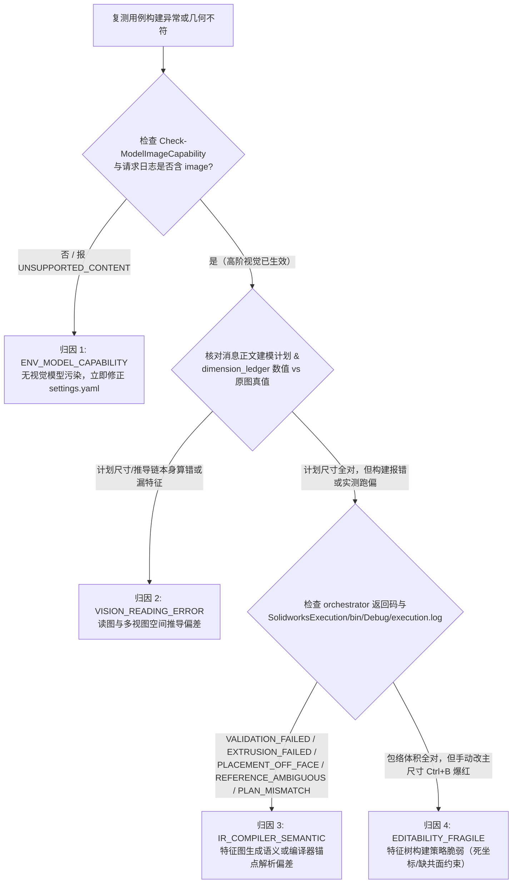
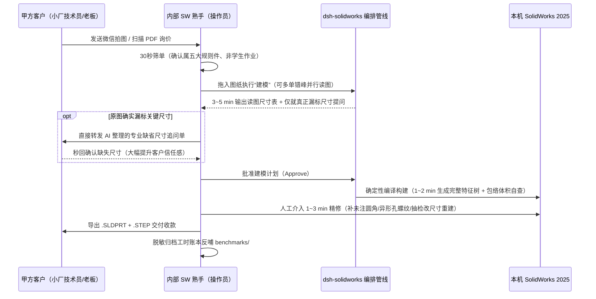

# dsh-solidworks 产品演进与商业化落地指南

> **文档定位**：本手册整合两轮一线真实市场调研（“懂 SolidWorks 但不懂 AI 的机械学长实测反馈”与“上海汽轮机厂一线技术员深度访谈”）及仓库当前工程架构事实（v2.2+ 确定性编译器与 12 工具受控编排体系），作为产品、研发与商业化团队统一行动纲领。

---

## 一、核心战略纠偏与客群锚定

早期 AI CAD 项目极易陷入“既想卖给预算雄厚的大型重工国企，又想做成外行小白一句话生成万物的爆款玩具”的战略摇摆。两轮一线调研用残酷的工业事实证明：**唯有主动砍掉伪需求，死磕“中小私企与代画熟手的规则机械件照图翻模”，才能建立真实可闭环的商业护城河。**

### 1.1 为什么坚决放弃“大型重工国企”与“纯外行小白”？

| 放弃客群 | 一线调研实证（真实阻力剖析） | 商业投入产出判定 |
| --- | --- | --- |
| **大型重工/主机国企**<br>（以上海汽轮机厂访谈为代表） | 1. **CAD 生态错位**：核心设计底座以 **UG (Siemens NX) / CATIA / Creo** 为主，SolidWorks 仅用于边缘非标工装，且汽轮机叶片、流道壳体多为高阶复杂曲面；<br>2. **MBD 三维直发普及**：主机厂已在 PLM/PDM 体系下推行 **MBD（基于模型的定义）**，上下游直接流转带 PMI 标注的三维数模，几乎不存在“拿着二维纸质图手工重翻三维”的高频工种；<br>3. **细密分工与物理内网隔离**：设计、工艺、标准化各司其职，办公网与互联网物理隔离，任何外部工具准入均需漫长的保密审查、信创适配与招投标周期。 | **极低 ROI（战略放弃）**<br>客单虽高但交付定制极重、销售周期按年计，初创团队切入必被拖垮。 |
| **纯外行小白 / 猎奇 C 端**<br>（无机械制图与 SW 基础人群） | 1. **无终审与兜底能力**：看不懂三视图投影、公差配合（如 `Ø20H7`、`M5-6H` 攻丝底孔 `Ø4.2`），AI 一旦漏建一处退刀槽或倒角，用户既查不出也不会手改；<br>2. **需求多为无图自由曲面**：期望“发一张商品照片或一句话生成流线外壳/手办玩具”，恰属参数化特征树最不擅长的领域；<br>3. **无本地软件环境与低付费意愿**：本机往往未装 SolidWorks，且混杂大量“大学生机械制图作业代做”流量（触碰项目工程伦理底线，必须主动过滤）。 | **负 ROI 泥潭（坚决拒止）**<br>售后客服成本极高、差评率高、复购近乎为零。 |

### 1.2 精准锁定黄金客群画像（ICP）

结合“懂 SW 但不懂 AI 的学长”实测反馈，真正愿意为本产品持续付费且能立即用起来的核心用户具备三大共性：**本机常开 SolidWorks、手里天天有二维图纸输入、具备 2 分钟人工终审与改图能力**。

1. **核心客群 A：中小制造私企的“一人多岗”技术员 / 工艺工程师**
   - **目标细分行业**：非标自动化设备厂、中小型 CNC 机加工/车铣复合厂、激光下料与钣金折弯厂、工业手板 3D 打印服务商（规模通常 10~150 人）。
   - **高频刚需场景**：老板或甲方直接通过微信发来手机斜拍的纸质蓝图、旧版扫描 PDF、DWG 截图（典型工业“脏图纸”），要求**半小时内算出精确体积重量报价（依赖 `mass_properties`）**、**导出钣金展开 DXF 排料**，或**生成 `.STEP` 导入 Mastercam/UG 编刀路**。技术员身兼报价、工艺、绘图数职，极度痛恨在基础拉伸打孔上消耗机械体力。
2. **核心客群 B：专职 CAD 代画熟手与机械设计外包工作室**
   - **目标渠道画像**：淘宝、闲鱼、猪八戒网及产业带线下的专职三维翻模接单人。
   - **高频刚需场景**：按件计酬，**时间与特征树质量直接决定时薪**。熟手最懂 SolidWorks 特征树的价值——只要 AI 能在 1~3 分钟内把前 80% 的底座、法兰、阶梯轴、孔阵按标准草图约束铺好，熟手花 2 分钟补上复杂圆角或异形孔向导即可交单，单日接单上限直接翻 2~3 倍。

### 1.3 产品能力护城河与公开“三做三不做”声明

> [!IMPORTANT]
> **产品对外统一定位**：面向 SolidWorks 熟手与中小制造工厂的**“规则机械件 2D-to-3D 确定性核验翻模提效器”**。我们不替代工程师签字，而是把原本 25 分钟的枯燥翻模压缩为“AI 自动打底 + 2 分钟人工精修”。

- **死守五大规则高频件护城河**（严格对齐 [`benchmarks/manifest.json`](../benchmarks/manifest.json)）：
  1. `bracket`（支架类：叉耳支架、U 形支座、带筋角码）；
  2. `shaft_flange`（轴套法兰类：阶梯轴、扁位/键槽轴、法兰盘端盖）；
  3. `housing_valve`（座体箱体类：中小型阀体、脚踏座、轴承座、规则泵壳）；
  4. `plate_block`（板块连接件：异形多孔安装板、高台支座、工装治具垫块）；
  5. `sheet_metal`（钣金件：折弯护罩、边线法兰电控托架）。
- **在产品首屏、文档与销售话术中公开声明“三不做”**：
  1. **不做复杂高阶自由曲面**（汽车 A 级曲面、叶轮叶片流道曲面、雕塑外观造型）；
  2. **不做无二维图纸尺寸输入的凭空概念原创**（严禁模型脱离图纸编造公差与结构尺寸）；
  3. **不做“100% 免检直上机床”的虚假承诺**（坚持客观核验分级：未完成全量尺寸账本校验的零件最高仅标记 `built_unverified`，强制提示人工终审）。

---

## 二、“学长”失败案例标准复测 SOP

在首轮外部实测中，一位精通 SolidWorks 的学长测试“钥匙件”与“支架件”时遭遇严重翻车，甚至出现“AI 折腾时间远超手画时间”的负面体验。经工程复盘，首要祸根并非编译器完全不可用，而是**模型路由配置疏漏导致的“无视觉模型污染”**。为杜绝此类低级事故并建立科学的工程排障机制，特制定本标准复测 SOP。

### 2.1 根因复盘：无视觉模型污染（Model Capability Pollution）

在首轮测试环境中，DSH 自定义路由误将默认会话挂到了 **`DeepSeek-V4.1-Flash`（纯文本无视觉能力模型）**。正如 [`docs/DSH模型图片输入配置.md`](./DSH模型图片输入配置.md) 所记录，官方 DeepSeek 纯文本系列不支持 `image` 输入；若自定义代理未严格区分多模态能力，模型要么直接拒收图片报 `UNSUPPORTED_CONTENT`，要么仅凭残缺文本盲猜几何坐标，导致建出的零件与原图面目全非。

### 2.2 标准复测前置铁律（Pre-flight Gate）

任何针对历史失败件（包括 [`benchmarks/manifest.json`](../benchmarks/manifest.json) 中预留的 `retest_senior_key_part` 学长钥匙件与 `retest_senior_bracket_part` 学长支架件）的复测，开工前必须逐条通过以下门禁：

1. **执行视觉能力硬守卫脚本（退出码必须为 `0`）**：
   ```powershell
   node .\dsh-integration\scripts\Check-ModelImageCapability.mjs
   & .\dsh-integration\scripts\Doctor-SolidWorksDsh.ps1
   ```
   确认输出中 `Model image capability` 为 `True`，且 `Installed solidworks profile synchronized` 为 `True`。
2. **锁死一线高阶多模态视觉模型与图片采样预算**：
   - **严禁**在看图翻模评测中使用任何纯文本模型或轻量 `*-flash` 弱视觉模型；强制锁定经验证的高阶视觉推理模型（如 `gpt-6.1-sol` 开启 `high` 推理强度，或同级旗舰多模态模型）。
   - 检查 `~/.dsh/settings.yaml` 图片预算：确保 `requestImagePixelBudget >= 4194304`（4 Mi 像素）、`requestImageMaxBytes >= 1048576`（1 MiB）；遇到密集小字公差图纸时，确保模型按规范调用 `read_drawing_text`（Windows 原生 OCR）+ `read_drawing_region`（批量 2x 局部裁切放大）。
3. **锁定单实例干净的 SolidWorks 执行环境**：
   - 确认本机仅运行单个可见的 SolidWorks 实例，访问 `http://localhost:5000/health` 确认 `comAttached: true`，且当前无残留 `undo_scope_active` 状态。

### 2.3 “读图偏差”与“特征图编译偏差”快速切分SOP

复测一旦出现尺寸不符或构建报错，研发人员严禁盲目改提示词，必须按以下三层诊断流在 3 分钟内切分责任边界：



#### 关键诊断对照速查表

| 现象 / 错误码 | 真实技术机理（源自编排器与编译器事实） | 责任归属 | 标准修复动作 |
| --- | --- | --- | --- |
| 模型报告 `trust_level = verified`，但人工量出总宽或孔径与原图不符 | `dimension_ledger` 与 `Feature Graph` 由同一模型同源生成：模型把原图 `Ø12` 看成 `Ø10` 时，账本与特征图同步写 `10`，内部自查无法揪出同源读错 | **读图偏差**<br>(`VISION_READING_ERROR`) | 必须用 `benchmarks/manifest.json` 外部独立人工 Golden 真值打分；检查局部放大裁切框是否覆盖了该视图标注 |
| `VALIDATION_FAILED`（计划期直接拒收，零 COM 调用） | 草图闭合轮廓存在 >0.1 mm 缺口、同一草图内闭合环交叉重叠，或 `slot.angle` 误传角度（如 `90`）而非弧度（`1.5708`） | **特征图语法偏差**<br>(`IR_COMPILER_SEMANTIC`) | 检查 `pycompiler/ir_schema.py` 返回的精确缺口坐标或字段提示，优化 Skill 快速参考卡示例 |
| `EXTRUSION_FAILED`（常见于圆柱侧面长出支管/凸台，如阀体案例） | 侧向凸台草图平面与主圆柱外表面**仅相切接触（零重叠面积）**，SolidWorks `FeatureExtrusion` 返回 `null` | **特征图几何语义偏差**<br>(`IR_COMPILER_SEMANTIC`) | 查阅 `execution.log` 末尾 50 行；按 [`docs/feature-graph-build-pitfalls.md`](./feature-graph-build-pitfalls.md) 规范将草图面移入圆柱实体内部保证面积重叠 |
| `PLACEMENT_OFF_FACE` 或 `REFERENCE_AMBIGUOUS` | `hole` 的 `ref.at` 法向第三坐标偏离目标面超过 `1e-5 m`；或两个对称凸台顶面等高导致 `resolve_top_face` 歧义 | **编译器/锚点解析偏差**<br>(`IR_COMPILER_SEMANTIC`) | 简单贯通孔组优先改用单草图多圆一次 `extrude(cut)`；工具层按锚点坐标消解等高面歧义 |
| `PLAN_MISMATCH`（构建完新文档被自动丢弃） | 实测 `bbox_mm` 与批准计划偏差超过 `max(1 mm, 2%)`，90% 源于基准面法向与 `extrude.reversed` 标志位写反 | **坐标系映射偏差**<br>(`IR_COMPILER_SEMANTIC`) | 对照 `feature-graph.schema.json` 的 `datum_frame` 实测右手系表核查 `+normal` 与 `reversed` 方向 |

---

## 三、“内部代画接单（Dogfooding 狗粮工场）”验证计划

在大规模向外部工厂推广客户端前，团队必须先跑通**“内部代画接单（Dogfooding 狗粮工场）”**最小商业闭环。自己下场接真单、挣真钱、吃自己的狗粮，既能规避干净竞赛题带来的虚假繁荣，又能零成本采集最珍贵的工业“脏图纸”。

### 3.1 最小作战单元配置

- **人员编组**：**1 名 SolidWorks 熟手（兼接单客服与终审微调） + 已锁死高阶视觉模型的 DSH 工作站**。
- **目标订单池**：闲鱼、淘宝、机械加工互助群中的**中小型规则机械零件 2D 转 3D 翻模单**（交付物：原生可编辑 `.SLDPRT` + 通用 `.STEP` / 钣金展开 `.DXF`）。
- **接单“三接三拒”铁律**：
  - **坚决承接**：非标设备支架、法兰轴套、治具板块、中小型阀座壳体、激光折弯钣金件（哪怕是手机拍的皱褶蓝图或带手写改尺寸的车间草图，只要人眼能认清即可接）；
  - **坚决拒单**：① **大学生机械制图课程作业与毕业设计**（严守团队原则，一票否决）；② 复杂曲面外观件/逆向点云抄数件；③ 涉密军工铭牌未脱敏图纸。

### 3.2 “AI 打底 80% + 熟手 2 分钟精修”标准作业流水线



- **产能倍增核心账本**：
  - 纯人工手绘一件中等复杂度座体/支架平均耗时 **15~30 分钟**，连续画 4 小时极易视觉疲劳漏看剖视细节；
  - 采用“AI 后台读图打底 + 熟手前台 2 分钟精修”模式，由于 AI 读图等待期（3~5 分钟）熟手正在精修上一单零件，**熟手单件实际占用的纯人工注意力仅 2.5~4 分钟**，单人单台 SolidWorks 工作站日均交付产能轻松放大 **2.5~3.5 倍**。

### 3.3 反哺 `benchmarks/` 的数据飞轮与止损门禁

1. **每单必记“四维工时卡”**：每完成一单真实交付，随手记录 `case_category`、`t_ai_minutes`、`t_edit_minutes`、`t_human_estimated_minutes` 以及**“人工精修到底改了哪一刀”**（例如：80% 的人工介入都在改沉头孔或补材质库映射，这就是编译器下周唯一值得开发的特性）。
2. **严格脱敏入库**：征得脱敏许可或彻底抹除客户图框/企业名/零件号后，将最具代表性的真实“脏图纸”按 [`benchmarks/README.md`](../benchmarks/README.md) 五步法补入评测集。
3. **量化放行与止损红线**：
   - 每双周运行一次 `benchmarks/evaluate_benchmark.py` 出具真实接单评测报告；
   - **扩量放行条件**：在五大规则件目标范围内，**最终核验可交付率 $\ge 85\%$、一次通过率 $\ge 70\%$、北极星耗时比 $R \le 0.50$ 且特征树改尺寸通过率 $100\%$**；若连续两周无法在真实工业脏图上跑进 $R \le 0.65$，立即暂停外部商业化推广，集中攻坚高频卡点。

---

## 四、商业化定价、新手破冰与绝对合规红线

当产品从内部“狗粮工场”走向外部中小制造私企与代画熟手客户端交付时，必须针对传统制造业用户的消费心理重构计费与破冰体验，并死守两条关乎企业生死的法律与安全红线。

### 4.1 计费体验重塑与首屏零门槛破冰

一线机械工程师与小厂老板普遍排斥复杂的 AI 概念配置与不可预期的沉没成本。商业化客户端必须执行以下四项体验设计：

1. **全面“去 Token 化”展示**：
   - 客户端界面、充值页与账单明细中**严禁出现“输入/输出 Token”、“推理倍率”、“上下文窗口”等 AI 行业黑话**。
   - 统一采用机械行业直观的计量单位：**“成功交付零件点数（Part Credits）”**（例如：常规支架/轴套/板块 1 点/件，复杂多孔阀体/箱体 2 点/件，或包月畅享卡）。
2. **“按成功交付零件计次，构建失败/回滚零扣费”承诺（消灭试错税焦虑）**：
   - 深度绑定 Python 编排器的客观状态机（`execution_status` / `verification_status` / `recovery_status`）：
     - 凡触发 `VALIDATION_FAILED`、`EXTRUSION_FAILED`、`PLAN_MISMATCH`、`rollback_failed`、网络超时中断；
     - 或用户在阅读 AI 建模方案阶段认为理解有误、主动点击取消（`cancel_action`）未执行构建的；
     - **系统后台一律自动免单（扣费 = 0 点）！** 只有当零件成功在 SolidWorks 中建成并通过客观包络核验交付到用户面前时才扣减 1 次额度，由平台承担底层模型偶发波动成本，彻底打消用户“AI 没画出来还白扣我钱”的顾虑。
3. **新装即赠无门槛体验包 + 托管高阶视觉路由**：
   - 新用户下载安装后无需自己去申请境外大模型 API Key 或手改 `settings.yaml`，开箱即赠 **5~8 个零件免费翻模体验点数**，云端网关强制锁定高阶多模态视觉模型，从根源上消灭“学长式配错纯文本模型”的首单翻车。
4. **首屏内置“零成本示例图纸一键体验（Zero-Cost Sandbox）”**：
   - 很多工程师刚装好软件时手边未必刚好有一张干净合规的图纸可发。客户端欢迎首屏直接内置 **3 张经典工业标杆图纸**（`M5双端盲孔阶梯轴`、`2-25 叉耳支架`、`HT200 正交阀体`），标注**“官方示例 · 零消耗体验”**。
   - 用户点击一键体验，30 秒内亲眼看着本机 SolidWorks 自动新建零件、逐个长出草图与拉伸/旋转/孔特征，结束后可自由双击特征树修改尺寸测试重建效果——用最硬核的实机表现瞬间建立专业信任。

---

### 4.2 两大绝对合规红线（全员高压线，严禁触碰！）

> [!CAUTION]
> **全团队法务与合规铁律**：以下两条红线直接决定项目与公司的存亡。任何产品功能设计、代码提交、安装脚本、宣传海报、短视频文案、社群答疑及销售私聊话术，**一旦触碰即刻一票否决**，严禁任何形式的“擦边暗示”或“私下指导”。

#### 红线一：严禁触碰任何“规避达索反盗版后台检测 / 热点防追踪”功能或话术，反向打造“单台正版产能放大 3 倍”的合法高 ROI 卖点

1. **绝对禁止清单**：
   - **代码与脚本层**：严禁开发、集成或捆绑任何修改 Windows Hosts/防火墙以屏蔽达索（Dassault Systèmes）官方域名与遥测通信的功能；严禁触碰 SolidWorks 许可证校验模块、注册表授权键值或进程注入；严禁提供任何“多机共享单套单机许可证”的远程桥接绕过工具。
   - **营销与客服话术层**：严禁在任何公开或私域渠道传授所谓“连手机热点防检测”、“断网运行防发律师函”、“兼容和谐版/破解版省软件费”等违规话术。系统仅通过标准公开的 Windows COM 接口附加用户本机已合法运行的 `SldWorks.Application` 实例。
2. **正向阳光商业叙事重塑（帮正版化中小厂老板算清合规大账）**：
   - 当前国内长三角、珠三角大量中小机加工与非标私企正在经历正版化合规升级：由于单套正版 SolidWorks 采购与年维护成本高昂（数万至十余万元），**许多工厂全厂仅采购了 1~2 套正版 SolidWorks 工作站，技术员经常需要排队等机器画图报价**，正版软件工位成为全厂产能瓶颈。
   - 我们的核心营销主轴应当旗帜鲜明地定位为：
     **“无需多买一套昂贵的 CAD 授权，合法合规地将厂内单台正版 SolidWorks 工作站的照图翻模产能放大 3 倍！”**
   - 给老板算清阳光 ROI：每月仅需百元级的 AI 翻模工具订阅费，就能让厂里那台宝贵的正版 SolidWorks 工作站从每天翻模 12 件提升到 35 件以上，既 100% 符合达索正版合规要求，又直接省下增购软件席位与扩招初级绘图员的巨额开支。

#### 红线二：严谨、诚实界定“图纸数据安全”宣传边界，严禁虚假承诺“全链路数据不出本地”

制造业客户对核心客户图纸外泄高度敏感，但安全信任必须建立在**100% 诚实、经得起技术审计的边界披露**之上，绝不可用欺骗性口号埋下商业违约雷区：

1. **清晰切分“本地绝对闭环层”与“云端 API 识图层”**：

   | 数据资产与执行环节 | 真实流向与技术保障事实 | 对外合规宣传口径 |
   | --- | --- | --- |
   | **客户端源码、特征编译与 COM 执行** | 仓库整体按 **AGPL-3.0 开源发布**，代码完全公开透明可审计，无任何后台全盘扫描或静默上传暗门；策略插件（`solidworks-policy`）严格白名单锁死仅开放 12 个任务级工具，模型无法触碰 Shell、宏或任意本地目录。 | **“客户端开源透明无暗门，AI 严格受限于 12 个绘图工具，绝不触碰您电脑里的其他文件。”** |
   | **生成的 `.SLDPRT` 三维模型与特征树** | Feature Graph 在本地确定性编译并直接通过本地 COM 写入 SolidWorks，**`.SLDPRT` / `.STEP` 三维源文件全程 100% 生成并保存在客户本机硬盘**，不经过任何云端服务器。 | **“生成的 `.SLDPRT` 原生三维源文件全程 100% 留在本机，平台绝不留存您的三维资产。”** |
   | **待识读的二维工程图纸图片（PNG / PDF 渲染页）** | 在标准云端 SaaS 版中，为调用多模态视觉大模型完成高精读图，**用户当次主动上传的那张二维图纸位图及局部放大裁切图，会通过 TLS 加密通道传输至云端大模型推理 API**。 | **严禁谎称“完全离线不联网”！** 必须如实告知：**“仅当次选中的二维图纸图片会加密传输至企业级零留存视觉 API 完成识图，识别后不做训练留存。”** |

2. **客户分级数据安全交付方案**：
   - **针对普通民用非标 / 机加工 / 代画客户（标准云端版）**：后台统一接入签署了**企业级零数据留存协议（Zero Data Retention，推理即焚、绝不用于模型训练）**的商业 API 通道；同时在客户端发图框旁提供一键**“裁切/遮挡标题栏敏感甲方名称”**的轻量脱敏引导。
   - **针对涉密军工配套 / 核电汽轮机供应链 / 严格内网隔离客户（企业私有化版）**：销售与售前必须第一时间明确告知**严禁使用公有云标准版上传涉密图纸**；为其提供**“企业内网私有化部署多模态视觉大模型 + 本地 DSH 编排服务”**的纯内网物理闭环交付方案，实现真正的全链路数据不出厂区。

---

## 五、近期执行里程碑 Checklist

| 阶段 | 核心动作 | 验收交付物与量化标准 |
| --- | --- | --- |
| **Week 1：复测清障与基线固化** | 1. 运行 `Doctor` + `Check-ModelImageCapability` 排净无视觉模型污染；<br>2. 完成“学长钥匙件”与“学长支架件”各 3 轮高阶视觉复测；<br>3. 将 `benchmarks/evaluate_benchmark.py --validate-only` 接入日常回归检查。 | 复测报告产出，明确切分剩余问题是读图偏差还是编译锚点偏差，向学长交付可编辑 `.SLDPRT` 赢回实测口碑。 |
| **Week 2~3：内部狗粮工场试跑** | 1. 启动“1 名 SW 熟手 + 插件打底 + 2 分钟精修”小规模真实代画接单；<br>2. 累计完成 $\ge 10$ 张真实工业“脏图纸”交付并脱敏归档入 `benchmarks/`。 | 真实订单集上验证**最终可交付率 $\ge 85\%$、北极星耗时比 $R \le 0.50$、特征树改尺寸零报错**。 |
| **Week 4+：种子商业化内测** | 1. 封装“去 Token 化点数 + 失败/回滚零扣费 + 首屏 3 张零成本示例图”体验包；<br>2. 面向 10~20 家中小机加工/钣金厂技术员与专职代画熟手开启合规种子内测。 | 验证付费转化率与“单台正版 SolidWorks 工作站产能放大 2~3 倍”的真实客户复购口碑。 |
