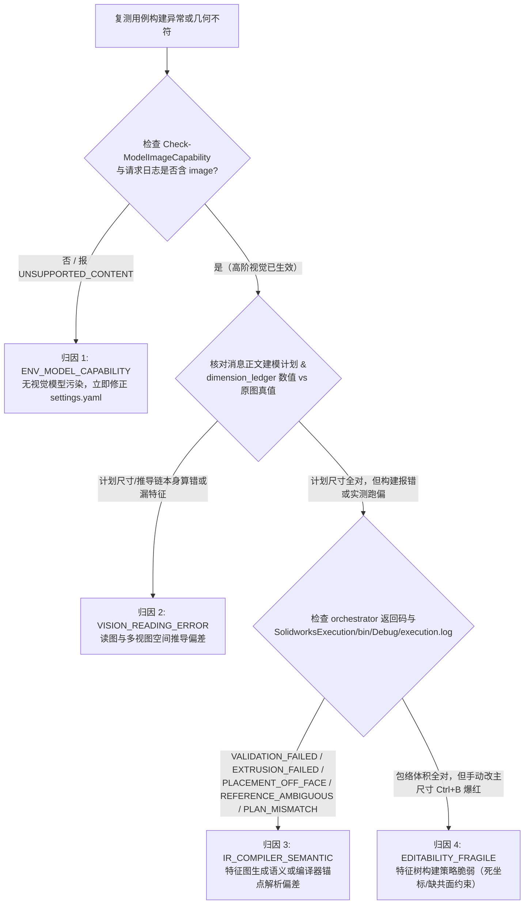
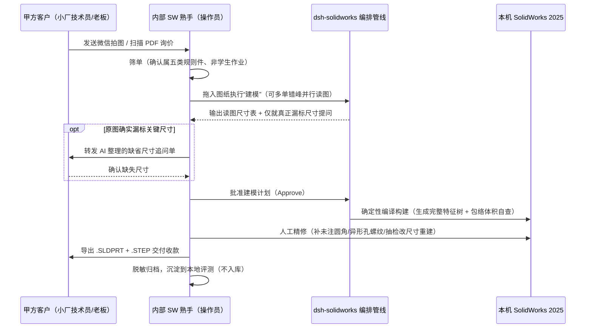

# dsh-solidworks 产品演进与商业化落地指南

> **文档定位**：本手册整合两轮调研（一位会 SolidWorks、AI 零基础的试用者的实测反馈，以及一次大型主机厂一线技术员访谈）和仓库当前的工程架构事实（v2.2+ 确定性编译器与 12 工具受控编排体系），作为产品、研发与商业化的统一参考。
>
> **数据状态**：两轮调研各只有一个样本，结论属于方向判断，不是统计结论。文中所有耗时、产能、转化率类数字**均尚未实测**，一律标注「待实测（试用者掐表数据，2026-11 起采集）」；有实测数据之前，不对外承诺具体倍数或百分比。

---

## 一、核心战略取舍与客群锚定

早期 AI CAD 项目容易在两个方向之间摇摆：既想卖给预算充足的大型重工国企，又想做成外行一句话生成万物的爆款玩具。结合两轮调研，本项目的取舍是：**先放弃这两类客群，聚焦中小私企与代画熟手的规则机械件照图翻模。**

### 1.1 为什么暂不进入“大型重工国企”与“纯外行小白”？

| 放弃客群 | 调研观察 | 判定 |
| --- | --- | --- |
| **大型主机厂 / 重工国企**<br>（以某大型主机厂一线技术员访谈为代表） | 1. **CAD 生态错位**：核心设计以 **UG (Siemens NX) / CATIA** 为主，SolidWorks 不是主力；<br>2. **MBD 三维直发**：已在 PLM/PDM 体系下推行 **MBD（基于模型的定义）**，三维数模带标注直接流转，“拿着二维图纸重翻三维”的需求较少（单一样本，未必代表所有同类企业）；<br>3. **网络隔离与准入**：办公网与互联网隔离，外部工具准入要经过保密审查与采购流程，周期长。 | **不作为目标客群**<br>定制与合规成本高、销售周期长，个人或小团队难以承担。 |
| **纯外行小白 / C 端尝鲜**<br>（无机械制图与 SolidWorks 基础的人群） | 1. **缺少终审与兜底能力**：看不懂三视图投影、公差配合（如 `Ø20H7`、`M5-6H` 攻丝底孔 `Ø4.2`），AI 漏建一处退刀槽或倒角时，用户既查不出也不会手改；<br>2. **需求多为无图自由曲面**：期望“发一张商品照片或一句话生成外壳/手办”，这正是参数化特征树最不擅长的领域；<br>3. **多半没有本地软件环境，付费意愿偏低**：本机往往没装 SolidWorks，并且这类需求里可能混有“大学生机械制图作业代做”（触碰工程伦理底线，必须主动过滤）。 | **不作为目标客群**<br>预计售后成本高、复购低（推测，未验证）。 |

### 1.2 精准锁定黄金客群画像（ICP）

真正愿意付费、能立即用起来的用户，预期具备三点共性：**本机常开 SolidWorks、手里经常有二维图纸输入、具备人工终审与改图能力**。

1. **核心客群 A：中小制造私企的“一人多岗”技术员 / 工艺工程师**
   - **目标细分行业**：非标自动化设备厂、中小型 CNC 机加工/车铣复合厂、激光下料与钣金折弯厂、工业手板 3D 打印服务商。
   - **高频刚需场景**：老板或甲方直接通过微信发来手机斜拍的纸质蓝图、旧版扫描 PDF、DWG 截图（典型工业“脏图纸”），要求**尽快算出体积重量报价（依赖 `mass_properties`）**、**导出钣金展开 DXF 排料**，或**生成 `.STEP` 导入 Mastercam/UG 编刀路**。技术员身兼报价、工艺、绘图数职，在基础拉伸打孔上耗费大量机械劳动。
2. **核心客群 B：专职 CAD 代画熟手与机械设计外包工作室**
   - **目标渠道画像**：淘宝、闲鱼、猪八戒网及产业带线下的专职三维翻模接单人。
   - **高频刚需场景**：按件计酬，**时间与特征树质量直接决定时薪**。熟手最懂 SolidWorks 特征树的价值——只要 AI 能自动把底座、法兰、阶梯轴、孔阵这类基础特征按标准草图约束铺好，熟手补上复杂圆角或异形孔向导即可交单，单日接单量预期会提高（提升幅度：待实测（试用者掐表数据，2026-11 起采集））。

### 1.3 产品能力范围与公开“三做三不做”声明

> [!IMPORTANT]
> **产品对外统一定位**：面向 SolidWorks 熟手与中小制造工厂的**“规则机械件 2D-to-3D 确定性核验翻模提效器”**。我们不替代工程师签字，而是把枯燥的翻模前段交给 AI 自动打底，再由人工精修终审。

- **聚焦五类规则高频件**：
  1. `bracket`（支架类：叉耳支架、U 形支座、带筋角码）；
  2. `shaft_flange`（轴套法兰类：阶梯轴、扁位/键槽轴、法兰盘端盖）；
  3. `housing_valve`（座体箱体类：中小型阀体、脚踏座、轴承座、规则泵壳）；
  4. `plate_block`（板块连接件：异形多孔安装板、高台支座、工装治具垫块）；
  5. `sheet_metal`（钣金件：折弯护罩、边线法兰电控托架）。
- **在产品首屏、文档与销售话术中公开声明“三不做”**：
  1. **不做复杂高阶自由曲面**（汽车 A 级曲面、叶轮叶片流道曲面、雕塑外观造型）；
  2. **不做无二维图纸尺寸输入的凭空概念原创**（严禁模型脱离图纸编造公差与结构尺寸）；
  3. **不做“免检直上机床”的承诺**（坚持客观核验分级：未完成全量尺寸账本校验的零件最高仅标记 `built_unverified`，强制提示人工终审）。

---

## 二、试用者失败案例标准复测 SOP

在首轮外部实测中，一位会 SolidWorks、AI 零基础的试用者测试“钥匙件”与“支架件”时遇到明显的翻车，反馈 AI 折腾的时间比手画还长。经工程复盘，首要原因并非编译器完全不可用，而是**模型路由配置疏漏导致的“无视觉模型污染”**。为避免此类低级事故并建立可复现的排障机制，特制定本标准复测 SOP。

### 2.1 根因复盘：无视觉模型污染（Model Capability Pollution）

在首轮测试环境中，DSH 自定义路由误将默认会话挂到了 **`DeepSeek-V4.1-Flash`（纯文本无视觉能力模型）**。正如 [`docs/DSH模型图片输入配置.md`](./DSH模型图片输入配置.md) 所记录，官方 DeepSeek 纯文本系列不支持 `image` 输入；若自定义代理未严格区分多模态能力，模型要么直接拒收图片报 `UNSUPPORTED_CONTENT`，要么仅凭残缺文本盲猜几何坐标，导致建出的零件与原图面目全非。

### 2.2 标准复测前置门禁（Pre-flight Gate）

任何针对历史失败件（包括该试用者提供的钥匙件与支架件）的复测，开工前必须逐条通过以下门禁：

1. **执行视觉能力硬守卫脚本（退出码必须为 `0`）**：
   ```powershell
   node .\dsh-integration\scripts\Check-ModelImageCapability.mjs
   & .\dsh-integration\scripts\Doctor-SolidWorksDsh.ps1
   ```
   确认输出中 `Model image capability` 为 `True`，且 `Installed solidworks profile synchronized` 为 `True`。
2. **锁定高阶多模态视觉模型与图片采样预算**：
   - **严禁**在看图翻模评测中使用任何纯文本模型或轻量 `*-flash` 弱视觉模型；使用经验证的高阶视觉推理模型（如 `gpt-6.1-sol` 开启 `high` 推理强度，或同级旗舰多模态模型）。
   - 检查 `~/.dsh/settings.yaml` 图片预算：确保 `requestImagePixelBudget >= 4194304`（4 Mi 像素）、`requestImageMaxBytes >= 1048576`（1 MiB）；遇到密集小字公差图纸时，确保模型按规范调用 `read_drawing_text`（Windows 原生 OCR）+ `read_drawing_region`（批量 2x 局部裁切放大）。
3. **锁定单实例干净的 SolidWorks 执行环境**：
   - 确认本机仅运行单个可见的 SolidWorks 实例，访问 `http://localhost:5000/health` 确认 `comAttached: true`，且当前无残留 `undo_scope_active` 状态。

### 2.3 “读图偏差”与“特征图编译偏差”快速切分SOP

复测一旦出现尺寸不符或构建报错，研发人员不要先改提示词，应先按以下诊断流切分责任边界：



#### 关键诊断对照速查表

| 现象 / 错误码 | 真实技术机理（源自编排器与编译器事实） | 责任归属 | 标准修复动作 |
| --- | --- | --- | --- |
| 模型报告 `trust_level = verified`，但人工量出总宽或孔径与原图不符 | `dimension_ledger` 与 `Feature Graph` 由同一模型同源生成：模型把原图 `Ø12` 看成 `Ø10` 时，账本与特征图同步写 `10`，内部自查无法揪出同源读错 | **读图偏差**<br>(`VISION_READING_ERROR`) | 必须用独立的人工金标准真值（本地评测，不入库）打分；检查局部放大裁切框是否覆盖了该视图标注 |
| `VALIDATION_FAILED`（计划期直接拒收，零 COM 调用） | 草图闭合轮廓存在 >0.1 mm 缺口、同一草图内闭合环交叉重叠，或 `slot.angle` 误传角度（如 `90`）而非弧度（`1.5708`） | **特征图语法偏差**<br>(`IR_COMPILER_SEMANTIC`) | 检查 `pycompiler/ir_schema.py` 返回的精确缺口坐标或字段提示，优化 Skill 快速参考卡示例 |
| `EXTRUSION_FAILED`（常见于圆柱侧面长出支管/凸台，如阀体案例） | 侧向凸台草图平面与主圆柱外表面**仅相切接触（零重叠面积）**，SolidWorks `FeatureExtrusion` 返回 `null` | **特征图几何语义偏差**<br>(`IR_COMPILER_SEMANTIC`) | 查阅 `execution.log` 末尾 50 行；按 [`docs/feature-graph-build-pitfalls.md`](./feature-graph-build-pitfalls.md) 规范将草图面移入圆柱实体内部保证面积重叠 |
| `PLACEMENT_OFF_FACE` 或 `REFERENCE_AMBIGUOUS` | `hole` 的 `ref.at` 法向第三坐标偏离目标面超过 `1e-5 m`；或两个对称凸台顶面等高导致 `resolve_top_face` 歧义 | **编译器/锚点解析偏差**<br>(`IR_COMPILER_SEMANTIC`) | 简单贯通孔组优先改用单草图多圆一次 `extrude(cut)`；工具层按锚点坐标消解等高面歧义 |
| `PLAN_MISMATCH`（构建完新文档被自动丢弃） | 实测 `bbox_mm` 与批准计划偏差超过 `max(1 mm, 2%)`，常见原因是基准面法向与 `extrude.reversed` 标志位写反 | **坐标系映射偏差**<br>(`IR_COMPILER_SEMANTIC`) | 对照 `feature-graph.schema.json` 的 `datum_frame` 实测右手系表核查 `+normal` 与 `reversed` 方向 |

---

## 三、“内部代画接单（Dogfooding 狗粮工场）”验证计划

在向外部工厂推广客户端之前，应先跑通**“内部代画接单（Dogfooding 狗粮工场）”**最小商业闭环：自己接真单、自己用工具，既避免干净竞赛题带来的虚假乐观，也能低成本采集珍贵的工业“脏图纸”。

### 3.1 最小作战单元配置

- **人员编组**：**1 名 SolidWorks 熟手（兼接单客服与终审微调） + 已锁定高阶视觉模型的 DSH 工作站**。
- **目标订单池**：闲鱼、淘宝、机械加工互助群中的**中小型规则机械零件 2D 转 3D 翻模单**（交付物：原生可编辑 `.SLDPRT` + 通用 `.STEP` / 钣金展开 `.DXF`）。
- **接单“三接三拒”原则**：
  - **承接**：非标设备支架、法兰轴套、治具板块、中小型阀座壳体、激光折弯钣金件（哪怕是手机拍的皱褶蓝图或带手写改尺寸的车间草图，只要人眼能认清即可接）；
  - **拒单**：① **大学生机械制图课程作业与毕业设计**（团队原则，一票否决）；② 复杂曲面外观件/逆向点云抄数件；③ 涉密军工铭牌未脱敏图纸。

### 3.2 “AI 打底 + 熟手精修”标准作业流水线



- **产能账本（待实测）**：
  - 纯人工手绘一件中等复杂度座体/支架的耗时：待实测（试用者掐表数据，2026-11 起采集）；
  - “AI 后台读图打底 + 熟手前台精修”模式下，熟手单件实际占用的人工时间：待实测（试用者掐表数据，2026-11 起采集）；
  - 推演：AI 读图等待期间，熟手可以精修上一单零件，所以人工占用的时间可能低于单件总耗时。这只是推演，不是实测结论；有数据前不对外承诺具体倍数。

### 3.3 沉淀到本地评测（不入库）的数据飞轮与止损门禁

1. **每单记录工时卡**：每完成一单真实交付，记录零件类别、AI 耗时、人工精修耗时、同类零件纯手工耗时（尽量掐表实测，不要凭印象估），以及**“人工精修到底改了哪一刀”**（例如：若人工介入集中在改沉头孔或补材质库映射，这就是编译器下一步值得开发的特性）。
2. **严格脱敏入库**：征得脱敏许可或彻底抹除客户图框/企业名/零件号后，将最具代表性的真实“脏图纸”补入本地评测集。评测集和金标准真值只保存在本地，不提交到公开仓库。
3. **放行与止损门禁（阈值待定）**：
   - 主要观察指标是**耗时比** = (AI 耗时 + 人工精修耗时) ÷ 纯手工耗时，分母必须来自实测；
   - 最终核验可交付率、一次通过率、耗时比的放行阈值，待有实测数据后再定，现阶段不预设数字；
   - **硬门禁**：改主尺寸后重建不报错；
   - **止损**：若在真实工业脏图上持续不能节省熟手时间，暂停外部推广，先集中解决高频卡点。

---

## 四、商业化定价、新手破冰与绝对合规红线

当产品从内部“狗粮工场”走向外部中小制造私企与代画熟手客户端交付时，需要针对传统制造业用户的消费心理设计计费与破冰体验，并遵守两条关乎企业生死的法律与安全红线。

### 4.1 计费体验与首屏零门槛破冰（设想，尚未实现）

> 本节是产品设想：点数计费、托管视觉路由、内置示例图均**尚未在仓库中实现**，具体规则与数量都待定。

一线机械工程师与小厂老板普遍排斥复杂的 AI 概念配置与不可预期的沉没成本。商业化客户端建议执行以下四项体验设计：

1. **去 Token 化展示**：
   - 客户端界面、充值页与账单明细中**避免出现“输入/输出 Token”、“推理倍率”、“上下文窗口”等 AI 行业术语**。
   - 采用机械行业直观的计量单位：**“成功交付零件点数（Part Credits）”**（点数规则待定，可按零件复杂度分档，或采用包月）。
2. **“按成功交付零件计次，构建失败/回滚不扣费”**：
   - 与 Python 编排器的客观状态机（`execution_status` / `verification_status` / `recovery_status`）绑定：
     - 触发 `VALIDATION_FAILED`、`EXTRUSION_FAILED`、`PLAN_MISMATCH`、`rollback_failed`、网络超时中断；
     - 或用户在阅读 AI 建模方案阶段认为理解有误、主动点击取消（`cancel_action`）未执行构建的；
     - **系统后台一律不扣费。** 只有零件成功在 SolidWorks 中建成并通过客观包络核验、交付到用户面前时才扣减额度，由平台承担底层模型偶发波动的成本，减轻用户“AI 没画出来还白扣我钱”的顾虑。
3. **新装赠送体验额度 + 托管高阶视觉路由**：
   - 新用户下载安装后无需自己申请境外大模型 API Key 或手改 `settings.yaml`，赠送一定数量（待定）的免费翻模体验点数，云端网关锁定高阶多模态视觉模型，避免“配错纯文本模型”导致的首单翻车。
4. **首屏内置“零成本示例图纸一键体验（Zero-Cost Sandbox）”**：
   - 工程师刚装好软件时手边未必有一张干净合规的图纸。客户端欢迎首屏内置 **3 张经典工业标杆图纸**（`M5双端盲孔阶梯轴`、`2-25 叉耳支架`、`HT200 正交阀体`），标注**“官方示例 · 零消耗体验”**。
   - 用户点击一键体验，亲眼看着本机 SolidWorks 自动新建零件、逐个长出草图与拉伸/旋转/孔特征，结束后可自由双击特征树修改尺寸、测试重建效果，用实机表现建立信任。

---

### 4.2 两大绝对合规红线（全员高压线，严禁触碰！）

> [!CAUTION]
> **全团队法务与合规铁律**：以下两条红线直接决定项目与公司的存亡。任何产品功能设计、代码提交、安装脚本、宣传海报、短视频文案、社群答疑及销售私聊话术，**一旦触碰即刻一票否决**，严禁任何形式的“擦边暗示”或“私下指导”。

#### 红线一：严禁触碰任何“规避达索反盗版后台检测 / 热点防追踪”功能或话术，并以合法的“提升单台正版工位照图翻模效率”作为卖点（具体倍数待实测，不对外承诺）

1. **绝对禁止清单**：
   - **代码与脚本层**：严禁开发、集成或捆绑任何修改 Windows Hosts/防火墙以屏蔽达索（Dassault Systèmes）官方域名与遥测通信的功能；严禁触碰 SolidWorks 许可证校验模块、注册表授权键值或进程注入；严禁提供任何“多机共享单套单机许可证”的远程桥接绕过工具。
   - **营销与客服话术层**：严禁在任何公开或私域渠道传授所谓“连手机热点防检测”、“断网运行防发律师函”、“兼容和谐版/破解版省软件费”等违规话术。系统仅通过标准公开的 Windows COM 接口附加用户本机已合法运行的 `SldWorks.Application` 实例。
2. **正向阳光商业叙事重塑（帮正版化中小厂老板算清合规账）**：
   - 部分中小机加工与非标私企正在经历正版化合规升级：单套正版 SolidWorks 的采购与年维护成本不低，**不少工厂只采购了少量正版 SolidWorks 工位，技术员经常需要排队等机器画图报价**，正版软件工位成为产能瓶颈。
   - 核心营销主轴应当明确定位为：
     **“无需多买一套昂贵的 CAD 授权，合法合规地提升厂内单台正版 SolidWorks 工作站的照图翻模效率。”**
   - 给老板算合规账：订阅费用待定；提升幅度待实测（试用者掐表数据，2026-11 起采集）。有实测数据之前，不对外承诺具体的提升倍数或“每天翻模多少件”，也不与增购软件席位、扩招初级绘图员的成本做数字对比。该方案仍在达索正版授权范围内使用，不涉及任何授权绕过。

#### 红线二：严谨、诚实界定“图纸数据安全”宣传边界，严禁虚假承诺“全链路数据不出本地”

制造业客户对核心客户图纸外泄高度敏感，但安全信任必须建立在**诚实、经得起技术审计的边界披露**之上，不可用欺骗性口号埋下商业违约雷区：

1. **清晰切分“本地闭环层”与“云端 API 识图层”**：

   | 数据资产与执行环节 | 真实流向与技术保障事实 | 对外合规宣传口径 |
   | --- | --- | --- |
   | **客户端源码、特征编译与 COM 执行** | 仓库整体按 **AGPL-3.0 开源发布**，代码公开可审计，无任何后台全盘扫描或静默上传暗门；策略插件（`solidworks-policy`）以白名单方式只放行 12 个 SolidWorks 任务级工具和 5 个支撑工具（提问、待办、加载本技能、读本地图片、读技能参考文档），没有 Shell、宏或通用文件工具。 | **“客户端开源透明无暗门，AI 只能调用白名单内的 12 个 SolidWorks 工具和 5 个支撑工具，没有 Shell 和通用文件工具。”** |
   | **生成的 `.SLDPRT` 三维模型与特征树** | Feature Graph 在本地确定性编译并直接通过本地 COM 写入 SolidWorks，**`.SLDPRT` / `.STEP` 三维源文件全程在客户本机生成并保存在本机硬盘**，不经过任何云端服务器。 | **“生成的 `.SLDPRT` 原生三维源文件全程留在本机，平台不留存您的三维资产。”** |
   | **待识读的二维工程图纸图片（PNG / PDF 渲染页）** | 在标准云端 SaaS 版中，为调用多模态视觉大模型完成高精读图，**用户当次主动上传的那张二维图纸位图及局部放大裁切图，会通过 TLS 加密通道传输至云端大模型推理 API**。 | **严禁谎称“完全离线不联网”！** 必须如实告知：**“仅当次选中的二维图纸图片会加密传输至企业级零留存视觉 API 完成识图，识别后不做训练留存。”** |

2. **客户分级数据安全交付方案**：
   - **针对普通民用非标 / 机加工 / 代画客户（标准云端版）**：后台统一接入签署了**企业级零数据留存协议（Zero Data Retention，推理即焚、绝不用于模型训练）**的商业 API 通道；同时在客户端发图框旁提供一键**“裁切/遮挡标题栏敏感甲方名称”**的轻量脱敏引导。
   - **针对涉密军工配套 / 大型主机厂供应链 / 严格内网隔离客户（企业私有化版）**：销售与售前必须第一时间明确告知**严禁使用公有云标准版上传涉密图纸**；为其提供**“企业内网私有化部署多模态视觉大模型 + 本地 DSH 编排服务”**的纯内网物理闭环交付方案，实现真正的全链路数据不出厂区。

---

## 五、近期执行里程碑 Checklist

各阶段的数量与验收阈值待有实测数据后再定，这里只列动作。

| 阶段 | 核心动作 | 验收交付物 |
| --- | --- | --- |
| **阶段 1：复测清障与基线固化** | 1. 运行 `Doctor` + `Check-ModelImageCapability` 排净无视觉模型污染；<br>2. 对试用者的钥匙件与支架件做多轮高阶视觉复测；<br>3. 在本地评测（不入库）上固化基线。 | 复测报告产出，明确切分剩余问题是读图偏差还是编译锚点偏差；向试用者交付可编辑 `.SLDPRT` 并收集反馈。 |
| **阶段 2：内部狗粮工场试跑** | 1. 启动“1 名 SW 熟手 + 插件打底 + 人工精修”的小规模真实代画接单；<br>2. 累计完成一批真实工业“脏图纸”交付（数量待定），脱敏后沉淀到本地评测（不入库）。 | 在真实订单集上验证可交付率、耗时比、特征树改尺寸是否报错（数值：待实测（试用者掐表数据，2026-11 起采集））。 |
| **阶段 3：种子用户内测** | 1. 封装“去 Token 化点数 + 失败/回滚不扣费 + 首屏示例图”体验包（设想，见 4.1）；<br>2. 面向少量中小机加工/钣金厂技术员与专职代画熟手开启合规种子内测。 | 验证付费意愿与复购反馈（数值：待实测）。 |
